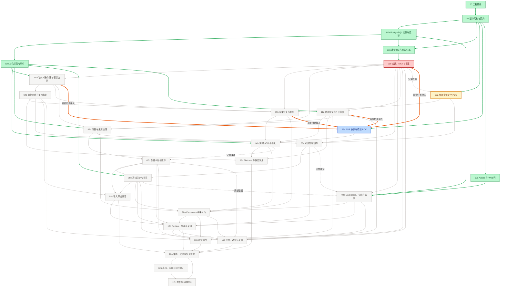

<!-- 由 scripts/roadmap.py 自动生成，不要手改；改 docs/roadmap/phases.json 或运行 `python scripts/roadmap.py set ...` -->

# Classroom OS 阶段进度

**6 / 28 完成**　`████░░░░░░░░░░░░░░░░`　21%

🟢 完成 6　🟣 待验收 0　🔵 进行中 1　🟡 可开工 1　⚪ 未开始 19　🔴 受阻 1

图例：节点颜色＝状态（🟡 黄色粗框＝前置都完成、可以开工）；实线＝硬依赖，虚线＝完整联调，橙色粗线＝真实付费接入前置；**连线变绿＝这条前置已满足**。

## 按模块

| 模块 | 进度 | 阶段 |
|---|---|---|
| 00 工程基线 | 1/1 | 🟢 00 |
| 01 架构契约 | 1/1 | 🟢 01 |
| 02 数据库与任务 | 2/2 | 🟢 02a 🟢 02b |
| 03 身份与权限 | 1/2 | 🟢 03a 🔴 03b |
| 04 存储与删除 | 0/2 | ⚪ 04a ⚪ 04b |
| 05 采集与恢复 | 0/2 | 🟡 05a ⚪ 05b |
| 06 ASR 语音识别 | 0/3 | 🔵 06a ⚪ 06b ⚪ 06c |
| 07 AI 问答与总结 | 0/2 | ⚪ 07a ⚪ 07b |
| 08 离线与同步 | 0/3 | ⚪ 08a ⚪ 08b ⚪ 08c |
| 09 Web 界面 | 1/2 | 🟢 09a ⚪ 09b |
| 10 课堂与复习 | 0/2 | ⚪ 10a ⚪ 10b |
| 11 运营与费用 | 0/3 | ⚪ 11a ⚪ 11b ⚪ 11c |
| 12 测试与发布 | 0/3 | ⚪ 12a ⚪ 12b ⚪ 12c |

## 现在可以开工

- **05a 缓存密钥安全 POC**（完整联调还差 03b）

## 关键路径

剩余最长的硬依赖链有 **11** 个阶段，决定最快什么时候能全部做完：

03b 会话、MFA 与恢复 → 04a 私有对象存储与密钥边界 → 04b 数据删除与备份恢复 → 05b 采集恢复与租约 → 06b 实时 ASR 与恢复 → 10a Classroom 与课后页 → 10b Review、来源与采用 → 11b 运营后台 → 12a 集成、安全与恢复验收 → 12b 真机、质量与长时验证 → 12c 发布与回退材料

## 瓶颈

未完成阶段里，卡住下游最多的五个：

- 03b 会话、MFA 与恢复：卡住 19 个下游（🔴 受阻）
- 04a 私有对象存储与密钥边界：卡住 16 个下游（⚪ 未开始）
- 11a 费用预留与开关前置：卡住 14 个下游（⚪ 未开始）
- 04b 数据删除与备份恢复：卡住 13 个下游（⚪ 未开始）
- 05a 缓存密钥安全 POC：卡住 13 个下游（🟡 可开工）

## 剩余并行波次

同一波里的阶段互不依赖，可以并行；前一波完成后下一波才能全部开工。

- 第 1 波：03b、05a、06a
- 第 2 波：04a、09b、11a
- 第 3 波：04b、07a
- 第 4 波：05b、07b、08a
- 第 5 波：06b、08b
- 第 6 波：06c、08c、10a
- 第 7 波：10b
- 第 8 波：11b、11c
- 第 9 波：12a
- 第 10 波：12b
- 第 11 波：12c

## 全部阶段

| 阶段 | 状态 | 负责人 | PR | 还差的硬依赖 | 其他前置 | 开始 | 完成 | 备注 |
|---|---|---|---|---|---|---|---|---|
| 00 工程基线 | 🟢 完成 | 林珈诚 | — | — | — | 2026-10-27 | 2026-11-04 | 工程基线已获人工验收并进入 main；Windows/Node 工程门禁已远端验证，不代表完整 Web 或生产验收。 本地交付与原则验收为2026-10-28；历史首次明确进入新仓main为2026-11-04，历时包含等待整合。 |
| 01 整体架构与契约 | 🟢 完成 | 林珈诚 | — | — | — | 2026-10-28 | 2026-11-04 | 整体架构、ADR、HTTP/WS 契约及实施映射已原则批准并进入 main；11 项 TBD 仍开放，架构批准不代表业务实现完成。 本地架构交付和接受为2026-10-28；历史首次明确进入新仓main为2026-11-04。 |
| 02a PostgreSQL 实体与迁移 | 🟢 完成 | 林珈诚 | — | — | — | 2026-10-28 | 2026-10-29 | PostgreSQL 实体、迁移、RLS、Repository 及撤权竞态修复已获批准并整合到 main；不代表生产迁移、真实身份或完整 HTTP 联调已完成。 历史完成日按当时获准正式Web开发线的本地整合和验证收尾记录，不是当日合并旧Windows main。 |
| 02b 持久任务与事件 | 🟢 完成 | 林珈诚 | — | — | — | 2026-10-29 | 2026-10-30 | 持久 Task/Attempt、Receipt、Outbox、租约与恢复已获批准并整合到 main；同键 reconcile 与迟到结果语义、多 Attempt 终态覆盖两项 P3 仍开放。 历史完成日按当时获准正式Web开发线的本地整合和验证收尾记录，不是当日合并旧Windows main。 |
| 03a 邀请验证与资源归属 | 🟢 完成 | 林珈诚 | — | — | — | 2026-10-30 | 2026-11-04 | 邀请激活、资源归属及权限/来源恢复整改已获批准并整合到 main；0006 仅支持可信 bootstrap，P3-01 与非超级用户成功升级仍未关闭；真实邮件和完整认证未验收。 |
| 03b 会话、MFA 与恢复 | 🔴 受阻 | Codex | — | — | — | 2026-11-04 | — | S1、S2、S3 Batch 1 已通过，Batch 2 诊断修订已获独审接受；本机监听状态观察不一致，真实 PostgreSQL 归属/握手未验证，数据库执行权仍关闭，完整 Cookie/MFA/恢复未交付。 |
| 04a 私有对象存储与密钥边界 | ⚪ 未开始 | — | — | 03b | — | — | — |  |
| 04b 数据删除与备份恢复 | ⚪ 未开始 | — | — | 04a | — | — | — |  |
| 05a 缓存密钥安全 POC | 🟡 可开工 | — | — | — | 完整联调还差 03b | — | — | 当前工作流仅保留关闭的未来模板，尚未启用或实施安全 POC。 |
| 05b 采集恢复与租约 | ⚪ 未开始 | — | — | 03b, 04a, 04b, 05a | — | — | — |  |
| 06a ASR 协议与模拟 POC | 🔵 进行中 | 林珈诚 | [#3](https://github.com/Mumao233/classroom-os/pull/3) [#4](https://github.com/Mumao233/classroom-os/pull/4) | — | 真实付费接入还差 03b, 04a, 05b, 11a | 2026-11-06 | — | 模拟协议 POC 已验收并通过 GitHub #4 整合到 main，原模拟 PR 为 #3；模拟候选 24 项及可信断言 4 项通过。PR-06a 的真实接口验证尚未执行，须专项授权及原付费前置门禁；本状态不授权继续调用真实 API。 |
| 06b 实时 ASR 与恢复 | ⚪ 未开始 | — | — | 05b, 06a, 11a | — | — | — |  |
| 06c Filetrans 与候选采用 | ⚪ 未开始 | — | — | 04b, 06b, 11a | — | — | — |  |
| 07a 问答与来源快照 | ⚪ 未开始 | — | — | 03b, 04a, 11a | — | — | — |  |
| 07b 总结卡片与版本 | ⚪ 未开始 | — | — | 07a | 完整联调还差 06b | — | — |  |
| 08a 可信加密缓存 | ⚪ 未开始 | — | — | 03b, 04b, 05a, 07a | — | — | — |  |
| 08b 离线同步与冲突 | ⚪ 未开始 | — | — | 07b, 08a | — | — | — |  |
| 08c 导入导出兼容 | ⚪ 未开始 | — | — | 04b, 07b, 08b | — | — | — |  |
| 09a Aurora 与 Web 壳 | 🟢 完成 | 林珈诚 | — | — | — | 2026-10-28 | 2026-11-04 | Aurora 导航、主题、响应式 Web 壳与 Mock 工作台已获批准并整合到 main；仅 Mock 范围，跨课堂合成实体 ID P3 仍开放，不代表真实课堂、认证、音频或 ASR 联调完成。 |
| 09b Dashboard、课程与设置 | ⚪ 未开始 | — | — | 03b | 完整联调还差 08a, 08b | — | — |  |
| 10a Classroom 与课后页 | ⚪ 未开始 | — | — | 05b, 06b, 07a, 08b, 09b | — | — | — |  |
| 10b Review、来源与采用 | ⚪ 未开始 | — | — | 07b, 08a, 08b, 08c, 09b, 10a | — | — | — |  |
| 11a 费用预留与开关前置 | ⚪ 未开始 | — | — | 03b | — | — | — |  |
| 11b 运营后台 | ⚪ 未开始 | — | — | 03b, 04b, 07b, 10a, 10b, 11a | — | — | — |  |
| 11c 搜索、通知与反馈 | ⚪ 未开始 | — | — | 03b, 07b, 08b, 09b, 10a, 10b, 11a | — | — | — |  |
| 12a 集成、安全与恢复验收 | ⚪ 未开始 | — | — | 06c, 08c, 10b, 11b, 11c | — | — | — |  |
| 12b 真机、质量与长时验证 | ⚪ 未开始 | — | — | 12a | — | — | — |  |
| 12c 发布与回退材料 | ⚪ 未开始 | — | — | 12a, 12b | — | — | — |  |
