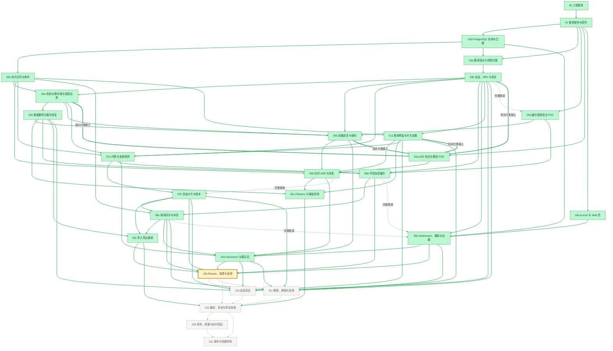

<!-- 由 scripts/roadmap.py 自动生成，不要手改；改 docs/roadmap/phases.json 或运行 `python scripts/roadmap.py set ...` -->

# Classroom OS 阶段进度

**22 / 28 完成**　`████████████████░░░░`　79%

🟢 完成 22　🟣 待验收 0　🔵 进行中 0　🟡 可开工 1　⚪ 未开始 5　🔴 受阻 0

图例：节点颜色＝状态（🟡 黄色粗框＝前置都完成、可以开工）；实线＝硬依赖，虚线＝完整联调，橙色粗线＝真实付费接入前置；**连线变绿＝这条前置已满足**。

## 按模块

| 模块 | 进度 | 阶段 |
|---|---|---|
| 00 工程基线 | 1/1 | 🟢 00 |
| 01 架构契约 | 1/1 | 🟢 01 |
| 02 数据库与任务 | 2/2 | 🟢 02a 🟢 02b |
| 03 身份与权限 | 2/2 | 🟢 03a 🟢 03b |
| 04 存储与删除 | 2/2 | 🟢 04a 🟢 04b |
| 05 采集与恢复 | 2/2 | 🟢 05a 🟢 05b |
| 06 ASR 语音识别 | 3/3 | 🟢 06a 🟢 06b 🟢 06c |
| 07 AI 问答与总结 | 2/2 | 🟢 07a 🟢 07b |
| 08 离线与同步 | 3/3 | 🟢 08a 🟢 08b 🟢 08c |
| 09 Web 界面 | 2/2 | 🟢 09a 🟢 09b |
| 10 课堂与复习 | 1/2 | 🟢 10a 🟡 10b |
| 11 运营与费用 | 1/3 | 🟢 11a ⚪ 11b ⚪ 11c |
| 12 测试与发布 | 0/3 | ⚪ 12a ⚪ 12b ⚪ 12c |

## 现在可以开工

- **10b Review、来源与采用**

## 关键路径

剩余最长的硬依赖链有 **5** 个阶段，决定最快什么时候能全部做完：

10b Review、来源与采用 → 11b 运营后台 → 12a 集成、安全与恢复验收 → 12b 真机、质量与长时验证 → 12c 发布与回退材料

## 瓶颈

未完成阶段里，卡住下游最多的五个：

- 10b Review、来源与采用：卡住 5 个下游（🟡 可开工）
- 11b 运营后台：卡住 3 个下游（⚪ 未开始）
- 11c 搜索、通知与反馈：卡住 3 个下游（⚪ 未开始）
- 12a 集成、安全与恢复验收：卡住 2 个下游（⚪ 未开始）
- 12b 真机、质量与长时验证：卡住 1 个下游（⚪ 未开始）

## 剩余并行波次

同一波里的阶段互不依赖，可以并行；前一波完成后下一波才能全部开工。

- 第 1 波：10b
- 第 2 波：11b、11c
- 第 3 波：12a
- 第 4 波：12b
- 第 5 波：12c

## 全部阶段

| 阶段 | 状态 | 负责人 | PR | 还差的硬依赖 | 其他前置 | 开始 | 完成 | 备注 |
|---|---|---|---|---|---|---|---|---|
| 00 工程基线 | 🟢 完成 | 林珈诚 | — | — | — | 2026-10-27 | 2026-11-04 | 工程基线已获人工验收并进入 main；Windows/Node 工程门禁已远端验证，不代表完整 Web 或生产验收。 本地交付与原则验收为2026-10-28；历史首次明确进入新仓main为2026-11-04，历时包含等待整合。 |
| 01 整体架构与契约 | 🟢 完成 | 林珈诚 | — | — | — | 2026-10-28 | 2026-11-04 | 整体架构、ADR、HTTP/WS 契约及实施映射已原则批准并进入 main；11 项 TBD 仍开放，架构批准不代表业务实现完成。 本地架构交付和接受为2026-10-28；历史首次明确进入新仓main为2026-11-04。 |
| 02a PostgreSQL 实体与迁移 | 🟢 完成 | 林珈诚 | — | — | — | 2026-10-28 | 2026-10-29 | PostgreSQL 实体、迁移、RLS、Repository 及撤权竞态修复已获批准并整合到 main；不代表生产迁移、真实身份或完整 HTTP 联调已完成。 历史完成日按当时获准正式Web开发线的本地整合和验证收尾记录，不是当日合并旧Windows main。 |
| 02b 持久任务与事件 | 🟢 完成 | 林珈诚 | — | — | — | 2026-10-29 | 2026-10-30 | 持久 Task/Attempt、Receipt、Outbox、租约与恢复已获批准并整合到 main；同键 reconcile 与迟到结果语义、多 Attempt 终态覆盖两项 P3 仍开放。 历史完成日按当时获准正式Web开发线的本地整合和验证收尾记录，不是当日合并旧Windows main。 |
| 03a 邀请验证与资源归属 | 🟢 完成 | 林珈诚 | — | — | — | 2026-10-30 | 2026-11-04 | 邀请激活、资源归属及权限/来源恢复整改已获批准并整合到 main；0006 仅支持可信 bootstrap，P3-01 与非超级用户成功升级仍未关闭；真实邮件和完整认证未验收。 |
| 03b 会话、MFA 与恢复 | 🟢 完成 | 林珈诚 | — | — | — | 2026-11-04 | 2026-11-14 | PR-03b 核心包已完成，2026-11-14 合入 main；登录/会话、MFA、改密重置、CSRF、WSS 票据、F01/F02 收口。CI 修复 GitHub #9 已合并，双 CI 与 VMware 回归通过（后端582+29子、前端229、Mock36）。人工恢复/维护 M0–M4 延后且关闭；R05 非统计通过，R02/R04 限历史单点；权限补审证据缺口保留。2026-11-15 用户确认收尾并要求更新网页，详见 docs/web-alpha/pr03b/INTEGRATION-20261115.md。 |
| 04a 私有对象存储与密钥边界 | 🟢 完成 | 林珈诚 | [#10](https://github.com/Mumao233/classroom-os/pull/10) | — | — | 开始日期未记录 | 2026-11-16 | 2026-11-16 按 Mumao233 合并 GitHub #10 的记录同步已交付范围，私有 S3 兼容存储、上传下载、Range、媒体票据及 R1 流生命周期修复已进入 main。已核对合流 VMware 166 项组合回归与后续 724 主测试、29 子测试通过记录，后者未启用 PR-03b auth-browser 模块。真实云 IAM、完整 TLS 链、音频保留策略及 0.2.1 契约候选仍待确认，audio_chunk committed 保持关闭。证据见该 PR 与 outputs/integration-20261116/ci-repair/SUMMARY.md。 |
| 04b 数据删除与备份恢复 | 🟢 完成 | 林珈诚 | [#16](https://github.com/Mumao233/classroom-os/pull/16) | — | — | 开始日期未记录 | 2026-11-16 | 2026-11-16 GitHub #16 合入 main（65dbcab）。已交付删除受理、撤权、独立删除账本、对象清除和备份恢复闸门。数据库正文清除待完成，相关请求保持 pending_delete。TBD-04、TBD-05 待签署。详见 docs/web-alpha/pr04b/HANDOFF-20261116.md。 |
| 05a 缓存密钥安全 POC | 🟢 完成 | 林珈诚 | [#11](https://github.com/Mumao233/classroom-os/pull/11) | — | — | 开始日期未记录 | 2026-11-16 | 2026-11-16 按 Mumao233 合并 GitHub #11、并经 #10 进入 main 的记录同步已交付范围。Web Crypto/IndexedDB 安全 POC、03b 身份与 PostgreSQL 密钥解锁、同一有效设备恢复候选及增量安全复审完成。合流 VMware 回归包含真实缓存 TLS 浏览器验证。正式接入候选默认关闭，TBD-03、正式迁移与契约、录音同意及恢复产品策略仍待确认。证据见该 PR、docs/web-alpha/pr05a/FORMAL-INTEGRATION-20261115.md 与 outputs/integration-20261116/ci-repair/SUMMARY.md。 |
| 05b 采集恢复与租约 | 🟢 完成 | 林珈诚 | [#18](https://github.com/Mumao233/classroom-os/pull/18) | — | — | 开始日期未记录 | 2026-11-17 | 2026-11-17 GitHub #18 合入 main（042d79f）。已交付采集状态机、租约与接管、分块幂等、持久化确认、断线恢复和 PR-04b 删除恢复兼容。采集恢复默认关闭，真实麦克风、录音持久化和生产启用待验收。 |
| 06a ASR 协议与模拟 POC | 🟢 完成 | 林珈诚 | [#3](https://github.com/Mumao233/classroom-os/pull/3) [#4](https://github.com/Mumao233/classroom-os/pull/4) [#19](https://github.com/Mumao233/classroom-os/pull/19) | — | — | 2026-11-06 | 2026-11-20 | 第四批正式 DashScope 最小 POC 在候选 a2a9a634 三例通过，发出 184,064 个确认采样。前序批次、独立调试、残余风险和账单记录见 docs/web-alpha/pr06a/REAL-POC-CLOSEOUT-20261119.md。林珈诚确认试用额度覆盖，实付 ¥0。B1–B4 本地预留共 ¥4 已释放。2026-11-20，GitHub #19 已合入 main（0718c85）。 |
| 06b 实时 ASR 与恢复 | 🟢 完成 | 林珈诚 | [#27](https://github.com/Mumao233/classroom-os/pull/27) | — | — | 2026-11-21 | 2026-11-21 | GitHub #27 已合入 main（fe4aafc）。VMware 模拟全量回归通过，Astra 复审关闭原审全部 9 项发现。真实 DashScope 与生产启用另行授权。 |
| 06c Filetrans 与候选采用 | 🟢 完成 | 林珈诚 | [#32](https://github.com/Mumao233/classroom-os/pull/32) | — | — | 2026-11-21 | 2026-11-22 | GitHub #32 合入 main（fb3437d）。已交付合成 Filetrans 重转写、独立候选与 CAS 采用，并接入 HTTP 0.3.0 的四个重转写错误码。VMware 完整 Web 回归 1,715 项主测试和 83 项子测试通过，Astra 复审 P0/P1 为 0。PR-08c 容量用例的 SeaweedFS 偶发截断记录在 docs/web-alpha/pr06c/VERIFICATION.md。真实 Filetrans POC 与生产启用另行授权。 |
| 07a 问答与来源快照 | 🟢 完成 | 林珈诚 | [#14](https://github.com/Mumao233/classroom-os/pull/14) | — | — | 开始日期未记录 | 2026-11-16 | 2026-11-16 GitHub #14 合入 main（cf88260）。已交付授权问答、冻结来源快照与引用、不可变版本和任务恢复。QA composition 与 Worker 默认关闭。正式接线和删除恢复联调门禁见 docs/web-alpha/pr07a/VALIDATION.md。 |
| 07b 总结卡片与版本 | 🟢 完成 | 林珈诚 | [#15](https://github.com/Mumao233/classroom-os/pull/15) | — | — | 开始日期未记录 | 2026-11-16 | 2026-11-16 GitHub #15 合入 main（801bc5d）。已交付总结与四类复习卡片、不可变 AI/个人版本、CAS 冲突保稿、显式采用、多批任务及费用恢复。Review composition 与 Worker 默认关闭，生产启用、真实模型质量及删除恢复联调待验收。详见 docs/web-alpha/pr07b/VALIDATION.md。 |
| 08a 可信加密缓存 | 🟢 完成 | 林珈诚 | [#17](https://github.com/Mumao233/classroom-os/pull/17) | — | — | 开始日期未记录 | 2026-11-17 | 2026-11-17 GitHub #17 合入 main（8b1e44e）。已交付 Web Crypto/IndexedDB 加密缓存、可信设备与密钥生命周期、删除失效和离线同步缓存接口。0013 恢复可信设备约束，最终 VMware 缓存、采集组合回归和四项 CI 通过。合并提交 8b1e44e 是 PR-08b GitHub #20 的主线基线。 |
| 08b 离线同步与冲突 | 🟢 完成 | 林珈诚 | [#20](https://github.com/Mumao233/classroom-os/pull/20) | — | — | 开始日期未记录 | 2026-11-18 | 2026-11-18 GitHub #20 合入 main（ec2beb9），主线基线为已合并 PR-08a 的 8b1e44e。已交付离线同步、加密 outbox、冲突保稿和恢复。0014 迁移、HTTP 0.2.1 加 pr07b-1 兼容及同步停用恢复三项人工验收已确认。同步默认关闭，PR-09b 消费者联调及认证会话锁等待 P2 专项验收仍待完成。 |
| 08c 导入导出兼容 | 🟢 完成 | 林珈诚 | [#22](https://github.com/Mumao233/classroom-os/pull/22) | — | — | 2026-11-18 | 2026-11-21 | PR #22 已合入 main（b9f693c）。TBD-06 服务端与导入导出策略 tbd06-v2 已由林珈诚签署，浏览器本地数值已确认，待 05b/08a 接线、Chrome/Edge 稳定版和近 1 GB 满池证据。生产尚未放行。 |
| 09a Aurora 与 Web 壳 | 🟢 完成 | 林珈诚 | — | — | — | 2026-10-28 | 2026-11-04 | Aurora 导航、主题、响应式 Web 壳与 Mock 工作台已获批准并整合到 main；仅 Mock 范围，跨课堂合成实体 ID P3 仍开放，不代表真实课堂、认证、音频或 ASR 联调完成。 |
| 09b Dashboard、课程与设置 | 🟢 完成 | 林珈诚 | [#13](https://github.com/Mumao233/classroom-os/pull/13) [#21](https://github.com/Mumao233/classroom-os/pull/21) | — | — | 开始日期未记录 | 2026-11-16 | 2026-11-16 GitHub #13 将最终功能提交 3cf88bb 合入 main（5388316）。Dashboard、课程、设置 Mock 前端与账号切换旧请求保护已交付；合流 VMware 前端 274 项 Vitest、61 项 Chromium 用例通过。2026-11-18 GitHub #21 将只改验收文档的定向审查记录 d216f23 合入 main（9ccf5c0），记录两项低严重度遗留问题。生产入口仍为 AuthWorkbench，真实后端及 PR-08a/08b 消费者联调待完成。 |
| 10a Classroom 与课后页 | 🟢 完成 | 林珈诚 | [#29](https://github.com/Mumao233/classroom-os/pull/29) [#30](https://github.com/Mumao233/classroom-os/pull/30) | — | — | 2026-11-21 | 2026-11-22 | GitHub #29 合入 main（00574aa），#30 让处理页读取全部采集轮次的音频清单（a0f5b4b）。所依赖的 HTTP 契约 0.3.0 与后端见 #31。课堂与课后页目前只挂在 mock 构建、使用合成数据，真实采集与 ASR 接线待后续集成。Review、来源阅读与重转写入口归 PR-10b。 |
| 10b Review、来源与采用 | 🟡 可开工 | — | — | — | — | — | — |  |
| 11a 费用预留与开关前置 | 🟢 完成 | 林珈诚 | [#12](https://github.com/Mumao233/classroom-os/pull/12) | — | — | 开始日期未记录 | 2026-11-16 | 2026-11-16 按 Mumao233 合并 GitHub #12、并经 #11/#10 进入 main 的记录同步已交付范围。预算预留、幂等费用结算、任务生命周期与管理入口候选完成，R2 缺失最终 usage 的 unknown 保护已修复并复审关闭。合流 VMware 回归已覆盖费用与 worker 恢复。候选沿用显式注入和默认关闭，正式迁移、模型与契约、真实价格、持续流及公共通知仍待验收。证据见该 PR、docs/web-alpha/pr11a/R2-RECOVERY-20261116.md 与 outputs/integration-20261116/ci-repair/SUMMARY.md。 |
| 11b 运营后台 | ⚪ 未开始 | — | — | 10b | — | — | — |  |
| 11c 搜索、通知与反馈 | ⚪ 未开始 | — | — | 10b | — | — | — |  |
| 12a 集成、安全与恢复验收 | ⚪ 未开始 | — | — | 10b, 11b, 11c | — | — | — |  |
| 12b 真机、质量与长时验证 | ⚪ 未开始 | — | — | 12a | — | — | — |  |
| 12c 发布与回退材料 | ⚪ 未开始 | — | — | 12a, 12b | — | — | — |  |
