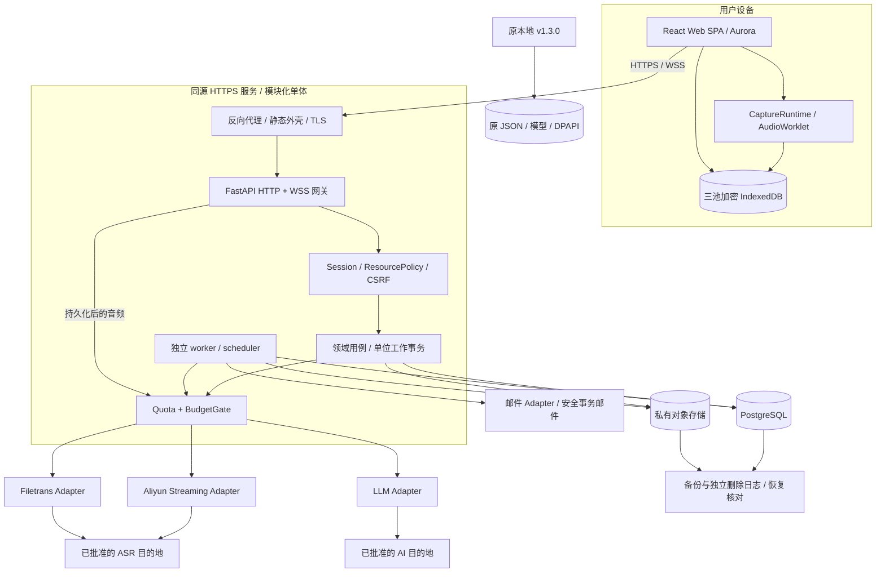
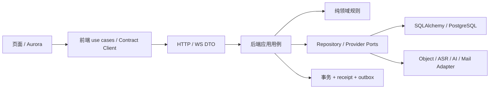

# PR-01 · Classroom OS Web Alpha 0.1.0 系统架构

日期：2026-10-28。设计起点：PR-00 `f773100`；本地业务基线 `43fa23c`。状态：**用户原则批准架构，接受ADR选定结构与技术栈**，见[批准与收尾记录](PR01-CLOSEOUT.md)。文中的“冻结”表示获批准的共同设计约束；11项TBD中的实验/产品参数继续开放，功能尚未实现，也未获后续开发授权。

## 1. 目标、依据和决定

为 10–30 名邀请制学生提供课程组织、主动录音、云转写、有依据问答、课后总结/卡片、个人编辑和跨设备复习闭环。依据是完整 37 页 [PRD v1.2](../Classroom_OS_Web_Alpha_0.1.0_PRD_v1.2.pdf)、[118 项需求矩阵](../REQUIREMENTS_MATRIX.md)、[冲突登记](../CONFLICTS.md)、[PR-00 验收](../PR00_ACCEPTANCE.md)。第21页是视觉示意；第35–37页更新 ASR 首选。软件、本地版、PRD、设计系统的版本彼此独立。

**采用独立 Web SPA + FastAPI 模块化单体 + PostgreSQL + 私有对象存储。** 一个代码库产生 API/实时网关和 worker 两种进程，PG 承担正式数据、任务、收据、事件和费用账本；不要求 Redis、Celery、微服务、Kubernetes、GPU 或向量数据库。React/TypeScript/Vite 与 Aurora 组件独立组织，Claude Code负责前端主线，Terra可选参与视觉探索，Astra负责架构/契约，Codex负责后端与集成。

### 冻结的系统不变量

1. Alpha 的租户就是个人用户；只有 Student/Admin，不提前引入学校/组织/共享笔记。私有对象的 owner 由服务端会话决定，URL 必须显式指定课堂，不存在全局 `current`。
2. 本地 `v1.3.0` 的入口、版本、配置、Whisper、DPAPI、JSON 数据、测试保持独立。Web 不实例化原 `Classroom`，不去掉 `local_only` 来开放公网。
3. PostgreSQL 是云端正式事实源；对象与 PG 双确认才是 `cloud_durable`。上传、ASR、AI、同步和采集分别展示状态。
4. 每个写操作有稳定 op_id/指纹；内容版本使用 CAS；删除墓碑先于旧客户端重放。模型调用与文件上传是不同幂等域。
5. 外部收费提交前持久化 attempt 和预算预留；已发送而结果未知不可自动重发、退款、换供应商。不存在跨网络的 exactly-once 承诺。
6. 临时字幕不能成为正式来源；生成固定材料、模型、目的地、提示和结构版本。机器原稿、候选、个人稿、采用指针分开，首稿也不自动采用。
7. 学习缓存、未同步草稿、音频恢复三池独立。私人持久缓存加密，关闭重开需要联网认证解锁。安全 POC 未通过时不启用可靠持久恢复承诺。
8. 删除先撤访问再清物理副本；恢复备份先应用删除/撤权账本。7天原音与14天学习缓存互不延长。
9. 用户配额和真实 Token/金额是不同账本；全部收费入口经过同一预算闸门。阅读、搜索、卡片揭晓不调用模型。
10. 技术参数需要实验不意味着结构未设计；详见 [ADR 与参数登记](07-ADR-REGISTER.md)。未关闭的发布阻塞项不能被配置默认值“批准”。

## 2. 整体拓扑与信任边界



边界：浏览器不可信，第三方内容/模型输出不可信；API 和 worker 同一应用信任域但不同最小权限角色；存储是私有资源，不挂静态站点。管理员运营界面没有他人正文端点。云 ASR/AI 的出站目的地和服务端凭据不由学生提交任意 URL 决定。

## 3. 模块、所有权和允许依赖

| 模块 | 独占写入职责 | 对外端口 / 依赖 | 禁止 |
|---|---|---|---|
| identity | 账号、邀请、验证、会话、MFA、设备授权 | Principal、SessionPolicy、邮件 outbox | 借邀请码赋 Admin；内容读取后门 |
| catalog | 学期、课程、课程材料版本、归档/改归属 | CourseRepository、课程 DTO | 同名合并；改课名改变 ID |
| classroom | 实际课堂、采集租约/epoch、分片 manifest、缺口 | CapturePort、MediaPort、QuotaGate | 自动抢占；把墙钟等同有效采样时长 |
| media | staging、校验、私有对象与资源短授权 | ObjectStore、删除协调器 | 客户端指定物理 key；公开桶 |
| transcription | ASR 流、机器稿/修订、时间映射 | AsrAdapter、TaskService、Meter | 按文本去重；unknown 自动补识别 |
| learning | 快照、问答、总结批次、卡片、个人稿、采用 | AiAdapter、SourceSnapshot、TaskService | 来源变更暗换；首稿自动采用 |
| sync | op 收据、版本 CAS、增量游标、冲突 | 各领域命令、墓碑 | 自行直接写各模块表；同步触发 AI |
| metering | 时长/次数、金额预留、usage 结算、开关 | BudgetGate、PriceBook、Reconciler | 用前端计数授权；未知按零 |
| lifecycle | 删除、导入/导出、恢复协调 | MediaPort、各模块删除 hook | 删除绕过在途检查；恢复已删资源 |
| operations | 用户/邀请/配额/运行状态、搜索/通知/反馈 | 已授权投影、审计事件 | 扫描全库正文给管理员；伪学习评分 |
| runtime | UnitOfWork、任务领取、outbox、clock、配置 | 基础设施适配器 | 包含产品规则或跨域万能 service |

所有对外请求先走 Application Use Case，再调用纯 Domain Policy，再走 Repository/Port。跨模块状态改变由一个应用事务协调，不能彼此调用 HTTP。Read model 可在同库按授权 JOIN，必须只读且不能成为第二套事实源。依赖方向不反向引用 UI 或供应商 SDK。



领域代码不依赖 FastAPI Request、SQLAlchemy Session、DOM、真实 SDK 或本地配置路径；异常映射由接口层做。读取与写入不用 CQRS 框架，只区分职责。

## 4. 进程与调度决定

- **API/网关**：一个 ASGI 进程起步；处理认证/短事务、授权媒体、WSS 事件订阅和实时 ASR 会话。单条 ASR 上游连接的 producer/consumer 由同一进程持有，PG 记录 owner、fence、提交范围与 usage。单进程只是初始拓扑，不是持久性来源。
- **worker**：相同后端包的独立入口。PG `FOR UPDATE SKIP LOCKED` 领取任务，短事务提交租约后才做网络 I/O；使用递增 fencing token 和 heartbeat。按删除/安全通知、交互请求、批次/导出分优先级，有限并发且防低优先级永久饥饿。
- **scheduler/reconciler**：worker 中定时 tick，依任务唯一键和 PG advisory lock 选单执行者，重启扫描遗漏。执行期限扫描、过期授权清理、未完成对象核对、usage 对账、死租约检查。定时器不能是唯一触发证据。
- **推送**：正式事件与业务同事务 outbox；PG LISTEN/NOTIFY 只传事件ID作唤醒提示，丢通知可按游标轮询补齐。partial/音量临时事件可丢弃；final/删除/状态变更持久可重放。不引入消息中间件。
- **过载**：注册/登录、上传字节、每用户 WS、ASR 并发、任务领取分别限额；当前课堂收尾/停止入口优先。排队不能承诺无限缓冲，后端满时保留客户端安全队列并返回可恢复错误。

## 5. 未来目录（本 PR 不创建应用骨架）

```text
classroom-os/
  app.py, static/, tests/, version.py, requirements*.txt  # 原本地线不改
  docs/web-alpha/architecture/                         # 本 PR 设计与契约
  web/                                                # 后续授权后新增
    frontend/                                         # 独立 package/lock/config
      src/app/                                        # router/providers/auth boundary
      src/pages/                                      # 路由页面组合
      src/features/{auth,courses,classroom,review,settings,operations}/
      src/runtime/                                    # capture/sync/events controllers
      src/platform/                                   # 浏览器音频/安全存储 ports
      src/api/                                        # generated DTO/client/query keys
      src/domain/                                     # 纯类型/状态/规则
      src/ui/{tokens,primitives,patterns,content}/
    backend/                                          # 独立 pyproject/lock
      classroom_web/{api,application,domain,infrastructure}/
      classroom_web/entrypoints/{api,worker}.py
      migrations/                                     # Alembic，单一迁移链
      tests/{unit,integration,contract}/
    contracts/                                        # 经审核从本PR契约生成/搬入
    e2e/                                              # Playwright，多账号故障场景
    ops/                                              # 部署模板/恢复手册，后续PR
  work/pr01/                                          # 忽略：提取、渲染、校验依赖
  outputs/pr01/                                       # 忽略：本地报告与汇总浏览稿
```

目录按职责而非每张表拆服务。初期可在 `domain/<module>/` 使用少量文件，只有模块规模需要时再细分。协议有唯一来源，禁止前后端各手写一套“差不多”的 DTO；设计期权威在 `architecture/contracts/`，迁入 `web/contracts/` 时保留版本记录并更新链接。

## 6. 旧源码复用决策

| 已核读来源 | 可复用价值 | Web 使用方式 |
|---|---|---|
| `app.py:96` 与 `create_app`/`local_only` | 既有流程与防护、队列故障经验 | 不导入运行时；Web独立启动，不读取 data/config，不移除本机保护 |
| `static/pcm-worklet.js` | 连续相位重采样、混声、尾帧 flush | PR-05按合成波形黄金样本验证后移植纯算法，PCM16量化/协议另外实现 |
| `study_workflow.py` | 请求指纹、固定材料、发送确认、未知状态 | 抽取纯规则到Web适配器或受测共享模块；不继承全局房间与JSON锁 |
| `review_schema.py` | 四种卡片、字段/来源/长度校验、禁止执行模型内容 | 保留现有 schema v1 golden fixtures；Web source ID映射，不从重写模型输出“修复”错误 |
| `review_workflow.py` | 批次计划、返回后校验/恢复、版本比较 | 保留语义，替换PG事务/任务；首次自动采用行为在Web明确禁止 |
| `review_sources.py` / `slide_history.py` | 历史图像/文字依据与来源变化 | 固定版本+hash，授权下载，不退回当前图冒充历史 |
| `course_catalog.py` | 大纲/词表规则与校验 | 词表是上下文，不是课堂证据；关联不可变课程材料版本 |
| `portable_package.py` / `portable_routes.py` | manifest、hash、路径/ZIP安全和独立副本 | PR-08c 适配 owner、对象存储和Web限额；不直接运行导入HTML/JS |
| `static/study-cache.js` | op恢复/本地待处理交互经验 | 原明文存储不能移植；重做账号/密钥/三池边界 |
| `ai_api.py` / `ai_settings.py` / `codex_bridge.py` | 流式输出与usage分类 | Web固定受控目的地，不启动本机Codex，不接受任意平台URL/Key |

“复用”不等于现在重构。将来任一共享源码提取，必须同时通过原完整 Python、九套 Node 及相应 Web 门禁，不复制已知冲突行为。

## 7. 客户端扩展边界

Web Alpha 不建设原生客户端，但固定以下 ports：CapturePort（PCM/时钟/权限/中断）、SecureStorePort（三池/密钥/容量）、TransportPort（HTTP/WS）、LifecyclePort（前后台）、FileTransferPort、NotificationPort。共同 DTO、状态机、source/revision、op_id 和服务器授权对所有客户端一致。

Windows/macOS 后续可评估 Tauri/原生壳；iOS/Android 可评估 React Native/原生应用。本 PR 不冻结未来 UI 框架。原生使用系统安全存储和经评审的 OAuth/OIDC Authorization Code + PKCE 或等价委托认证，不能把 Web Cookie 或供应商Key复制进包。增加原生认证端点须单独ADR；当前不建立OAuth授权服务器。后台音频、系统通知、离线登录都需平台级权限和独立产品批准，浏览器当前限制不会被接口名称掩盖。

## 8. 系统级验收接口

设计验收见 [PR-01验收报告](PR01-ACCEPTANCE.md)。后续实现必须证明：A/B账号所有资源拒绝越权；保存ACK经进程重启可找回；收费unknown不自动重发；旧fence不能继续云发送；删后离线旧稿不复活；总结候选不覆盖个人稿；路由/主题切换不丢采集与草稿；所有真机/真实质量结论另有证据。

完整的协议、数据字段、安全与费用规则分别在 [前端](02-FRONTEND-AURORA.md)、[数据后端](03-DATA-BACKEND.md)、[接口与流程](04-CONTRACTS-FLOWS.md)、[安全离线](05-SECURITY-OFFLINE.md)、[成本运维](06-COST-OPERATIONS.md)。这些文件共同组成设计，不以一张总图替代可实施契约。
