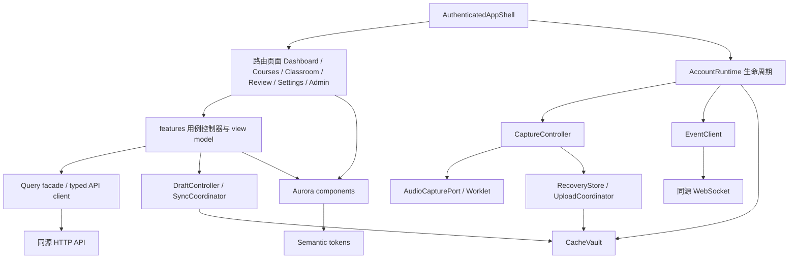
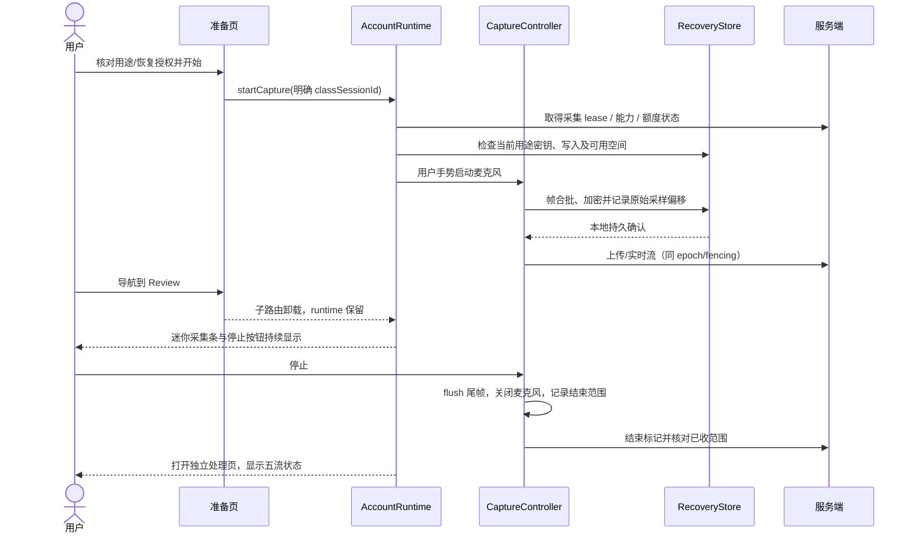
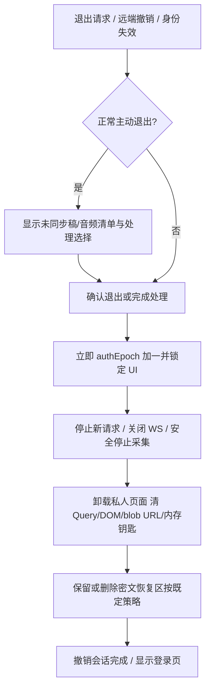

# PR-01 · 前端、Aurora 与客户端边界

版本：架构评审稿 1.0，2026-10-28。适用产品：Classroom OS Web Alpha 0.1.0；本文件是设计交付，不是 PR-09 实现或浏览器验收成绩。

依据：PRD v1.2 原件物理 p5–6、p13–23、p27、p29–32，以及 [需求矩阵](../REQUIREMENTS_MATRIX.md)、[冲突登记](../CONFLICTS.md)、[既有技术审计](../archive/2026-10-28-initial-analysis.md)。已阅读 37 页文字提取并查看 p21 概念图。图中的日程、任务总量、节省时间与聊天欢迎文案仅为视觉示意；不得据此新增智能课表、学习评分或通用聊天主页。

本文“冻结”指用户已原则批准的PR-01架构基线，后续获授权的实现应遵守；批准不关闭11项TBD中的实验/产品参数，也不授权PR-09实施，见[收尾记录](PR01-CLOSEOUT.md)。接口字段与事件名称以 [HTTP 契约](contracts/openapi.json)、[事件契约](contracts/events.schema.json) 为规范来源。

## 1. 技术选择与理由

| 选择 | 主要收益 | 主要代价 | 本版决定 |
|---|---|---|---|
| 继续原生 JS/HTML 并在旧页面上增加账号、路由 | 零构建迁移，局部复用快 | 当前单页全局状态与 DOM 操作已经交织；多账号清理、页面生命周期、可复用组件和 Terra 并行工作更容易相互污染 | 保留给本地 v1.3.0，不作为新 Web 壳 |
| React + TypeScript + Vite SPA | 组件/状态边界显式，契约类型可生成；静态构建部署简单；适合大量受保护交互页面 | 引入构建和依赖，需控制组件粒度与副作用 | **选用**；仅新增独立 Web 工作区 |
| Next.js / 服务端渲染 React | 路由与服务端渲染整合，公开页面首屏/SEO 工具成熟 | 本版主要是登录后工作台，采集/离线仍在浏览器；额外 Node 服务与 Python 后端会增加认证、部署和维护边界 | 本版不引入；未来出现公开内容分发需求再评估 |
| Vue + TypeScript + Vite | 同样可完成任务，生态成熟，状态与模板清晰 | 无现存 Vue 资产；与本次选定的 React 组件交付体系并存增加成本 | 可行备选，当前冻结一个栈以减少协作分叉 |

附属选择：React Router 管页面和 URL 状态；TanStack Query 管服务端读取缓存；Zustand 管少量跨路由运行时视图状态；React Hook Form 管登录、课程、设置等短表单。笔记编辑器、音频与持久草稿由独立领域控制器管理，不塞进表单库。组件样式采用 CSS custom properties + CSS Modules；用 Radix Primitives 提供 Dialog、Popover、Tabs 等无样式交互基础，Aurora 在外层封装。不引入整套重型视觉组件库、微前端、GraphQL、全局 Redux 或 CRDT 协同编辑。

用户指定分工：**Astra 负责总体架构、技术选型、接口契约和跨模块 review；Claude Code（Claude Desktop）主开发前端 PR-09a/09b/10a/10b；Codex 负责后端、数据库、ASR、AI、认证、基础设施和集成；Terra 为可选原型与风格探索协作者。** 前端可在冻结契约上独立使用 Mock 开发，详细入口见 [Claude 前端交接](09-CLAUDE-FRONTEND-HANDOFF.md)。本轮不因该分工而启动这些后续 PR。

这些选择不要求购买服务。PR-09a 建立 Web 自己的锁文件和可复现构建，记录当时兼容的具体版本、许可证与依赖扫描结果；不在架构文档中冒称已经安装或验证最新版本。新增库必须能对应实际能力，禁止为一两个按钮引入动画运行时。普通动效使用 CSS，暂不需要 GSAP/Framer Motion。

## 2. 前端模块图与依赖方向



依赖规则：`app → pages → features → domain/platform/api/ui`；`ui` 仅依赖 tokens、无样式 primitives 和纯类型；`domain` 不依赖 React、DOM 或网络；`platform` 不导入页面。跨 feature 通过公开用例/只读 selector 协作，禁止互相访问内部 store。后端状态机、权限和费用决定仍由服务端执行；前端校验用于提前反馈，不能成为唯一门禁。

AccountRuntime 内含一个当前账号作用域的采集控制器、事件连接、同步协调器、内存密钥句柄和请求 epoch。它挂在认证壳层，位于子路由之上。打开新课程、Review 或 Settings 不销毁录音；采集状态栏在全局保持。登出、账号切换、会话撤销触发安全 teardown；单纯主题、布局或页面切换不能触发 teardown。

## 3. 路由、数据加载和授权

以下为前端 URL，不能据其猜测 API。页面路径都不包含 `owner_id`；当前账号、会话和设备上下文由 `/auth/session` 的认证响应确定，资料与偏好再通过 `/me` 读取。公开页不下载私人资料；路由守卫只改善体验，服务端仍逐请求授权。

| 路由 | 页面职责与数据上下文 | 进入/离开约束 |
|---|---|---|
| `/login` | 邮箱密码，必要时转 MFA | 不因错误提示泄露账号是否存在；密码可粘贴 |
| `/register` | 邀请注册、待验证状态 | 邀请 token 只临时使用；首轮解析后从 URL 移除，不写分析日志 |
| `/verify-email`、`/password/forgot`、`/password/reset` | 单次邮件验证与恢复 | token 不进入持久状态；重置后重新登录 |
| `/auth/mfa` | 待认证会话的 TOTP/恢复码挑战 | 不获得完整账号数据；恢复码不持久缓存 |
| `/` | 登录后重定向 `/dashboard` | 未认证转 `/login`，不启动采集 |
| `/dashboard` | 继续学习、快速开始、最近课程、待处理、学习动态 | 同一确定性规则计算继续入口；无数据展示真实空态 |
| `/courses?semester=…&view=…&sort=…&q=…` | 学期筛选、课程卡片/列表 | 筛选进入 URL；不按同名课程合并 |
| `/semesters/:semesterId/edit` | 学期编辑 | 基础 revision 必须保留；冲突不丢输入 |
| `/courses/new`、`/courses/:courseId/edit` | 课程创建/编辑 | 名称和学期必填，其余按 PRD 可后补 |
| `/courses/:courseId/overview` | 课程概览 | 统计与继续入口来自实际记录 |
| `/courses/:courseId/classrooms` | 实际课堂列表、归档/改归属 | 移动课堂需服务端 CAS，历史来源不改写 |
| `/courses/:courseId/materials` | 大纲、词表 | 课程材料与课堂图片分开；不承诺 PDF/PPT/OCR |
| `/courses/:courseId/review` | 当前课程复习 | 过滤同一 Review 对象集合，不另建副本 |
| `/classrooms` | 课堂入口/选择 | 有活动采集优先返回；无活动才进入选择/准备 |
| `/classrooms/prepare?course=…` | 课程、标题、语言、设备、试音、网络、额度、用途告知 | 点击正式开始才获取/启动正式麦克风；试音独立 |
| `/classrooms/:classSessionId/live` | 课堂三/双/单栏与五流状态 | 可看其他课堂，但主动采集只能由已有 lease 绑定对象进行；不得把当前路由当上传目标 |
| `/classrooms/:classSessionId/processing` | 停采集后核对上传、转写、AI、同步 | 停止不会自动总结；未上传音频持续告警 |
| `/classrooms/:classSessionId/record` | 已结束课堂原文、图片、标记、问答 | 原音删除后保留文本时间位置；不可显示可播放 |
| `/classrooms/:classSessionId/review` | 单课复习入口 | 与全局/课程入口使用同一对象 ID |
| `/review?semester=…&course=…&classroom=…&type=…&status=…` | 任务优先 + 全部资料库 | 仅授权对象；保留筛选上下文 |
| `/review/items/:artifactId` | 正文、卡片、个人编辑、版本比较、来源侧栏 | `returnTo` 仅允许站内白名单路径；不得开放重定向 |
| `/settings/:section` | `profile/security/sessions/trust/appearance/ai/usage/storage/data/privacy/about` | 敏感修改要求再认证；学生不出现平台 Key 和供应商地址输入 |
| `/tasks`、`/notifications` | 持久任务、故障和完成通知 | 已读不等于解决；跳转再次授权 |
| `/search?q=…` | 正式文本关键词定位 | 不发 AI 请求；离线注明范围不完整 |
| `/feedback` | 版本、设备、复现步骤，用户选择片段 | 默认不附全部正文、密钥或整课音频 |
| `/admin/users`、`/admin/invites`、`/admin/usage`、`/admin/runtime` | 四个后台页面 | Admin + MFA；无私人正文/冒充功能 |
| `/*` | 404/无权限安全回退 | 不泄露他人资源名称；保留全局正在采集控制 |

列表使用 cursor 分页，不一次加载全账号原文。课程/Review 四标签用真实可链接路由；弹出来源侧栏可用 URL 参数记录选中引用，但不把正文、token 或完整提问放 URL。路由 chunk 按主要页面懒加载；采集控制与迷你状态条在认证壳首包，Review 数学渲染与编辑器按需加载。错误边界分壳层与页面，页面渲染故障不得直接结束麦克风；关键控制提供稳定的壳层回退 UI。

加载顺序：公共运行配置（仅公开能力和构建标识）→ 同源 Cookie 会话 `/auth/session` → 建立 account/device scope → `/me` 与页面资源 → 单独询问可信设备/本次录音恢复授权。登录产生的未信任设备 ID 只用于身份与租约绑定，不能推定已同意学习缓存。初次渲染不读取所有 IndexedDB 内容，不按本地残留 user ID 自动解锁。离线重新打开只能打开静态壳和登录联网提示；不冒充已认证离线登录。

## 4. 状态所有权与持久化规则

| 状态类型 | 唯一所有者 | 保存位置/规则 | 禁止做法 |
|---|---|---|---|
| 正式课程、课堂、转写 final、采用稿、任务、配额 | 服务端数据库 | Query 内存缓存只作投影；revision / ETag / event cursor 决定更新 | 组件修改缓存就显示云保存 |
| partial 字幕、音量、当前帧、网络背压 | CaptureController / EventClient | 内存；只保留有界窗口，刷新后可丢 | 持久为可引用正式文本、每帧引发全树渲染 |
| 采集 lease、classSessionId、epoch、fencing token | 服务端授权 + CaptureController 镜像 | 当前账号内存；恢复时重新核对服务端 | 浏览器自封唯一采集者、用 route current ID 补传 |
| 问答未发送输入、编辑中笔记 | DraftController | 可信设备写入加密 draft store；未信任仅当前页内存 | 持久化到 localStorage 或 Query 自动 persister |
| 同步操作 | SyncCoordinator | 独立加密 outbox，稳定 op_id / base_revision / body_hash | 连线恢复时自动发 AI/重转写操作 |
| 已确认学习缓存 | CacheVault | 独立 encrypted cache store；14 天/20 节/50MB 限制 | 与唯一草稿/录音共用 LRU 淘汰 |
| 待上传音频/图片 | RecoveryStore | 独立加密 recovery store；云 durable ACK 后清理 | 上传 HTTP 200 但未落数据库就删除唯一副本 |
| 筛选、当前 Tab、目标引用 | URL / route state | 可分享非敏感 URL；必要返回位置保留内存 | URL 中保存正文/密码/邀请 token |
| 主题、字号、非敏感布局 | UI preference controller | 账号偏好由服务端同步；设备布局可持久在独立非私密 preference store | 主题切换重建 AccountRuntime |
| 短表单输入/验证错误 | React Hook Form | 页面内存；提交失败保留输入 | Mutation 开始就清空，失败无法恢复 |
| 弹窗、展开、焦点、拖动状态 | 局部 React state | 组件内存 | 所有 UI 状态放全局 store |

Query key 固定首段 `['account', accountId, resourceKind, resourceId, …filters]`，对象 ID 与 scope 不从组件全局变量推导。切换账号即创建新 QueryClient 并清除旧实例；私人 query 禁止 `persistQueryClient`。WebSocket final 事件更新相应实体 revision 或 invalidate 精确 key；断流补查正式快照，不用历史 partial 重建正式结果。

初次同步或 `resync.required` 调用 `/sync/bootstrap`，原子替换已确认云目录/版本/采用指针投影，保留未同步草稿和录音池。按快照返回的精确 revision 获取需要的正文，再从同一快照 watermark 重放；不能先拉列表再取最新 cursor，也不能把迟到旧事件覆盖已经读到的较新版本。正文版本不可用、对象墓碑与超容量均依契约明确处理，不以截断投影冒充全量同步。

收费 mutation 的重试固定为关闭。普通元数据写入仅由 SyncCoordinator 以同一个 `op_id` 和同一 body 自动重试，先处理可识别的网络故障与收据核对；4xx 权限、删除、版本冲突不盲重试。Query GET 可有有界退避，但身份/权限失败立即停止。网络超时只能显示“确认中/结果未知”，不能转成“失败未收费”。

契约状态投影固定为：采集 `idle/recording/paused/local_only/failed/ended`；上传 `pending/uploading/durable/failed`；ASR `idle/streaming/catching_up/draining/succeeded/failed/unknown`；AI 任务 `queued/running/succeeded/failed/unknown/cancel_requested/cancelled`；同步 `synced/local_only/syncing/failed/conflict`。前端准备中、等待用户同意等交互状态与服务端任务状态分开；确认 generation plan 后才进入任务状态。状态组合显示中文文案，不以一个成功徽章遮蔽任一故障。

笔记保存快照记录 `local_serial`。收到某次保存回执时，只清理该 serial；用户已经继续输入时保留新稿并将 base_revision 更新到服务器确认值。发生冲突则保留云版本和本地版本，比较后另存/手工合并/明确采用云端；本版不采用静默最后写入胜出，也不需要多人实时 CRDT。

## 5. 生命周期与关键用例

### 5.1 采集不依赖路由



音频 Worklet 负责混声、连续重采样、音量测量；PCM16 量化、哈希、加密和网络调度不占用音频回调。基准传输格式为 16kHz、mono、PCM16LE；帧长度/持久合批大小由 ASR 协议与设备测试冻结。保持连续采样时间轴，不能照搬旧本地 VAD 的静音丢弃再把结果声称为完整连续云流。暂停不产生新有效音频样本，但记录墙钟跨度；resume 创建明确连续/新 epoch 映射，按契约执行。

同浏览器多标签使用 BroadcastChannel 传递无正文状态和账号撤销通知，Web Locks 可减少重复采集尝试；两者均只是优化，服务器 lease/fencing 才是权威。租约丢失立即停止发送旧流；已采集未确认分片保留在原 epoch，走独立恢复核对，不改成新租约数据。恢复网络不自动重发已送供应商而结果未知的音频。

浏览器关闭、刷新、系统休眠和移动锁屏不承诺持续录音/上传。`beforeunload` 仅尽力提醒；`visibilitychange` 用于记录风险和 UI 更新，不据此声称已成功保存。Service Worker 不负责后台开麦，也不把 Background Sync 当可靠录音任务执行器。强制停止或空间不足时保存已知范围与缺口，界面给停止、导出或恢复入口。

### 5.2 账号撤销与换号的安全顺序



所有异步响应提交 UI 前校验原 `authEpoch`、`accountId`、资源 ID；清理期间晚到回包不能把旧正文写回新页面。自愿退出可先处理唯一稿；被撤销时立即隔离，不能为了等草稿保存继续展示旧正文。服务器登出响应失败也保持本地锁定，并明确服务端会话撤销结果待核对；新账号不持有旧账号的恢复密钥。换号时中止未开始的网络操作，已提交收费任务由服务端账本继续核对，不能声明取消退款。

### 5.3 可信缓存与三存储池

CacheVault 是唯一允许访问私人 IndexedDB 的模块。所有私人记录含账号、设备、用途、对象、版本和密钥版本；加密 AAD 必须绑定这些身份，不接受将密文跨账号直接复制读取。具体密钥发放/重登/重置策略依安全架构及 PR-05a POC，未通过时持久私人缓存功能关闭，不用明文替代。

学习缓存每次读取先校验 TTL、撤销/删除标记及授权窗口；仅本地阅读不续 14 天 TTL。满足任一上限便淘汰已同步且过期/最久未访问课堂的资料。50MB 统一为 **50,000,000 bytes**；该初始软额度在实际设备上的效果，以及草稿、录音硬限仍属 TBD-06。UI 从版本化策略配置读取，不能分散硬编码。原音永不进入学习缓存；未默认下载的图片显示“此图片未在本设备缓存”。

三池分别显示字节数、课堂/操作数、最早风险、最后成功确认时间和清理影响。清理已同步学习缓存与删除未同步草稿/待传音频使用不同操作和警告；“清空缓存”不能顺带丢掉唯一副本。容量估计不足/浏览器清理/持久化许可拒绝都作为真实降级状态，不能以 `navigator.storage.persist()` 成功冒充永久可靠备份。

### 5.4 AI、总结与来源

问答从 30 秒/2 分钟/意群/课件选择形成服务端来源快照；确认页显示范围、图片、供应商、缺项、预计批次和额度。UI 向服务端发送准备/确认命令，不能在渲染、切页或网络重连 effect 中触发模型。自动解释默认为关；显式开启后仍按服务端额度受控，不能绕过互动次数。

结束课堂先进入处理页。用户可等待全部材料，或确认对明确的部分范围总结；部分范围标签随产物保存。首稿及后续稿均是候选，生成完成只触发“可查看候选”通知；必须通过明确 adoption 操作才变更当前采用版本。个人稿独立，源材料更新只提示变化，不自动替换历史依据。来源侧栏使用固定版本 ID；缺失、删除、损坏、离线缺图各自显示原因，不换成最新图片冒充旧依据。

### 5.5 搜索、通知、删除和导入

搜索在线覆盖当前账号的课程/课堂、正式转写、已同步个人笔记和卡片；按后端索引策略区分当前有效版本与历史。UI 默认不把未确认本地草稿加入云搜索，离线只检索已解锁当前账号缓存，并显示范围提示。任何查询不发 AI 请求。命中定位再次授权，404/墓碑时撤结果，不展示旧缓存正文。

通知展示真实任务/故障状态。普通完成去重，上传分片 ACK 不逐条 Toast；采集中断、保存失败、权限失效持续可见。已读只改已读字段，解决由实际事件确认。取消/未知任务操作采用专用确认组件，不复用普通“重试”按钮。删除课堂或课程弹窗展示关联范围；归档和删除分开，课程移走与级联选择由后端预检返回的合法选项驱动。

课堂包导入/导出由服务端任务执行，前端只上传、预览、确认和观察。导入不能执行包内 HTML/JS，不自动开麦或请求模型。ZIP 默认不带原音，勾选后显示有效性、体积和隐私影响；旧包恢复显示哪些内容保留/拒绝，不宣称双向实时同步。

### 5.6 静态壳升级、客户端格式与恢复

Service Worker 仅缓存 allowlist 中带内容 hash 的公开 JS/CSS/字体/图标与离线壳，不缓存带 Cookie 的 API、私人下载、媒体短链、邀请/密码重置页面或 WS 事件。导航 HTML 采用联网获取、失败退回已安装兼容壳；构建清单绑定 `build_id`、`api_contract_version`、`cache_schema_version`。缓存安装必须完整成功才作为新版本候选，失败保留旧壳；生产构建不依赖跨域 CDN 脚本。

新版本发现后只提示可更新，不在采集中 `skipWaiting`、自动 reload 或强迫重开数据库。等待采集停止且唯一待同步数据已安全持久化后由用户执行更新；存在未上传风险时明确列出。浏览器不能保证多标签协调顺利，更新前用 BroadcastChannel 通知其他标签并复查 runtime 状态，仍以各标签实际 ACK 为准。

IndexedDB schema 单调版本化，升级事务可回滚；先扩展 store/字段，旧版本客户端遇到不支持格式只读或暂停同步，不能覆盖未知字段。`versionchange` 时关闭连接并显示更新入口，`blocked` 不强制删库。密文解不开/校验失败时保留原记录与错误元数据，不能自动清空整个恢复区。恢复入口区分旧 schema、密钥不可用、服务端已删除和损坏，按各自策略处理，不把格式错误转成空白新课堂。

每次应用启动先核对服务端最低/最高客户端契约能力；兼容 API 的新增字段可忽略，但未知关键状态一律显示“版本需要更新/操作暂停”并禁止收费重试。需要强制升级时仍保留安全停止、风险清单和允许的唯一稿导出路径。客户端回退不执行破坏性降级迁移；不兼容时停写并前滚修复。

## 6. Aurora Design System 0.1

### 6.1 Tokens 层级与主题

采用 `primitive → semantic → component` 三层。页面只用 semantic 或 component token，不直接写品牌十六进制值。主题由 `[data-theme="day|night"]` 提供，不用 CSS `filter: invert`；系统模式监听 `prefers-color-scheme`，用户明确覆盖优先。低特效为独立偏好，不等于强制切换主题。

| semantic token | Aurora Day 初值 | Nebula Night 初值 | 使用边界 |
|---|---|---|---|
| `color.bg.canvas` | `#F6F8FE` | `#0B1121` | 页面背景 |
| `color.surface.readable` | `#FFFFFF` | `#162038` | 长正文、字幕、编辑器 |
| `color.surface.secondary` | `#EEF1FC` | `#25334D` | 次级分区 |
| `color.text.primary` | `#16233B` | `#EEF2FF` | 正文 |
| `color.text.secondary` | `#526079` | `#B7C3DC` | 辅助但仍必要的文字 |
| `color.action.primary` | `#4256D6` | `#ADB9FF` | 主操作实色背景 |
| `color.action.onPrimary` | `#FFFFFF` | `#10182B` | 主按钮文字 |
| `color.brand.cyan` | `#1686AD` | `#50C6DA` | 装饰/符合对比的图形；浅色值不用于普通小字 |
| `color.border.decorative` | `#DAE2F1` | `#35425C` | 装饰边界，不作为唯一控件识别边界 |

`color.status.success/warning/danger/recording/offline`、`color.border.control`、`color.focus.ring` 必须分别定义，不能全用品牌渐变。其最终值需在浅深、hover/pressed/focus/disabled、透明背景混合后通过 TBD-11 检查；架构冻结语义名和用途，具体色值为实验参数。每种状态同时有文字/图标，图标标签不依赖颜色。

| token 家族 | 初值/规则 |
|---|---|
| `space.*` | 4px 节律；8/12/16/24/32px 常用 |
| `radius.*` | small 8、control/card 12、hero 16、dialog 20–24px |
| `font.body` | 系统中英字体栈，16px/1.6；笔记 17–18px/1.7 |
| `font.captionSize` | 用户可调 16–24px；关键状态不用微小元数据字号 |
| `layout.readingMax` | 720–800px 初值，随字号和容器收缩 |
| `surface.glassL1` | 导航/浮动工具，背景 alpha 0.78–0.88，blur 16–24px |
| `surface.glassL2` | Dashboard/课程卡/弹层，alpha 0.85–0.94，blur 12–20px |
| `surface.readableL3` | 正文 alpha 0.96–1，blur 0–8px，优先实色 |
| `motion.control/hover/panel/complete` | 100–160 / 140–200 / 180–260 / 200–350ms 初值 |
| `z.nav/toolbar/popover/modal/critical` | 有序有限层级；停止录音和紧急状态不被常规浮层盖住 |

表面透明度只应用于背景层，不能 `opacity` 整个组件导致文字变淡。玻璃不层层叠加；品牌渐变只在欢迎/导航/AI 入口，不能穿过长正文。`backdrop-filter` 不可用、`forced-colors`、减少动效和手动低特效下回到实色边框；功能、焦点、故障不消失。

### 6.2 组件分层及所有权

| 层 | 组件 | 责任与禁止项 |
|---|---|---|
| 基础可访问 primitives | Button、IconButton、Input、Textarea、Checkbox、Select、Tabs、Dialog、Drawer、Popover、Tooltip、Menu、Toast | 标签/键盘/焦点/aria；无 API 和业务 store 导入 |
| 视觉布局 | AppShell、DesktopNav、MobileNav、PageHeader、GlassPanel、ReadableSurface、SplitPane、EmptyState、Skeleton、ErrorPanel | 容器/主题/响应式；不因 skeleton 伪造进度 |
| 真实状态 | StatusBadge、FiveFlowStatus、SaveIndicator、QuotaMeter、TaskStatusCard、PersistentAlert、OfflineScopeBanner | 接收规范状态和能力；不由组件猜是否安全/已保存 |
| 学习内容 | TranscriptSegment、TranscriptTimeline、EvidenceDrawer、SlideVersionPreview、QuestionComposer、ReviewReader、CardDeck、VersionCompare、DraftEditor | 纯展示/编辑事件；文本与来源分开，支持未知/删除/缺图 |
| 敏感动作 | SendConsentDialog、AdoptVersionDialog、RetryWithCostRiskDialog、DeleteImpactDialog、LogoutPendingDialog、TrustDeviceDialog | 展示服务端返回计划与范围，发明确用户 intent；不能自行生成服务端授权 token |
| 页面组合 | DashboardPage、CourseDetailPage、ClassroomPage、ProcessingPage、ReviewPage、SettingsPage、AdminPage | 组合 feature view model 和组件；不可直接访问 IndexedDB/供应商 API |

所有有交互的组件在 Storybook（或等价本地组件目录）中具备状态故事；该工具在 PR-09a 建立，本次不创建。关键组件 props 设计示例（接口示意，真实类型从 contracts 生成）如下：

```ts
type EntityRef = { id: string; revision: number };
type SaveState = 'synced' | 'local_only' | 'syncing' | 'failed' | 'conflict';
type ActionCapability = { allowed: boolean; reason?: string };

interface SaveIndicatorProps {
  state: SaveState;
  cloudRevision?: number;
  localDurable: boolean;
  errorLabel?: string;
  onResolve?: () => void;
}

interface CaptureToolbarProps {
  classSessionId: string;
  statusLabel: string;
  effectiveDurationMs: number;
  hasUnknownGap: boolean;
  commands: Record<'start' | 'pause' | 'resume' | 'stop', ActionCapability>;
  onCommand: (command: 'start' | 'pause' | 'resume' | 'stop') => void;
}

interface VersionCompareProps {
  base: EntityRef;
  localText: string;
  cloud: EntityRef & { text: string };
  onKeepLocalAsCopy: () => void;
  onMerge: (text: string, cloudRevision: number) => void;
  onUseCloud: () => void;
}

interface EvidenceDrawerProps {
  snapshotId: string;
  availability: 'available' | 'offline_missing' | 'deleted' | 'corrupt';
  sourceVersion: string;
  timePrecision: 'provider' | 'capture_chunk' | 'unknown';
  audioPlayable: boolean;
  onNavigateSource: () => void;
}
```

`commands` 来自用例控制器依据当前服务端能力和本地安全状态的交集；即使按钮因旧投影仍可点，服务端必须再次校验。`localDurable=false` 时不能仅显示“仅本设备保存”，应明确“尚未安全保存，仅当前页面”，并提供处理入口。五流面板接收五个独立模型，不提供一个 `isComplete` 替代它们。

### 6.3 响应式、阅读和可访问性

外壳断点使用视口初值 1200/768px。Classroom 使用扣除导航与内边距后的容器宽度：≥1160px 尝试三栏，720–1159px 双栏，<720px 单栏；三栏必须同时满足原文 440、解释 280、问答 320px 和分隔/间距，不够即降栏。44/25/31% 是布局初值，不是小屏强制比例。拖动采用可键盘操作 separator，另设重置、折叠、恢复按钮；设备布局偏好与正文数据分开。

桌面导航为 Dashboard/Courses/Classroom/Review/Settings 五入口；移动底部为前四项，设置从头像进入。全局课堂入口回到活动采集；手机单栏保留原文/解释/问答 tabs，不把三栏缩成窄列。工具栏采用安全区和软键盘避让；停止按钮、发送、来源和冲突解决在缩放、触屏、键盘下均可达。

TranscriptTimeline 维护用户滚动锚点；用户回看后停止自动跟随，迟到 final 插回原时间而不拉动视口。长课堂分页/有界窗口渲染；虚拟化只在保留键盘、阅读器可达和搜索定位后启用，不以性能为由隐藏历史内容。partial 高频更新不设 assertive live region；用户可浏览正式段落，重要故障单独适当播报。公式局部滚动，长词可折行，不产生整页水平溢出。

Markdown 默认禁原始 HTML，链接仅允许安全协议；远程图片不由正文任意加载，引用媒体必须经授权资源接口。数学渲染沿用 KaTeX `trust:false`、表达式长度/展开上限和失败回退原文的原则；新 Web 将其作为纯 renderer 审查后移植，不直接执行旧全局 DOM 插件。图片 alt 与来源标签明确，内容错误反馈不默认附带全课。

验收目标为 WCAG 2.2 AA：普通字 4.5:1、大字及适用控件 3:1；200% 字体和 320 CSS px 等效重排；焦点可见不被工具栏遮挡；表单错误与字段关联；模态焦点返回触发点；关键状态非仅颜色。触控优先约 44px，AA 的 24×24 CSS px 带例外规则单独检查，不将二者等同。尚未实施或审计，不能写“已全面符合”。

## 7. 未来目录与前端协作契约

以下是后续实现的目标结构，本 PR 不创建这些业务目录。使用一个前端 package，避免 10–30 人阶段过早拆成多包 monorepo；需要真正跨客户端复用时再抽包。

```text
web/frontend/
  package.json                 # 独立 Web 依赖与版本
  pnpm-lock.yaml
  src/
    app/                       # router/providers/auth lifecycle/error boundaries
    pages/                     # 各主要页面，路由组合
    features/
      auth/ courses/ classroom/ review/ settings/ operations/
      search/ notifications/ imports-exports/
    domain/                    # 纯 types/reducers/selectors/guards，不依赖 React
    api/
      generated/               # 从 OpenAPI/事件 schema 生成，不手改
      client.ts                # Cookie/CSRF/错误映射/authEpoch
      query-keys.ts
    runtime/
      account-runtime.ts
      capture-controller.ts
      sync-coordinator.ts
      event-client.ts
      upload-coordinator.ts
    platform/
      ports.ts                 # 浏览器/未来 native 可替换的边界
      browser/audio/           # Worklet、设备、权限、PCM
      browser/storage/         # IndexedDB、加密、三池生命周期
      browser/notifications/   # 仅站内/跨标签，不默认系统推送
    ui/
      tokens/ primitives/ patterns/ content/
    fixtures/                  # 合成、无真实课堂的契约响应/事件
    styles/
  public/                      # 仅公开静态内容，无私人上传
  tests/                       # unit / component / contract / browser
  .storybook/                  # Aurora 全状态目录（后续 PR 建立）
web/contracts/                 # 后续落地生成入口；本 PR 规范在 docs 下
```

Claude Code、Astra、Codex 与 Terra 的协作边界：

1. 输入包为本架构、规范 contracts、完整状态 fixtures、设计 tokens 和页面 view-model 类型。每次 UI 任务指定需求 ID、允许修改目录、组件入口、状态清单和截图尺寸；真实用户数据不进入 fixture。
2. Claude Code 主开发 `web/frontend/` 的组件、页面、前端用例/投影、Mock adapters 和浏览器测试，按 PR-09a/09b/10a/10b 分批交付。Astra 拥有架构、选型、接口契约和跨模块审查；Codex 主责服务端领域逻辑、真实采集/存储/模型适配与系统集成，前端对应 ports 由双方联调。Terra 只在明确委派时探索视觉原型、配色和布局，产物由 Claude 整理入组件，不承担默认前端主线。
3. 页面接入 `viewModel + command callbacks`。UI 不直接 import `fetch`、IndexedDB、供应商 SDK、CryptoKey 或数据库类型；只在 feature controller 接通 typed client/ports。这样布局重构不改变收费与保存语义。
4. 契约版本和 fixture 版本必须一致。并行开发可用 MSW 或纯 adapter 提供已校验合成响应，包括延迟/错误/unknown/冲突/删除；假的成功数据必须显式标注为开发 fixture，不能进入生产空态。
5. Claude 可自行决定不改变结构/语义的组件拆分、CSS 和布局细节；改变 DTO、状态转换、隐私/费用确认、租约和保存语义须由 Astra 评审并与 Codex 同步契约，不能为“按钮可点”伪造成功结果。UI PR 附双主题 × 关键状态、键盘路径、320px/200% 和真实焦点说明；集成 PR 再跑真实鉴权/任务/浏览器检查。组件预览通过不代替业务 E2E 或真实录音验证。

## 8. 与现有源码的复用映射

| 已阅读源码 | 可复用内容 | Web 必须重新建立的边界 |
|---|---|---|
| `static/pcm-worklet.js` | 连续 44.1/48k→16k 重采样、混声、flush、零输出避免回声的算法与测试 | 原路径/注册方式可调整；增加协议/采样时间映射；不把 Float32 帧当 PCM16 二进制直接发送 |
| `static/app.js` | `AudioSegmenter`、尾帧、试音、回看保护、范围选择、课件确认等经验 | `state.session` 和 localStorage 序号不能作为多账号/多设备权威；连续云流不直接复用旧 12 秒 VAD 分段协议 |
| `static/study-cache.js` | 事务化请求记录、同键异体比较、内存降级提示、配额不删旧副本的思路 | 原明文 Blob/文本与 session-only key 不适用于 Web；账户/用途/加密/三池/删除全部重新封装 |
| `static/review.js` | per-tab draft、防晚到回包串课、base revision、保留新输入、unknown 核对与显式采用 UI | localStorage 明文稿/请求不得直接沿用；账号 epoch 与持久任务契约不同；Web 首稿服务端也不能自动采用 |
| `static/review-render.js` | 受限 Markdown、KaTeX 安全参数、失败保留原文、时间未知展示 | 抽成纯 renderer，经 Web XSS/可访问性检查后使用；不直接共享全局 `innerHTML` 生命周期 |
| `static/index.html` / `static/styles.css` | 本地结构与样式作为历史交互参照 | 不修改、不把 Web CSS 覆盖旧样式；Aurora 独立实现 |

纯算法的实际抽取必须在相应后续 PR 中运行原完整 Python 与九套 Node 加新增 Web 回归。本 PR 只记录边界，未改旧模块；既有测试成绩仍属于 PR-00/历史成绩。

## 9. Windows、macOS、iOS、Android 的扩展端口

Web 之外的客户端本版不实现。保留以下端口即可，不为未来百万用户建设通用插件系统：

| 端口 | Web 实现 | 未来客户端替换 | 共享不变量 |
|---|---|---|---|
| `AudioCapturePort` | getUserMedia + AudioWorklet | Windows/macOS 原生音频、iOS/Android 系统采集 | 输出 codec/sample rate/offset/epoch/interrupt 事件；不能伪报持续录音 |
| `SecureVaultPort` | 内存 CryptoKey + 加密 IndexedDB | OS Keychain/Keystore/加密本地库 | 账号/用途隔离、撤销/清理、未同步唯一副本保护 |
| `UploadTransportPort` | HTTP/WSS + 前台调度 | 原生后台上传能力 | durable ACK、hash、fencing、unknown 不自动收费重放 |
| `ConnectivityPort` | 浏览器网络提示 + 实际请求结果 | 原生网络状态 | “online”提示不等于服务可达 |
| `AuthSessionPort` | 同源 HttpOnly Cookie + CSRF | 后续经 ADR 的 native 授权流程、安全 token 存储 | 服务端可撤销、设备 scope、MFA、owner 过滤 |
| `FileExportPort` | 浏览器下载/显式用户保存 | 原生文件/分享入口 | 仅本人数据、有效期、删除边界明确 |

可共用 HTTP/事件 schema、纯状态机、数据转换和需求 fixtures；React DOM/CSS 不能直接承诺在 React Native 共用。Windows/macOS 包装壳的 Tauri/Electron 选择以及 iOS/Android 技术栈均需未来单独 ADR；本次不引入其依赖或后台录音权限。老 Windows v1.3.0 仍为独立本地产品线，不因未来端口存在变成云客户端。

## 10. 冻结项、实验项和可判定验收

| 类别 | 本次确定 | 仍需证据 |
|---|---|---|
| 前端结构 | React/TS/Vite SPA、独立 Web 工作区、六页面域、runtime 跨路由、领域/展示/平台分层 | 具体依赖锁版本、首包/长时资源及支持浏览器：TBD-09 |
| 状态语义 | 服务端权威、五流独立、费用不自动重试、首稿候选、账号 epoch、三缓存池 | 浏览器恢复写入吞吐、离线授权窗口、密钥安全：TBD-03/06 |
| Aurora | token 层级、双主题、稳定阅读层、状态组件与 Terra 分工 | 最终语义色、透明混合对比、blur/动画参数、低端性能：TBD-11 |
| 响应式 | 外壳/课堂断点作用域分离、最小可读宽度优先、核心操作不消失 | 数值微调、软键盘/缩放/读屏/真机结果：TBD-09/11 |
| 扩展 | API/schema 与纯控制器可复用，native ports 隔离 | 原生技术栈/后台行为/平台权限，均不属于 Alpha |

后续验收场景不是本 PR 已通过的测试：

| 编号 | 输入/故障 | 必须观察到的结果 | 首要 PR |
|---|---|---|---|
| FE-01 | 录音中依次进入 Courses、Review、Settings 并切主题 | 同一 lease/epoch、采集持续、迷你停止入口可见、无新收费任务 | 05b/09a/10a |
| FE-02 | A 账号请求未返回时撤销并登录 B | 旧响应不能提交 B 的 Query/DOM；内存钥匙/blob URL/旧 WS 清理 | 03b/08a |
| FE-03 | 编辑后保存中继续输入，再收到旧回执 | 新输入仍在，只有已确认 serial 清理；不显示整段已同步 | 08b |
| FE-04 | 两设备相同 base revision 修改同笔记 | 其中冲突可比较、双方内容保留，无静默覆盖 | 08b/10b |
| FE-05 | 原音上传 ACK/ASR final/AI 完成乱序到达 | 五流独立，只有 durable ACK 移除相应本地分片 | 05b/06b/10a |
| FE-06 | 超时后重新打开 unknown AI 操作 | 先核对，明确重复费用风险才允许新尝试 | 07a/07b |
| FE-07 | 清空学习缓存，存在未同步稿和待传音频 | 只清学习池，另外两池与风险入口保留 | 08a |
| FE-08 | 撤销信任/退出/离线重开 | 无旧正文和钥匙；须联网重新认证解锁，限制清楚 | 05a/08a |
| FE-09 | 课堂结束但资料缺失，用户生成部分总结 | 显示缺失范围；候选不自动采用；没有伪完整标签 | 07b/10a |
| FE-10 | 原图被移除/旋转或原音到期 | 历史依据不替换；删除/损坏/缺图与时间精度明确 | 04b/10b |
| FE-11 | 320px、200%、长公式、移动键盘、读屏与减动效 | 核心控制可达、无整页横溢出、无高频字幕抢读、焦点不丢 | 09a/10/12b |
| FE-12 | 无数据 Dashboard、离线搜索、已删除搜索命中 | 无假数字/排程；范围真实；墓碑清结果且不泄露旧正文 | 09b/11c |
| FE-13 | Admin 页面被 Student 直接打开/篡改 URL | UI 与 API 均拒绝；没有他人正文预取 | 03b/11b |
| FE-14 | 一次 90–120 分钟合成长流 | 内存/事件窗口有界、音频尾帧和滚动锚点正确；报告实际设备资源 | 05b/06b/12b |

PR-01 完成的是上述结构、路由、状态所有权、组件与扩展契约。后续实现必须逐项给出真实命令、环境和结果；本文件不把静态设计审查当作浏览器、音频、安全 POC 或无障碍合规证明。
