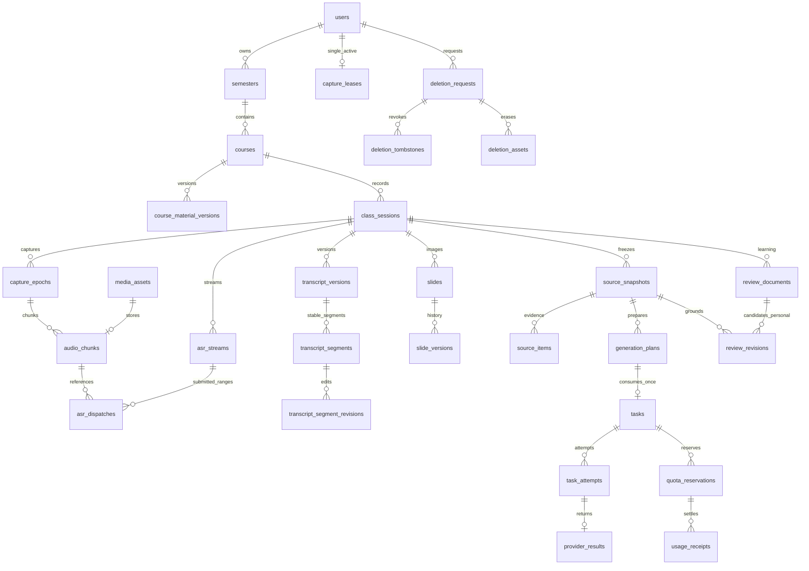

# PR-01 · PostgreSQL、后端领域与持久任务

整体架构及ADR选定结构/技术栈已获原则批准，11项TBD继续开放，见[收尾记录](PR01-CLOSEOUT.md)；没有创建数据库或执行迁移。字段级权威为 [domain-model.json](contracts/domain-model.json)，含全部表的列类型、可空性、主键、唯一键、外键、索引、CHECK、RLS和跨行事务不变量。JSON是逻辑设计规格，不冒充可直接执行DDL；PR-02需据此生成Alembic迁移并在真实PG验证。

## 1. 数据规范与领域职责

PostgreSQL17、SQLAlchemy2、Alembic、Python3.12为选定目标。稳定ID用UUIDv4，由服务端生成；客户端op_id也为UUID但不能指定owner。UTC timestamptz保存时间，Asia/Shanghai划分配额日/月；采样位置bigint半开区间`[start_sample,end_sample)`，与墙钟/显示毫秒分开。金额micro-CNY bigint，对外十进制字符串；容量bytes。可变对象有revision≥1、updated_at、deleted_at；内容版本不可变，删除可清正文但保必要墓碑。

所有私有表均有owner_id，`UNIQUE(owner_id,id)`，领域父子关系使用 `(owner_id,parent_id)`→父表`(owner_id,id)`。控制平面如users/invitations/feature_controls/platform_budgets不通过通用owner API暴露，仅专用repository访问。Admin不会因角色跳过私人表owner判断。

表多是对PRD所需身份、历史、任务、计量、安全关系做规范化，**不是按表建立服务或一次建完全部表**。按02–11的所属PR渐进迁移，单库、少量模块/进程，无预设组织、多租户计费客户、向量数据、课表排程和协同编辑实体。

## 2. 实体关系



图中关系均隐含owner复合键，不把图省略owner误解为只有单列FK。来源项引用固定segment_revision或slide_version，二选一；current/adopted指针属于同一对象/课堂，除owner FK外还需同血缘约束。

## 3. 领域表组与字段语义

| 表组 | 主要表 | 关键数据与边界 |
|---|---|---|
| 身份 | users、pending_registrations、invitations、email_actions、auth_sessions、mfa_* | 注册等待验证存pending_registrations，不提前创建可访问课程的激活用户；验证/邀请/名额事务；session的security_epoch与user一致 |
| 设备/授权 | devices、cache_keys、consent_records | 登录设备默认未信任；trust只授权学习缓存；录音授权独立；DEK封装、目的/课堂/key_version分区 |
| 课程 | semesters、courses、course_material_versions | 同名可存在；课程创建同时建空材料v1，current_material指向自己；改归属不改历史material版本 |
| 采集 | class_sessions、capture_leases、capture_epochs、capture_gaps | 每owner一行lease、fence递增；epoch独立采样时钟，gap类型含pause/known_missing/unknown/overlap；scheduled_class_ref在Alpha必须null |
| 媒体 | media_assets、audio_chunks、slides、slide_versions | 对象key服务端生成；每版本hash/字节数/状态/期限；chunk唯一epoch+seq；原图移除不等于彻底删除 |
| 转写 | asr_streams、asr_dispatches、transcript_versions、transcript_segments、transcript_segment_revisions | durable提交区间、provider request/segment/revision、时间来源；实时/重写/导入版本分开，personal不覆盖machine |
| 来源/生成 | source_snapshots、source_items、generation_plans、questions、review_runs、review_batches | 固定输入范围与缺口、模型/价格/prompt/schema；plan锁+唯一consume防换op重复执行；批次单独attempt |
| 学习版本 | review_documents、review_revisions、marks | ai_candidate/personal两类不可变版本；adopted指针可空；理解状态手动；来源损坏不换当前版本 |
| 同步/操作 | operation_receipts、sync_conflicts | 操作指纹、最小响应/引用；双方分支保留；secret签发不缓存完整响应，墓碑优先 |
| 执行/事件 | tasks、task_attempts、provider_results、owner_event_counters、outbox_events | lease/fence、发送intent、raw/valid结果、每owner有序事件；临时字幕不写持久事件 |
| 计量 | quota_periods、platform_budgets、quota_reservations、reservation_allocations、usage_receipts、quota_adjustments、price_catalog | 日/月多配额行，money hold与产品次数分开，累计usage差额；价格版本，不用浮点金额 |
| 生命周期 | deletion_requests、deletion_tombstones、deletion_assets、transfer_jobs、import_id_maps | 原音/课堂/账号不同删除范围；物理清单含历史临时对象；导入来源ID映射到新ID |
| 运营 | feature_controls、notifications、feedback_reports、audit_events | 控制开关/人数cap专用锁；通知读/解决分开；反馈有consent；审计禁止正文和secret |

认证短授权另用 `auth_challenges`：preauth、login_mfa、reauth、ws_ticket、media_ticket、deletion_preview，token只存hash，scope严格限定对象/版本/用途，非preauth必须有owner/当前security_epoch；单次消费事务锁。公开认证幂等用短期 `preauth_receipts`（preauth scope+operation+op），只存HMAC指纹、最小结果码/引用；不能把密码明文或可离线猜测的普通密码摘要当幂等hash。敏感结果不从receipt回放。

### DTO映射与持久字段

数据库不直接返回ORM。以下转换由唯一mapper负责并有契约测试：

| 数据库存储 | API投影 | 规则 |
|---|---|---|
| users.security_epoch / erasing / erased | 前端authEpoch语义 / deleting / 不再返回User DTO | epoch只由服务器增加；erased主体只留最小墓碑，查询404/410，不把erasing当已物理删 |
| invitations.open | issued | 仍核expires_at，终态单独映射；revision/updated_at持久 |
| semesters.start_date/end_date | starts_on/ends_on | 可空，两个有值才校验先后 |
| course_material_versions | CourseMaterial聚合 | syllabus+glossary+language同一不可变版本；没材料仍空v1，UI分编辑不生成两套ID |
| asr_streams状态+mode | ASR投影 | not_submitted→idle，completed→succeeded，result_unknown→unknown；streaming+catch_up→catching_up |
| review_documents.kind、review_revisions | ReviewDocument.kind/card_type/revision | 卡片类型在内容schema保留；ai_candidate/personal与采用指针分开 |
| questions/marks/review_documents.understanding | understood boolean | 只有用户命令能改；AI返回不自动设true |
| deletion_requests.pending/failed/complete | pending_delete/delete_failed/deleted | access_revoked单独状态；202不是deleted |
| 不可变版本created_at和revision | updated_at=created_at，revision来自版本序号 | 未设序号的只读快照可固定revision=1；可变实体必须真实递增，不能伪造CAS |

marks保存note以及精确segment_revision/slide_version/review_revision+hash，或capture_epoch+sample_offset时间点（二选一），支持尚无正式字幕时的重点/没懂按钮。transcript_segments额外保存class-relative start_ms/end_ms，可与epoch/sample同时存在；导入保原位置、无法确定为null+timestamp_source=unknown，不填0伪造精度。媒体first_cloud_received_at在空staging可null；staging清理用created_at，收到第一字节才记接收时间。

### 约束不能只靠API前置检查

- 同owner但不同课堂的segment/slide/review不能交叉绑定。复合FK保证owner，延迟约束trigger或显式锁住父对象的事务断言保证同class/document；关键永久血缘推荐DB constraint trigger，测试覆盖绕过API直接SQL写。
- `current_material_version_id`、`adopted_revision_id`形成指针环，FK可 `DEFERRABLE INITIALLY DEFERRED`；提交前必须存在且归同对象。nullable复合关系用MATCH SIMPLE（owner非空、parent可空），另用CHECK限定允许空的语义。
- 删除不用大范围ON DELETE CASCADE自动抹账本；先撤访问，再按显式子对象清单清理。保留owner的最小opaque user shell到批准的墓碑/计量保留结束，不保邮箱/密码/原始正文。
- JSONB都对应版本化结构，限定字节/数组/深度；不能用于无限任意属性存储。生成plan、provider输出、同步分支都有各自schema和大小门禁。
- 所有资源索引前缀owner；主要列表索引owner+parent+时间/ID，worker索引state+not_before+priority，删除索引state+期限。索引不是自动授权。中文关键词采用同owner过滤的trigram/子串，先普通索引再按真实查询计划优化。

## 4. 事务边界与隔离

短业务事务默认READ COMMITTED +目标行锁/CAS；邀请名额、预算、采集lease使用显式行锁串行化竞争。同步bootstrap用REPEATABLE READ一次快照。不能把网络/provider/object I/O放进长数据库事务。

| 事务 | 同一提交包含 | 外部I/O边界 |
|---|---|---|
| 激活 | 锁人数控制行/邀请/pending，重核期限与邮箱，user+invite消费+审计+事件 | 邮件由独立outbox，失败不回滚已激活事实 |
| 草稿保存 | owner/墓碑/CAS、不可变revision、document版本、op收据、owner事件 | 无模型调用 |
| 生成execute | plan行锁/consume、额度hold、task、op收据、outbox | 提交后worker才允许发送 |
| 分片确认 | 验对象hash/存在后，chunk/asset committed、op收据、事件 | 对象先staging持久；失败有协调器，不伪跨系统事务 |
| 采用 | 同document候选/个人revision，base_revision CAS，采用指针、事件 | 不修改AI原稿或重生成 |
| 删除接受 | 独立日志先持久接受；DB墓碑/撤权/删除任务/清单/收据/事件 | 物理对象异步删，日志失败返回503未持久接受 |
| usage结算 | 锁budget/配额/reservation，唯一usage receipt，增量金额与释放hold | 账单拉取在事务外，重复核对不能重复扣 |

统一锁序：必要的global control/budget→owner quota（按resource/period排序）→所属资源/plan→任务/attempt→owner event counter。删除先锁账户/对象访问状态，与dispatch短事务使用相同顺序；不持锁等待provider结果。死锁/序列化失败只可重试**数据库事务本身**，不能重执行已发生外部收费。

RLS示意（设计，不是本PR运行命令）：

```sql
BEGIN;
SELECT set_config('app.owner_id', :authenticated_user_id, true);
UPDATE review_documents
SET revision = revision + 1, adopted_revision_id = :revision_id
WHERE owner_id = :authenticated_user_id AND id = :document_id
  AND revision = :base_revision AND deleted_at IS NULL;
-- 要求恰好一行；同事务写receipt和outbox，再COMMIT。
```

运行数据库角色非superuser、非BYPASSRLS、非表owner，启用FORCE RLS。pool归还不依赖手工RESET作为唯一隔离，`SET LOCAL`随事务结束清除；空owner fail closed。migration角色和worker领取角色单独授权。worker领取只读任务队列调度元数据，执行时使用task.owner设置受限事务，不能将后台角色视为可读所有正文。

未知owner的Cookie引导使用只授auth角色EXECUTE的固定SQL函数：按token_hash检索auth_sessions，只返回owner/session/security_epoch/expiry/device等最小元数据。scheduler的SKIP LOCKED领取函数只返回task ID/owner/kind/lease，不返回input_ref/正文。函数固定search_path、无动态SQL、撤销PUBLIC执行；definer使用只对这些表生效的窄RLS策略，不赋通用BYPASSRLS，且不能由普通API调用者选择owner。取得主体后正文查询仍走普通SET LOCAL事务。CSRF值可由当前不透明会话token与服务端secret做HMAC派生，数据库保校验值；不因只存hash而另加泄露明文的查询接口。

## 5. 持久任务、attempt和故障窗口

Task表示用户意图/批次工作，Attempt表示一次实际provider提交尝试。Task状态 `queued/running/succeeded/failed/unknown/cancel_requested/cancelled`；Attempt状态 `planned/submitting/accepted/succeeded/failed/unknown/cancel_requested/cancelled`。UI五流投影映射见04；不能直接把Task running当“正在录音”。

领取SQL示意：在短事务中`SELECT ... WHERE state='queued' AND not_before<=now() FOR UPDATE SKIP LOCKED LIMIT n`，写leased_by/lease_expires_at/lease_token+1并提交。每个heartbeat和结果发布均比较lease_token；旧worker晚回包先保存可幂等核对的provider result，不越权发布新版本。provider result唯一attempt，usage唯一provider_usage_key+metric_revision；若provider重复返回不同正文，保存冲突诊断并核对，不覆盖已确认来源。

| 崩溃点 | 可恢复动作 | 禁止 |
|---|---|---|
| queued尚未领取 | 重新领取 | 无 |
| claimed但attempt仍planned且无发送intent | lease过期后重新安排未发送步骤 | 仅凭内存标识判断未发 |
| submitting已提交、实际发送前后 | 保守unknown，查询provider/账单/迟到结果 | 自动当未发重试 |
| provider结果已落DB、校验前 | 本地重做纯校验/发布 | 再请求模型“修复” |
| 结果已确认、outbox未推送 | 游标重放相同事件 | 创建重复卡片/重复扣费 |
| 删除/禁用发生在发送中 | 停新发送，收usage，禁止被删正文重新发布 | 承诺已取消/已退款 |

SDK自动重试必须关闭或只限确认未发送的连接建立阶段；不能让库绕过attempt。未知新尝试需独立确认重复费风险、新attempt+新hold，保留前attempt unknown。确认有收费的错误也不能自动释放全部预留。

## 6. 实时和事件一致性

每owner使用 `owner_event_counters`一行；业务变更事务锁该行分配 `next_sequence`并一直持锁到commit。因此较大序号不可能先于更小序号提交。**禁止用global BIGSERIAL + MAX(seq)充当可完整重放游标**，否则低序号晚提交会被客户端永久跳过。

bootstrap在同一REPEATABLE READ快照读取轻量元数据投影和`next_sequence-1`水位；正文按确定revision获取，查询缺失/过大显式失败。事件cursor绑定owner，保留窗口外返回resync_required，客户端先保outbox再重取快照。outbox只存最小引用/状态，final文本发送时读取不可变revision并重新授权；删后回放不复活正文。LISTEN/NOTIFY仅提示，PG轮询和游标能补丢失通知。

音频PCM帧100ms初值，聚合约1s持久chunk，DB与对象确认后发ASR。发送前持久asr_dispatch区间intent，旧lease fence拒绝新live帧；旧epoch补传需独立recovery授权，仅存数据不自动重新识别。记录采样位置/现实时间/未知gap，休眠不当有效采集。上游重连新stream；已送未知区间不会被普通reconnect当未发送处理。

## 7. 迁移、包兼容与版本

Alembic独立置 `web/backend/migrations`，revision名如`0001_identity_catalog`仅命名例，实际按所属PR加入。PR-02a先关系/CAS/墓碑与迁移骨架；02b执行表；03身份；04媒体删除；05/06采集转写；07版本学习；08同步/包；11计量与运营按前置顺序完成。不能为了生成模型全貌在PR-01执行migration或一次上线全部表。

每个变更给出空库升级、前一schema升级、重复迁移、失败回滚、旧代码兼容窗口、owner负例；回填分批有进度/断点、可重复，不能锁全库做长I/O。回退代码不降schema，不删收费/删除账本。收缩字段需要单独后续批准PR。

旧包`PACKAGE_SCHEMA=1`作为输入兼容，导入创建新UUID，原owner/session/segment/image ID保存为provenance和import_id_maps；引用重映射后重新算规范hash，保留original_hash，不把新hash冒充原始hash。禁止导入凭据、发送consent、活跃队列；不执行包内HTML/JS。原2GiB/10000文件上限不是Web承诺。采用旧schema的source别名S/P仅在本快照内映射到正式UUID，不作为全局ID。

## 8. 后续可判定验收

DB-01：跨owner FK和RLS直接SQL拒绝；DB-02：同owner跨课堂来源/采用拒绝；DB-03：同名课独立且移动不改历史；DB-04：双CAS只一个成功并保冲突稿；DB-05：同op异体409；DB-06：同plan不同op只一task；DB-07：预算/邀请并发不超额；DB-08：worker重复领取/旧fence晚到不能发布；DB-09：submitting崩溃保unknown；DB-10：结果已落库只重校验；DB-11：对象成功PG失败不能durable；DB-12：低seq晚commit反例不可发生；DB-13：恢复先墓碑、敏感secret不进receipt；DB-14：migration空库/升级/失败/兼容。

这些是PR02及相应实施PR的真实PG门禁，本PR只静态校验模型引用/类型/键以及合成接口，不用内存字典冒充事务测试。
