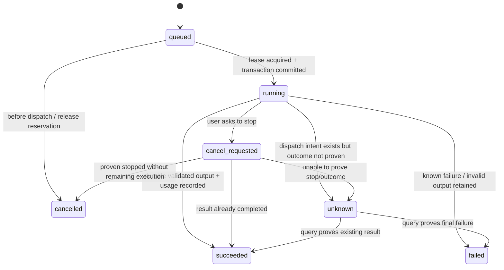
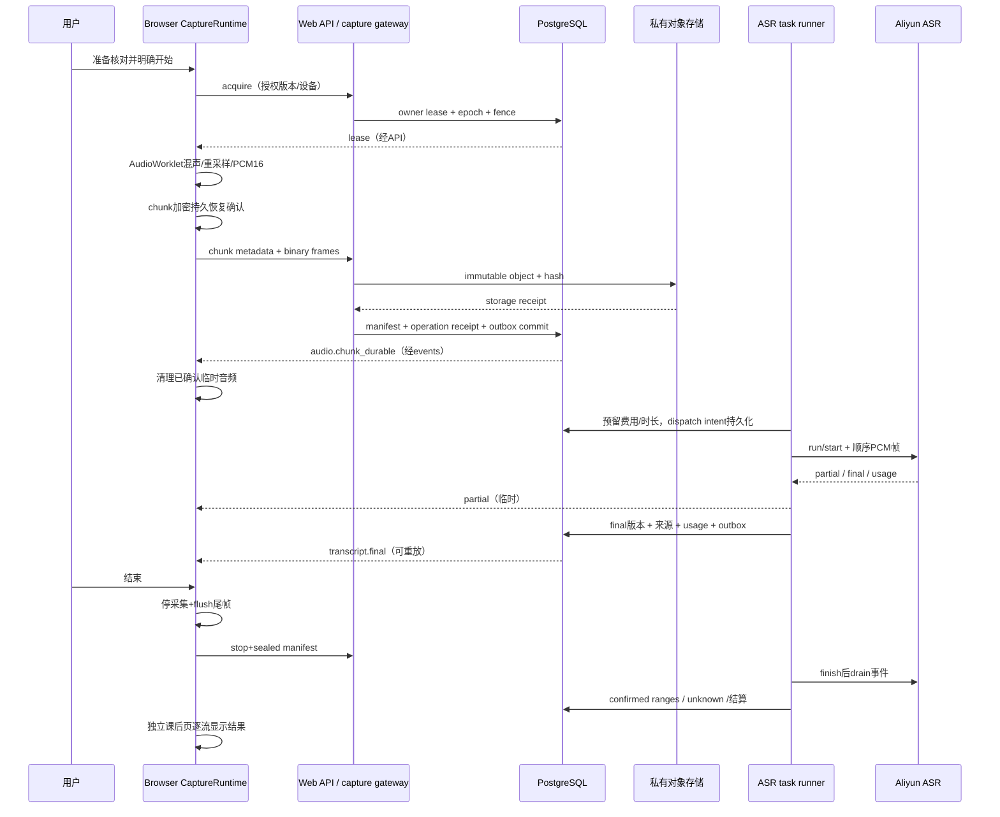
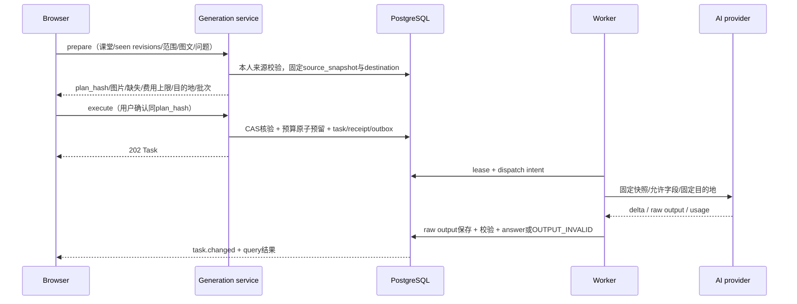
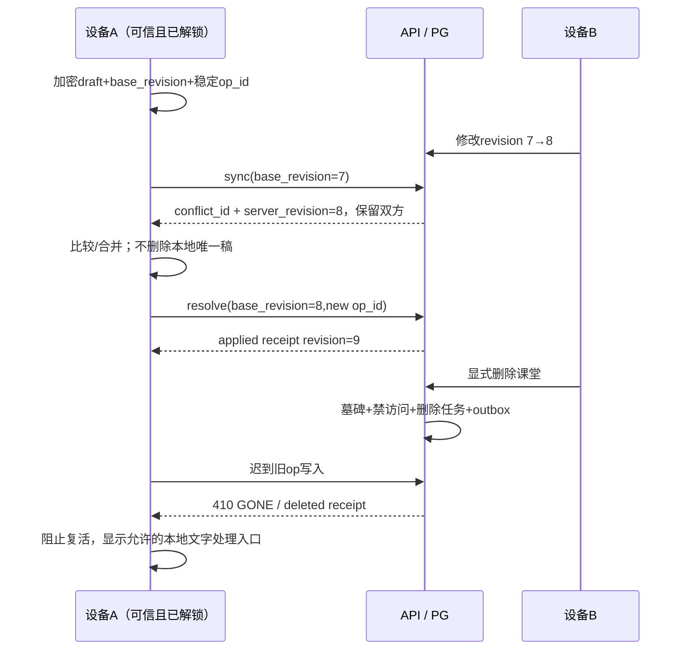

# PR-01 · HTTP、WebSocket、状态机与端到端数据流

版本：契约 0.1.0，2026-10-28。状态：PR-01 设计定稿，等待产品负责人审核；本文件规定后续实现行为，不代表服务已经运行。需求基准为 PRD v1.2 的物理 p7–19、p24–30、增补 A1–A10，冲突按 [CONFLICTS](../CONFLICTS.md) 处理。

## 1. 契约边界与命名

机器入口：[OpenAPI 3.1](contracts/openapi.json)、[事件 JSON Schema](contracts/events.schema.json)、[合成正反例](contracts/examples.json)、[领域模型](contracts/domain-model.json)。HTTP OpenAPI 是 `/api/web/v1` 的请求/响应结构权威；本文件补充跨请求、事务、权限、时钟与状态语义。数据库表结构不是前端接口，禁止把 ORM 对象直接序列化到响应。

- `User` 为个人租户。客户端不传 `owner_id`；服务端从已验证会话获得主体，所有资源查询带归属和有效性校验。Admin 运营接口也没有读取学生私人正文或冒充的捷径。
- PRD 增补的 `classroom_id` 在本契约统一命名 `class_session_id`，实体为 `ClassSession`，HTTP 为 `/class-sessions`。全局“当前课堂”只允许是本机导航偏好，不能作为后端读写默认值。
- 实体、操作、草稿、attempt、stream、epoch 使用 UUID；名称和内容相同不构成同一实体。UUID 格式校验不是授权。
- 服务端时间为 UTC ISO 8601；日/月额度边界用 `Asia/Shanghai`。客户端墙钟仅用于显示诊断，授权、租约、到期、计费窗口以数据库时间为准。
- `revision` 为从 1 递增的对象 CAS 版本；不可变内容版本另有 UUID。CNY 金额用 **microyuan（10^-6 元）**整数，DB `bigint`，JSON 十进制整数字符串。样本数、毫秒、字节、Token 是不同字段，不能互换。
- 请求结构默认拒绝未知字段。响应新增可选字段是兼容扩展；新枚举值必须先升级客户端兼容处理或提高最低客户端版本。未识别状态显示“需要更新/状态不可识别”，禁止映射为成功。
- 所有私有 HTTP 响应 `Cache-Control: no-store`。静态壳由版本化资源缓存；Service Worker 不能通用缓存 `/api/web/v1/**`。

### 1.1 HTTP 通用语义

成功创建资源返回 `201`；仅任务/删除已持久接收返回 `202`；完成同步写入返回 `200`。`202` 绝不表示模型已完成、物理删除已完成或对象已经可用。列表用稳定排序 `(created_at,id)` 或显式的最近活动字段和 opaque cursor；每页最多 100，cursor 绑定主体、筛选条件与排序。服务器过滤权限后分页，不先取跨租户结果再删。

所有写操作携带 `Idempotency-Key: <UUID>`、`X-CSRF-Token`。首次认证前从 `GET /auth/csrf` 获取绑定预认证会话的 token；Cookie 使用 Secure/HttpOnly/SameSite，Origin/Fetch Metadata 校验与 CSRF 并用。登录后换会话 ID 和 CSRF token。敏感操作另带短期 `X-Reauth-Token`；管理员同时满足 MFA。

登录成功自动建立**未信任的 device 身份**并返回 `device_id`；刷新时通过 `GET /auth/session` 取得当前 device/session/user/CSRF 上下文。`trust` 只升级私人学习缓存授权，不能成为录音前被迫同意的条件。录音恢复仍要求本次独立 consent。MFA challenge 阶段 `user/device_id/csrf_token` 为 null，不泄露已认证会话。

身份、角色、CSRF、限流、请求体上限在进入领域命令前检查。不存在与非本人私有 ID 统一返回 `404 NOT_FOUND`；已能证明属于本人的墓碑资源可返回 `410 GONE`。认证失败 `401`，已知功能无权限 `403`，输入 `422`，CAS/同键异体/租约冲突 `409`，容量 `413/507`，速率 `429`，不可用 `503`。预算/配额拒绝用 `409 BUDGET_BLOCKED/QUOTA_EXCEEDED`，不能被前端通用重试器自动重新收费。

统一错误结构示例：

```json
{"error":{"code":"REVISION_CONFLICT","message":"云端版本已变化，请比较后保存。","request_id":"11111111-1111-4111-8111-111111111111","retryable":false,"retry_after_seconds":null,"current_revision":8,"conflict_id":"22222222-2222-4222-8222-222222222222","task_id":null}}
```

`retryable=true` 只表示在**同操作键、同请求体**下可做传输重试。它从不授权新 attempt。任何已发送模型请求结果不明都通过任务核对处理，不因 HTTP 超时/502/WS 断连重建任务。错误不回显正文、令牌、供应商原始错误或 URL 密钥。

### 1.2 操作收据与 CAS

1. 作用域为 `(owner_id, operationId, op_id)`；公开认证操作使用短期预认证会话作用域。外层 `Idempotency-Key` 即单写 `op_id`；同步批次另有外层批次键，内层各操作自己的稳定 `op_id`。
2. 对明确字段做规范 JSON 编码、SHA-256；hash 包含路径实体 ID、业务体、CAS 基础版本和二进制摘要，不包括追踪头。数组顺序有语义时保留。请求体 hash 不替代媒体字节 hash。
3. 相同作用域/键/体，返回原收据及当前可授权的结果引用，不重复应用。相同键异体返回 `409 IDEMPOTENCY_MISMATCH`，原收据不变。
4. 有效性与墓碑检查优先于旧成功回执展示：删除后不能通过旧收据拿到私人正文、原对象链接或触发副作用。保留最小状态/操作 tombstone，不能因收据清理而把旧收费操作当新操作。
5. 可变资源写要求 `base_revision`；事务 `UPDATE ... WHERE owner_id=? AND id=? AND revision=?`，零行则冲突。同步的外层和 payload 内 `base_revision` 必须一致。
6. 对个人稿冲突，服务器保留提交的分支和当时云版本，返回 `conflict_id`；本地 outbox 不删除。用户可比较后合并、明确选云端或另存新笔记；不可用最后写入覆盖。
7. `GET /operations/{op_id}?operation=...` 核对失去 HTTP 响应的操作。仅有收到请求或内存队列入队不能创建“applied”收据。

**秘密响应例外是冻结安全约束。** 通用 `operation_receipts` 只存最小非秘密状态/资源引用，不存 Cookie、cache 解密材料、MFA seed、恢复码、邀请明文 token、WS/download ticket。OpenAPI 中 `x-replay-policy=reauthorize-and-reissue` 的登录/解锁/票据类操作，在重试时重新检查身份、scope、epoch、有效期后签发；不能重放旧授权。`x-replay-policy=non-secret-status` 的恢复码和邀请 token 只展示一次，响应丢失返回 `409 SECRET_ALREADY_ISSUED`，用户重新认证并显式轮换/重发（旧秘密失效），不从回执恢复明文。所有秘密响应 no-store，日志/APM/错误追踪也不能收集响应体。

执行模型计划还受 `(owner_id, plan_id)` 唯一消费约束：`generation_plans.consumed_task_id` 与新任务/预留/回执同事务更新。即使客户端换一个 op_id 重复 execute 同一 plan，也只返回原 task；主动生成新版本必须重新 prepare 并确认新 plan。无法用换幂等键绕过一次确认或重新收费。

## 2. 全平台 HTTP 接口目录

详细字段、必填、枚举、长度、返回类型和操作 ID 见 OpenAPI；下面给出模块责任与边界。

| 模块 | HTTP 路由族 | 关键规则 |
|---|---|---|
| 版本/预认证 | `/meta`、`/auth/csrf` | 能力与限制来自服务器版本化配置；无秘密；预认证 CSRF 不代表登录 |
| 注册与登录 | `/auth/register`、`verify-email`、`resend-verification`、`login`、`login/mfa` | 注册不激活；邮箱验证+邀请消耗+人数名额同事务；拒绝原因不泄露受邀邮箱；登录 MFA challenge 不是可访问课程的会话 |
| 密码/邮箱/MFA | `/auth/password/*`、`email/*`、`mfa/*`、`reauth` | 单次 token、过期检查、恢复码一次、敏感再认证；密码重置撤全部会话和解锁授权；管理员不能停 MFA 后继续运营 |
| 个人设置/会话/设备 | `/me`、`preferences`、`sessions`、`devices`、`cache-unlock`、`quota` | 设备信任与登录独立；没有平台 Key/BYOK/任意供应商 URL 字段；解锁功能受安全 POC 开关保护 |
| 学期与课程 | `/semesters`、`/courses`、`/courses/{id}/materials` | 同名允许；语言默认 `auto`；大纲/词表是版本化文本；更改默认不重跑历史模型 |
| 实际课堂 | `/class-sessions`、`/{id}/capture/*` | 创建课堂不自动开麦/收费；改归属需同 owner 课程且 CAS，不改采集时间和历史快照 |
| 音频/云 ASR | `audio-manifest`、`audio-chunks`、`asr-streams` | 文件持久确认、送供应商和转写 final 三个独立事实；仅 durable chunk 可送云 ASR |
| 媒体/图片历史 | `/media/uploads`、`/media/{id}/access`、`content`、`/slides` | 私有 staging→校验→可用；旋转产生新版本；普通移除保历史依据；删除类操作按删除政策级联清除 |
| 转写与版本 | `/transcript-versions`、`/transcript-segments/{id}/corrections`、`adopt` | partial 不进证据；机器版本不可覆写；人工稿与重转写均独立；采用用 CAS |
| 问答/总结/重转写 | `/{id}/generation-plans`、`/generation-plans/{id}/execute`、`/tasks`、`/questions` | 先冻结材料和目的地并展示，再确认派发；每个真实调用有 attempt/预算记录 |
| 复习与标记 | `/review-documents`、`personal-revisions`、`revisions`、`adopt`、`/marks` | 三入口同 ID；AI 首稿也仅候选；已理解只由用户显式写入；卡片揭晓不调 AI |
| 同步 | `/sync/bootstrap`、`operations`、`changes`、`conflicts`、`/operations` | 批次逐操作原子并分别收据；删后写拒绝；不自动生成 AI；cursor 过期走有界快照重同步 |
| 可携带副本 | `/exports`、`/imports/preview`、`/imports/commit` | 默认导出不含音频；单独确认；导入新 UUID/本人归属/不恢复凭据和活跃任务；预览不自动提交 |
| 删除 | 各资源 `deletion-preview`、`delete`、`/deletions/{id}` | 短期确认 token 绑定对象版本/影响范围；课程移走或级联明确选择；注销立即撤会话 |
| 搜索/通知/反馈 | `/search`、`/notifications`、`/feedback` | 搜索仅关键词；权限和墓碑过滤；已读不等于故障解决；反馈正文片段须显式确认 |
| 运营 | `/admin/users`、`invitations`、`quota-adjustments`、`usage`、`health`、`switches`、`audit` | Admin+MFA+敏感再认证；记理由；没有学生录音/笔记读取和 impersonation 路由 |
| WS 凭证 | `/ws-tickets` | 短效单次、绑定现有会话/channel/课堂/epoch，不能成为长期 bearer |

### 2.1 需要领域层检查的跨字段规则

JSON Schema 验证结构；以下约束仍必须由服务端领域逻辑和真实数据库验收，不宣称结构样例已证明这些性质。

| 输入 | 领域约束 |
|---|---|
| Semester | 已提供两日期时 `starts_on <= ends_on`；学年/日期允许未填写（null）；删除移入目标同 owner、不得为自己或已删除对象 |
| Course / ClassSession | 关联父对象同 owner；名称更改不改 ID；禁止连接已删除父对象 |
| CourseMaterial | 课程创建同时建立空材料v1；一个不可变版本同时保存syllabus/glossary/language和hash。UI可分别编辑大纲与词表，但写入整个聚合版本并CAS current material revision；不把两个DTO复用同一ID当独立实体 |
| AudioChunk | `end_sample > start_sample`；`byte_length = (end_sample-start_sample)*2`；seq 与 sample 区间不重叠、不反向；最后尾片可短于初值 |
| Lease | `fence_token` 必须等于 owner 当前有效 lease；过期不能靠客户端时间延长；takeover 必须显式确认并匹配旧 lease ID |
| Mark | `anchor` 是 source、review_revision、timepoint 的明确联合类型；没有final时可用本课堂 capture_epoch_id+sample_offset 标记重点/没懂，不强造转写来源。source只允许本课堂稳定原文/图片版本；引用Review revision明确是学习产物，不能冒充教师原文。时间点待稳定材料可用后重新确认关联，不能自动改写历史锚点 |
| Recovery | 授权只允许既有 epoch 已知范围/manifest 的补传，不能成为旧设备继续实时采集通行证，也不授权付费补识别 |
| GenerationPlan | 各 seen source 归属本课堂且版本/hash 一致；recent30/recent120 由 anchor 取范围；range 需 start/end；question 必须有文字；AI须非空source_snapshot；重转写可无文字快照但必须有冻结音频manifest/chunk清单，验证云原音有效性、一次/课和时长额 |
| ExecutePlan | plan hash/目的地配置/price版本一致、未过期；存在图片时 confirm_images=true；来源变化需 confirm_original_snapshot=true；部分范围需 confirm_partial_scope=true；新材料不自动加入 |
| Review output | `source_ids` 必须属于冻结材料别名映射；禁止重复 JSON key；英文与中文意思成对；所选卡片类型约束；校验合法不等于事实正确 |
| SyncOperation / ResolveConflict | `object_type` 与 payload 分支一致；双层 base_revision 相同；edited_merge 必须提交 typed merged_operation（支持个人稿/mark/preferences/course），其 op_id 与本次操作键一致且基础版本为当前云版本；use_server 不带新正文；copy_to_new_note 只对个人文字、需同owner有效目标课堂；已删除对象优先返回 deleted |
| Media / Import | MIME magic与声明一致，尺寸/解压后字节/文件数/压缩比有界；路径穿越、symlink、绝对路径、坏hash拒绝；每个字段/引用有映射 |
| Invitation | email_bound 必须提供 email；通用邀请不授权 Admin；未验证不消耗；账号状态与人数锁同事务 |
| Feedback | 非空 confirmed_excerpt 必须 confirm_send_excerpt=true；默认为 null；不自动附全文 |

搜索默认范围冻结为**当前正式转写、当前采用笔记/卡片、最新已同步个人稿、课程/课堂元数据**。历史 revision 与未同步草稿不进入服务器索引；本地仅当前账号已解锁且未过期缓存可查，必须提示不完整。索引返回 revision/location，点击后重新授权。关键词命中不能泄露已删快照正文；不得请求 AI、做 OCR 或扩为语义检索。

## 3. 浏览器到后端的 WebSocket 协议

### 3.1 两条连接与认证

`wss://<same-origin>/api/web/v1/ws/events` 用于已授权主体的事件；`.../ws/capture` 用于一个已拥有租约的采集 epoch。两条连接避免大音频阻塞界面事件。后端到供应商的 WSS 完全独立，供应商密钥和 URL 不进入浏览器。

浏览器先 POST `/ws-tickets`，提交 CSRF、Cookie 和 channel/课堂/epoch/fence；服务器签发短效单次票据。连接 upgrade 检查精确 Origin 和有效 Cookie；采用 `classroom.v1` subprotocol。第一条 JSON 必须为 `authenticate`，票据在短握手期限内消费并绑定 Cookie 会话；票据不放 URL 或日志。认证前不订阅、不接收音频、不披露资源。票据寿命和握手超时是配置初值，由 PR-03b 安全测试冻结。

每次消息处理仍验证 account/session 有效性；会话撤销、禁用、删除、fence 失效会停止新输入并关闭对应连接。事件发送前也重新确认 owner 和墓碑；公开运营事件不能携带学生正文。以 `4401` 关闭已失效身份、`4403` 关闭不允许 scope、`4409` 关闭 stale fence、`4429` 关闭限流、`1013` 提示服务暂不可用。客户端只对连接做退避重连，不因此重新开麦、重新执行计划或重放 unknown 供应商请求。

### 3.2 帧、持久 ACK 与回压

输入音频冻结为真实 16 kHz、单声道、signed PCM16 little-endian；44.1/48 kHz Web Audio 输入必须真实混声、重采样和量化。复用 `static/pcm-worklet.js` 中连续采样相位和 flush 语义，封装到独立 Web adapter 后增加真实字节测试，不能把 WAV header 当 PCM 帧。

**传输 frame 和 durable chunk 分开。** 初值 frame≈100 ms（1600 samples/3200 bytes），durable chunk≈1 s（16000 samples/32000 bytes）；这两个参数待 PR-05b/06a 测试，不是供应商能力承诺。浏览器先形成、加密并确认本地完整 chunk，再开始上传该 chunk。长课产生的对象数、聚合对象策略和延迟应计入压测；首字幕 P95≤3秒仍只是优化目标。

WS 首发 `capture.chunk_start`（完整 chunk 元数据、客户端生成 chunk UUID、op_id、fence），服务端验证并建立 pending 元数据。之后每个 JSON `capture.frame` 紧邻一条 binary 消息；binary **恰好 byte_length 字节且 hash 一致**，且 sample_count×2=byte_length，顺序和 offset 连续。不得在 JSON/header 与 binary 之间混入另一个 frame。仅在最后完整 chunk 校验成功、私有对象写入确认、数据库 manifest+收据提交后发送持久 `audio.chunk_durable`。

`capture.frame_received` 仅表示进入短期接收缓冲，字段 `durable=false` 为常量；客户端不得清理唯一副本或显示云保存。WS 断线后以 manifest/operation receipt 核对已持久 chunk，只补传缺失 chunk。HTTP `/audio-chunks` + `PUT .../content` 为重试/兼容通路，使用同 descriptor/hash/唯一键，不能产生两份正式分片。

manifest 用闭区间 `durable_ranges/missing_ranges(first_seq,last_seq)` 压缩序号，例如3小时、每秒一片为 `0..10799`。不能采用1000个分片的通用分页上限截断长课。显式 chunk ID 清单结构上限为50000，仍受服务器配置的请求体/存储容量控制；超限明确返回错误，不丢最后部分。范围按升序、不相交且first≤last，服务端校验后合并相邻区间。

`capture.ready` 给出 max_frame_bytes 与 inflight_window_bytes，客户端不能超过未确认窗口；后端缓冲也有硬上限。到窗口上限停止上传并保留本地队列；内存/磁盘不足必须明确停止或让用户知情选择受限模式。心跳不是空 PCM，空帧不计时/计费。服务端存储失败不继续把尚未 durable 的音频送供应商。

### 3.3 事件交付与重放

| 类别 | 事件 | 持久语义 |
|---|---|---|
| 临时 | `transcript.partial`、`ai.delta` | 有 connection_seq/stream/attempt/segment 标识；重连可丢弃；不作为学习证据或正式保存 |
| 音频 | `audio.chunk_durable` | 与 manifest/receipt 同事务 outbox；重复事件按 event_id 去重 |
| 正式转写 | `transcript.final` | final 的 source revision 先落 DB，再 outbox；唯一(provider/stream/segment/revision)，不用文本内容去重 |
| 任务/资料 | `task.changed`、`object.changed` | 有 entity revision；缓存只前进，不用迟到旧事件回退 |
| 删除/撤销 | `object.deleted`、`capture.lease_lost` | 立即失效本地可读状态和相关查询；删音频保留文字时间，删课堂删除其关联正文 |
| 运营状态 | `quota.changed`、`notification.created` | 仅该用户可见元数据；高风险不会因读通知而消失 |

每个 durable event 有 UUID `event_id` 和 opaque `cursor`。数据库事务锁当前 owner 事件计数器分配递增序列，和业务/outbox 同事务提交；没有先发序列后晚提交造成读者跨过未提交事件的问题。客户端不能把 cursor 当另一个用户的授权，不假设序列连续。`resume.after` 从最后已应用 cursor 继续，at-least-once 交付；相同事件可重复，投影按 event_id/对象 revision 幂等。

重放窗口不足或客户端结构太旧发送 `resync.required`，客户端调用 `GET /sync/bootstrap`。服务器在**同一个 REPEATABLE READ 事务快照**中读取完整、有限的目录/采用指针投影和 committed owner event clock，返回 `projection_complete=true` 与 watermark。不能使用全局 bigserial 的 MAX 作为水位：低序列事务晚提交会被跳过。bootstrap 只含 object ID、revision、parent、采用指针与更新时间，不含全转写/私人正文；初值上限 10000 投影，超限显式 `CAPACITY_EXCEEDED`，不截断伪称完整。上限需 PR-08b 负载验证；未来需要分页时另加一致性快照设计，不用跨请求保持长事务。

客户端将已确认云投影原子替换，但未同步草稿/录音池保留。按对象精确 `revision` 或 immutable revision_id 取得必要正文，随后从 watermark 重放；物理历史版本已经不可用时返回 `409 SOURCE_UNAVAILABLE`，不能用当前正文冒充历史版本，可重新 bootstrap。已经读到更高 revision 的投影不被旧增量回退；删除后 hydration 返回410并清理可读状态。禁止“拉列表后再随便取当前 cursor”跳过期间变更。数据清理/墓碑总是先于旧事件正文展示；outbox 持久保存对象/revision引用，发送时重新授权水合正文，不额外永久保存转写全文副本。WS 不保证 exactly-once，HTTP/数据库才是事实来源。

## 4. 五条状态机与任务状态

### 4.1 采集、上传、ASR、AI、同步相互独立

| 流 | 状态 | 转换触发与守卫 |
|---|---|---|
| 采集 | idle → recording | 用户点击开始，媒体许可+单采集租约+安全恢复可用；页面 mount/重连不得自动转换 |
| 采集 | recording ↔ paused | 用户暂停/继续；暂停先 flush 尾片；继续生成新 epoch，累计有效时长继续，现实时间中间留 gap |
| 采集 | recording → local_only | 网络/预算不足且用户已知情、安全本地容量有效；恢复联网不自动补发 unknown |
| 采集 | recording/local_only → failed | 麦克风撤销、存储失败、设备失联；记录已知或未知 gap，不能补成静音已录 |
| 采集 | recording/paused/local_only/failed → ended | 显式结束或故障确认结束；停止新输入、flush、封口 manifest；不等于后续流程完成 |
| 上传 | pending → uploading → durable | 本地→传输→对象+DB确认；仅收到帧/对象成功而DB失败不允许 durable |
| 上传 | uploading → failed → uploading | 同 chunk/hash 核对后重试；不能删除唯一未确认分片 |
| ASR | idle → streaming/catching_up → draining → succeeded | 预算预留及授权后开流；finish 后持续读事件至 terminal；尾部不是close即成功 |
| ASR | streaming/draining → unknown | 曾发出供应商字节，但无可证终局；保留已确认final与未知范围，核对优先 |
| ASR | idle/streaming → failed | 明确未提交、可证明拒绝或供应商明确失败；失败费用仍按证据结算 |
| AI | idle → queued → running → succeeded/failed/unknown | 只有 executeGeneration 已持久接收才排队；delta 不是成功；结构坏则 failed OUTPUT_INVALID，保留raw并计费 |
| 同步 | local_only → syncing → synced | 本机持久且待上云→发送→服务端收据；内存编辑失败不能称local_only |
| 同步 | syncing → failed/conflict | 网络/存储错误可同op重试；CAS冲突保留双方；删除优先返回deleted并阻止复活 |

`FlowStates` 是客户端合成展示结构：capture/local_only 与 sync/local_only 中的“本机”只描述当前浏览器；服务器不能知道另一设备未发送的全部资料。服务端返回云事实，客户端叠加自身队列和采集状态；不把它存成全球唯一真假状态。课堂列表使用服务器已知状态，并注明设备本地待办可能未同步。



unknown 到新运行不是状态自动跳转。`retryTask` 在用户明确确认重复费用后建立**新的 attempt/关联任务和预算预留**；原 unknown 和账本留存。租约超时只允许尚未 dispatch 的任务安全重领；`submitting` 前先提交 dispatch intent 后做网络 I/O，因此 intent 存在但进程崩溃一律按可能已发送处理。没有客户端/供应商幂等证据时不能声称仅收费一次。

产物成功与费用结算是独立事实：已持久且校验通过的产物可以显示成功，usage仍待核对时账本继续保留预留/未知风险，不等待滞后账单才允许阅读，也不把任务成功当金额已知。

### 4.2 采集 epoch、时间和接管

epoch 内 `(seq,start_sample,end_sample)` 严格单调，end exclusive。课堂定位=`epoch.timeline_offset_ms + sample/16`，映射精度为采集片段，不声称逐词对齐。`started_at/ended_at` 描述现实时间；`effective_capture_ms` 是有效样本总数；暂停、休眠、麦克风故障和未知区间另存 gap。设备墙钟漂移不会修改历史位置。

同 owner 最多一个有效 capture lease。续租和接管均使用 DB 时间及 compare-and-swap；新持有者获得递增 fence_token 和新 epoch。旧设备联网后所有实时命令拒绝 STALE_FENCE；允许本人用独立 `recovery-authorize` 对本地封口 manifest 声明的历史范围补传旧 chunk，服务端核对既有epoch、hash、序号、时长/容量上限并锁定本次范围，返回短期 `X-Recovery-Upload-Token` 和 `asr_authorized=false`。此前只在本机的离线分片可以纳入这个明确恢复范围，但不能冒充服务端已证明连续录音；时间不确定处保留gap/来源标记。超出封口范围、课堂已删或音频到期则拒绝；该 token 不能继续实时录音或自动付费补识别。本地唯一内容保留明示导出/处理入口。接管不抹旧设备离线录音，也不把两设备不同时间强行拼成无缺口课堂。

## 5. 四条完整数据流

### 5.1 浏览器录音 → 云 ASR → 稳定来源



供应商流断开后建立新 `stream_id`，不能假设旧会话继续。range 分三类：未上传、已 durable 确知未发送、曾发送结果未知。前两类经原范围/额度重新核对可补传或补识别；第三类先 query existing，供应商无查询能力则保留unknown，仅用户确认后新尝试。重复/迟到 final 按供应商 segment identity+stream+revision 处理；相同原话出现在不同时间是不同段，不按文本去重。

实时默认模型 `qwen-audio-3.1-asr-flash-streaming` / `cn-beijing`；Filetrans 为独立 `qwen-audio-3.1-asr-flash-filetrans` POC。SDK/API族、单流寿命、补送速率、时间戳、热词、方言处理和 token/sec 仍待实测。领域 Adapter 接口冻结为 `start(config) / send(frame) / finish() / events() / query(receipt)`；query 不支持时必须返回 unsupported，不能伪造not_found从而自动补费。

### 5.2 按需问答 → 固定材料 → 显式收费确认



准备不调用 AI、不扣次数。浏览器所见 source revision/hash 用于固定点击时材料；正文从服务器对应历史版本读取，客户端不能伪造转写。旧图片旋转/移除后若原版本仍合法可读，告知“依据已变化”并显式选择原快照；来源已删除或损坏则阻止发送。模型无图能力时拒绝包含图片的计划，不静默丢图或自动改用其他供应商。

所有课堂文本/图像/名称是不可信材料；prompt 将它们放数据区，禁止工具、联网、取文件或账户操作。LLM 无平台凭证，输出只走纯文本/受限 Markdown/KaTeX 渲染。自动解释默认关闭；开启须提交独立明确的目的地/范围/次数与费用上限，后台每批仍占互动额度和预算；关闭不抹掉在途收费。

### 5.3 课后总结 → 候选 → 个人稿与采用

停止采集只固定范围，不触发总结。用户进入处理页核对缺失上传/final/unknown，再选择等待或明确总结当前部分。prepare 冻结“哪些材料纳入、哪些缺失、各版本、目的地、提示版本、结构版本、估计批次与最高费用”。新到转写/图片不进入已确认计划。

同一 `review_summary` 父任务占一次用户总结额度，各批子任务及必要汇总调用各自有 attempt/reservation/usage。批次按完整 source unit 拆分，不能截断单段伪称完整；单单位超预算则拒绝或要求用户改选范围，不自动丢图。已成功批次可恢复复用；已发送unknown批次不自动重放；汇总只有依赖批完成且原计划授权范围允许时执行。

模型原始输出先持久化；严格验证 JSON、四类卡片、允许的 S/P 别名和缺失说明。结构错误：task=failed、`OUTPUT_INVALID`、provider_outcome=succeeded，raw可核对，费用正常结算，不自动调用模型“修复”。正文事实、数值、公式/缺步骤正确性仍需质量验收。

本人显式打开 `/tasks/{id}/raw-output` 可读取有界、惰性渲染的原始模型文字及 validation 状态；这里不能返回上游 headers、Key或服务日志。导入的旧转写 `origin=import`、stream_id=null，时间声明标为 `import_declared` 或 `legacy_fragment`；无法提供时间位置时 start_ms/end_ms=null、timestamp_source=unknown，不编0或伪造云ASR供应商请求。重转写计划额外冻结 `audio_manifest_sha256` 与 `audio_chunk_ids`；文本source_snapshot不能替代原音清单。

校验通过产生 `ReviewRevision(kind=ai_candidate)` 与固定 source_snapshot；**首稿也不写 adopted_revision_id**。个人编辑生成 `kind=personal` 新 revision，原AI稿不改。用户调用 adopt、传对象 base_revision+revision_id，才移动采用指针。全局/课程/单课 Review 查询同一 document ID；读卡片、揭晓和手动已理解仅本系统操作，不消耗 AI。

### 5.4 离线个人稿 → 冲突 → 删除优先



批量同步每操作独立事务（不以一个冲突回滚所有稿），且响应逐项 receipt。列表响应成功不是每项成功；客户端只对 applied 清理对应已同步 outbox。删除/禁用身份下不重新解锁云内容；当前已解锁离线唯一文字的处理遵循隐私/删除政策，不通过导出重新创建已删课堂。

## 6. 必须验收的断点与失败结果

| 故障注入位置 | 持久事实和用户行为 | 不允许行为 |
|---|---|---|
| IndexedDB 加密写失败 | 尚未安全保存；停止/警告；可操作恢复入口 | 显示local_only或清理内存后假称可找回 |
| 对象成功、DB提交失败 | pending协调记录；重新核对hash/对象；浏览器保唯一副本 | 显示durable、发ASR或重建第二对象后不核对 |
| DB提交成功、ACK丢失 | manifest/receipt查到原durable；同键返回原结果 | 重复收费、重复正式段 |
| 供应商发送前进程退出 | 无dispatch intent才可重领；有intent按unknown | 单凭任务running超时自动重发 |
| 供应商成功、结果落库失败 | unknown；优先查询/回执重建；保留预算风险 | 自动退款或新付费调用 |
| 取消请求与成功回包竞态 | 最终保存可验证结果与usage，通知已完成/无法撤回 | 总称cancelled且费用为0 |
| 删除与导出/下载/ASR竞态 | 删除事务撤访问；worker再次校验；停止新供应商输入；在途结果隔离/丢弃正文并留最小计费记录 | 任务把删除内容重新发布，长链接继续取新数据 |
| 浏览器刷新/页面关闭 | 不自动开麦；联网认证后解锁；只有服务端已接收任务可继续 | 承诺关页后继续上传/后台录音 |
| event cursor失效/重复 | 一致性快照+增量；event_id去重 | 从任意最新cursor开始跳过变更 |
| 旧设备已删资源写入 | tombstone拒绝；保授权边界内本地文本处理 | upsert复活课堂或恢复过期原音 |
| 配额与预算并发争抢 | 同事务锁owner+platform预算行并按统一锁序预留 | 仅前端预估、先发请求后扣费 |

## 7. 设计验收与源码继承证据

PR-01 的结构检验使用 examples.json 正反例；它能证明字段约束、schema引用、未知字段、机器候选、unknown字段、durable/partial边界的设计一致性，不能代替真实 PostgreSQL、对象存储、浏览器、供应商及竞态测试。后续 PR-02/03/04/05/06/07/08/11 必须执行本章每一故障场景并保留失败证据，门禁来自 [WEB_TEST_GATES](../WEB_TEST_GATES.md)。

本次阅读并继承的实际源码语义：`study_workflow.py` 的请求指纹、所见版本恢复、目的地/原材料确认；`review_sources.py` 的冻结来源与非截断批次；`review_schema.py` 的四类卡片、严格字段/引用/缺失检查；`slide_history.py` 的图片历史；`portable_package.py` 的独立导入与请求收据；`static/pcm-worklet.js` 的连续重采样和flush。`app.py` 的全局当前课堂、内存队列、ASR重启重排、`review_workflow.py:616–617` 的首稿自动采用均不能原样成为Web行为。本PR没有修改这些文件。

设计冻结的是：协议结构、owner推导、CAS/幂等、状态分离、候选采用、未知费用保护、持久ACK、版本快照和删除优先。需实验冻结的是：帧/chunk时长、WS窗口/heartbeat、租约寿命、流连接寿命、厂商事件映射/查询能力、缓存安全参数、文件大小、价格/Token换算与质量/延迟门槛。参数不得因为本契约存在而视为已实测或已获收费授权。

## 8. 前端开发者契约交接

Claude 可据 `contracts/openapi.json` 生成 TypeScript DTO/client，依据 events.schema.json 判别事件；合成 fixtures 与 MSW handler 仅在 Web 开发环境模拟这些契约。前端实现不导入 Python ORM、内部任务状态或供应商 SDK；内部字段调整不能迫使组件重写。统一业务状态由 adapter 转成展示模型，视觉组件只接 props 与显式事件。

fixtures 至少包含：新用户空态、durable前后、partial/final、已结束但有待上传、unknown收费、首稿候选未采用、409版本冲突、删除失败但访问已撤、离线未解锁、预算阻断。examples.json 提供机器校验的基础样例，MSW 再按这些字段扩展交互；mock通过不能标记后端、ASR、浏览器或费用验证通过。契约变更必须同时更新schema/fixture/前端适配器，并在PR描述标明兼容性。本PR不启动Claude页面开发或PR-09。
