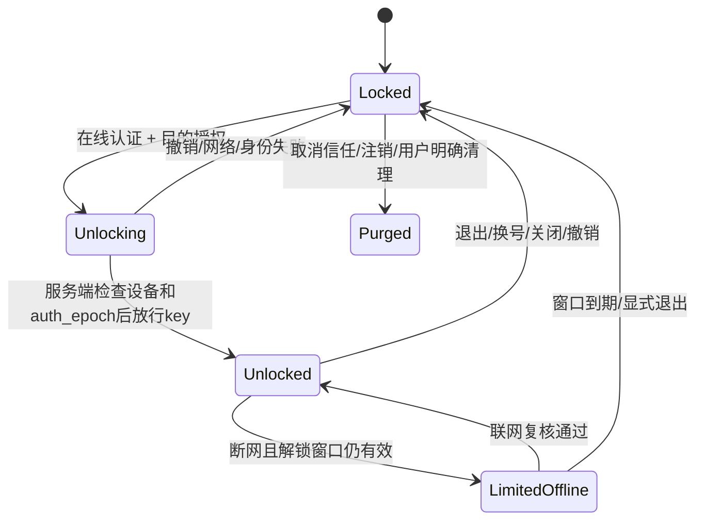
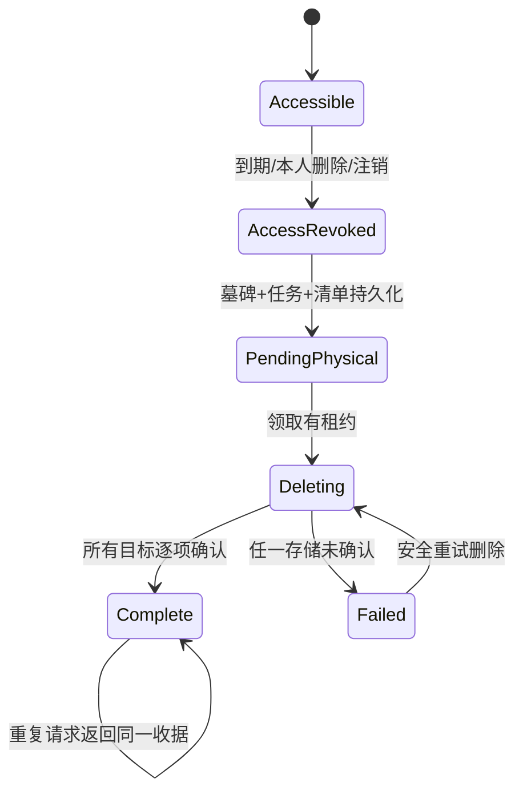

# PR-01 · 认证、隐私、删除、离线与同步设计

状态：整体架构及ADR选定结构/技术栈已获原则批准，见[收尾记录](PR01-CLOSEOUT.md)；11项TBD继续开放，密码成本、解锁窗口、删除异常期限等实验/产品参数仍受门禁约束，见 [ADR登记](07-ADR-REGISTER.md)。对应 AUTH-01–08、DATA-03–07、SYNC-01–02、REC-02–03。

## 1. 认证方案与主体

推荐应用内服务端不透明会话，认证组件采用 Starlette/FastAPI 会话边界 + `argon2-cffi`（Argon2id）+ 成熟 TOTP 库，邮件通过可替换 Adapter。组件只承担已审查密码学原语；邀请、名额、撤销与 MFA 流程是本项目显式用例。选择与托管认证/大型身份平台比较见 ADR-05，不自行发明密码算法，也不把通用 auth 库视为已覆盖全部产品安全要求。

`Principal = user_id + role + session_id + device_id + auth_epoch + mfa_level + reauthenticated_at`。请求先验证 session、账号状态和 auth_epoch，再检查资源owner/删除状态。只有服务端生成的 Principal 能传入 repository，客户端 owner 字段一律拒绝。

### 注册和邀请原子流程

1. 接收邮箱/密码/邀请令牌，分别限流；规范化邮箱的域部分，邮箱本地部分策略要一致，不能擅自按供应商删除点号/加号。保存 Argon2id hash，验证/邀请只存随机令牌摘要。等待验证是 `pending_registrations` 记录，不提前创建激活users，不占名额，不可读课程。
2. 邮件经 durable mail outbox 发送；测试用本地捕获器，普通PR不真实寄邮件。验证链接默认30分钟、单次；重发使旧链接失效，邀请默认7天。
3. 验证完成事务按固定锁序锁平台人数行、邀请、待激活用户和验证记录；检查邮箱约束、期限、撤销、10/30阶段容量；同时激活账号、消费邀请码/验证令牌、增加人数、写审计和outbox。任何失败全回滚，邀请码不被吞掉。
4. 同邀请码多个 pending 请求允许竞争，只有最终验证成功者激活。错误不透露被指定邮箱、账号是否存在或其他人的资料。

### Cookie、CSRF 与 WS

- Cookie 使用 `__Host-classroom_session`、Secure、HttpOnly、Path=/、SameSite=Lax、不设置Domain；高熵随机ID，DB只存摘要。普通会话空闲14天、绝对30天来自PRD初值；管理员时长、再认证窗口待TBD-08评审。登录/MFA通过、权限变更时轮换ID，防session fixation。
- 所有写HTTP使用与会话绑定的CSRF token + Origin检查；登录/注册也校验Origin和限流；GET不得产生业务写或生成模型请求。CORS同源，凭据请求不允许 `*`。
- WS不能靠SameSite单独防护。先用CSRF保护的HTTP端点申请短效单次ticket，绑定user/session/auth_epoch/允许通道/课堂，握手校验Origin；ticket放握手后的首条认证消息，不进URL、访问日志或长期存储；认证超时主动关闭。事件恢复每次重新鉴权。
- 账号禁用/注销/密码重置增加auth_epoch并撤销所有session。outbox通知活跃连接关闭；每次敏感命令/新收费帧仍检查PG撤销状态。推送丢失不能让旧连接永久有效。DB不可用时拒绝新敏感/收费动作，浏览器仅显示已有授权本地能力。

秘密签发是通用幂等回执的例外：Cookie、MFA seed、恢复码、解锁DEK、一次性ticket不得作为完整响应保存在 `operation_receipts`、outbox或日志。只存最小操作状态/引用；再次请求先重新认证/授权，短授权可重签并使旧授权失效。恢复码只展示一次，响应丢失须近期再认证后整组轮换，不从收据取回旧明文。所有秘密响应 `Cache-Control: no-store`，公开DTO也不得包含provider key。

### MFA、恢复与运维

学生自选TOTP；Admin必须完成MFA才能进入运营权限。TOTP seed用服务端KEK加密；恢复码高熵、只存hash、每码单次事务消费；校验防窗口内重复使用并限流。开启/关闭/替换MFA、改邮箱/密码、注销要近期再认证；改邮箱完成新邮箱验证前不更改登录身份。重置密码撤全部会话、缓存解锁资格和旧WS，要求重新登录。

首个管理员仅在明确授权的运维初始化工具中创建，要求数据库未有管理员、受限本机/管理通道、审计且强制首次绑定MFA；禁止网页bootstrap公开端点。Admin丢失MFA先用恢复码；全部丢失则停止管理写并走单独批准的身份核实恢复流程，记录双人核验或项目负责人明确批准、时间、变更、全部撤销。不可创建密码后门或“临时跳过MFA”。准确流程须TBD-08审核后启用。

## 2. 多租户和威胁模型

| 入口/威胁 | 强制机制 | 必测负例 |
|---|---|---|
| ID枚举、嵌套资源错配 | owner作用域查询 + `(owner_id,id)` FK + RLS；不存在/他人资源统一404 | A的class_session绑定B的course；A订阅B的任务/历史图 |
| Admin查看私人正文 | 管理repository只提供无正文投影；Admin角色不跳过owner策略 | 任意他人音频、导出、搜索、反馈未确认片段拒绝 |
| SQL连接池身份串租户 | 每事务 `SET LOCAL` 作用域，服务角色无superuser/BYPASSRLS，不是表owner；FORCE RLS | 归还连接后另一用户请求，worker任务间切换 |
| 越权的后台任务 | task携owner；领取角色只见队列调度元数据，执行事务设置任务owner，处理前再验账号/墓碑 | 排队后被禁用、删除、换归属、撤授权 |
| XSS/模型注入 | CSP、自托管依赖、禁脚本HTML、Markdown净化、KaTeX trust=false；模型文本不能执行工具 | 课件/标题/导入HTML/模型输出脚本、外链与恶意TeX |
| SSRF/任意模型目的地 | 固定批准provider allowlist、出站策略、禁用户URL重定向到内网 | 用户提交localhost/metadata端点/嵌套URL |
| 文件攻击 | mime sniff + 解码上限、像素上限、转码去EXIF、hash；ZIP路径/符号链接/文件数/展开字节/比率限制 | ZIP Slip、ZIP bomb、重复文件、伪图片、包内脚本 |
| 重放、预算竞争 | 稳定op+hash、CAS、租约fence、PG原子reservation | 同键异体、双设备、跨月、重复usage |
| 共享设备/被偷浏览器目录 | 私人缓存密文、内存key、重新在线认证、账号命名空间 | 关闭后直接读IDB、换账号、重置密码、清理授权 |
| 供应商/运维读取 | 最小发送范围、私有网络、secret隔离、审计及告知 | Key/正文不进日志；不宣称E2EE |

RLS是纵深防御，不代替业务owner检查或授权测试。未知对象只返回404；当前用户已知的删除对象可返回410（不向未授权主体暴露墓碑）。后台数据库维护账户属于独立受审计运维边界，不能通过应用角色隐式获得其权限。

## 3. 私有媒体和模型授权

Alpha 推荐**浏览器媒体经过受控API代理**，每个下载/Range请求核验身份、owner、用途和 `expires_at/deleted_at`，`Cache-Control: private, no-store`。短效下载ticket绑定资源版本/用途/会话，撤权后代理拒绝新请求；不把永久或直连桶URL下发浏览器。已经接收的字节无法收回。已建立流在删除/过期时关闭，最大残留到下一授权检查，检查周期必须04b测量。

供应商如必须URL拉取Filetrans，只提供单资源、单用途、短有效期的受控签名访问，设置可撤销代理或存储短链，并记录有效期/请求ID；发送前再次检查原音未过期。不能承诺收回第三方已缓存的音频。实际供应商保留/删除政策TBD-10，不能用本应用7天政策代替供应商承诺。

上传不等于发送模型。consent记录用途、对象范围/快照hash、接收方配置版本、提示版本、时间、会话及撤销状态。问答先prepare→显示文本/图片范围→confirm；当前来源发生变化时要重新prepare或明确确认旧快照。自动解释的授权只适用于本课堂、已选范围与上限，关闭后停止新批次；不能沿用上节课/导入包授权。

## 4. 本地加密与三池生命周期

选定方案：每个 `(user_id, device_id, purpose, key_version)` 的随机256-bit DEK，服务端KEK封装，浏览器经在线认证/设备授权取得后导入不可导出的 Web Crypto key，**仅放内存**。IndexedDB保存密文、nonce、AAD、key_id和最小元数据，不能保存可解密的CryptoKey或明文key。AES-GCM 每次写入生成独立随机96-bit nonce；重试复用既有密文，不能把新明文用旧nonce重加密；AAD包含owner/device/purpose/object/version/schema。服务端KEK使用受限secret或受管密钥能力，版本化轮换；不依赖用户密码直接加密DEK。

这不是端到端加密，不能抵御解锁页面XSS、浏览器插件或已被控制设备。服务器KEK丢失也会造成缓存不可解；必须在PR-05a用合成资料完成故障和轮换验证。

| 池 | 内容/授权 | 清理与容量 | 写失败 |
|---|---|---|---|
| 学习缓存 | 主动信任；已访问目录、采用笔记/总结/卡片、必要来源片段/明示小预览 | 14天自最近云版本核验、20节实际访问LRU、50MB软额同时生效；50MB按50,000,000 bytes展示，单位选定、设备容量待测 | 清已同步旧项，明确离线缺失；不回退明文 |
| 草稿outbox | 信任设备；用户未确认云保存的稿/标记操作 | 独立bytes和操作数保护，绝不受学习LRU删除；同步回执后压缩清理 | 保内存当前输入、持续告警、复制/导出；不得声称已本机保存 |
| 音频恢复 | 本次录音单独授权，未信任设备也可只授权该池 | 独立容量预检/阈值；云durable后尽快删本地块；唯一未传块由用户处理 | 停止安全录制承诺，必要时停止采集、保可恢复块，明确导出/删除 |

清理IDB时不能扫描删除其他账号未处理内容。普通退出立即停止展示、取消请求、关WS、清内存key/Query/Blob URL；在此之前提示未同步内容同步/导出/明确放弃。可保留经审核的同账号密文恢复区；换号永不展示旧密文内容。密码重置/设备撤销不销毁唯一稿的服务端封装key作为默认动作；先撤全部解锁grant，后续新认证+明确恢复流程重新授权同账号旧密文；取消信任/注销按用户确认清理key与对应恢复区，失联设备下次上线执行。精确恢复窗口、是否保留封装key多久为TBD-03，不用“加密”掩盖数据可恢复性问题。

离线窗口到期只停止解密和编辑，不静默删除唯一稿；在内存窗口终止前提示处理。浏览器关闭/崩溃不会继续上传，也不会准点物理清除过期数据；下次打开检查TTL、撤销和墓碑。Service Worker只缓存hash化静态外壳，任何带个人资料的API、媒体、下载ticket和key响应不进入Cache API。

## 5. 多设备同步、版本与离线冲突

写入统一 `{op_id, object_id, base_revision, payload}`，request fingerprint覆盖操作类型、对象、基础版本和规范化payload。服务端按owner+operation+op_id唯一；同键同体返回原收据，同键异体409。CAS比较失败409 `REVISION_CONFLICT`，返回允许本人读取的cloud_revision和版本引用，不覆盖本地稿。

客户端保存两份：提交时冻结的payload/操作ID，以及之后继续输入的本地草稿generation。旧请求ACK只确认其generation；不能把发送后新输入也标已同步。网络重试使用同op_id，用户编辑后提交新op_id。适用于笔记、理解状态、标记、课程和偏好，不用LWW静默处理内容冲突。

冲突页提供比较/手动合并、另存新副本、明确采用云端；人工合并提交当前base_revision+新op_id。Review采用操作是独立CAS命令，默认不自动推断用户要用最新AI稿。

增量游标为owner作用域单调event sequence；首次登录取授权快照+水位，后续补事件。游标超出保留窗返回 `resync_required`，先保本机outbox，重新获取墓碑/授权快照再逐笔核对收据。不可用快照覆盖outbox。删除事件优先，离线旧修改返回410，保留可允许导出的个人文字，不复活原对象。分页/排序包含稳定ID，禁止以客户端时间作为事件顺序。

搜索决定：在线索引正式转写当前选定版本、已云保存个人笔记最新版本、已采用卡片/总结、课程课堂名称；不索引AI候选原始输出、历史版本、未确认本地草稿、删除内容。需要找历史版本在该对象版本页显式查阅。离线搜索只扫描当前账号已解锁授权缓存，标注范围不全；不跨账号、不调AI。中文初期用PG `pg_trgm` + 明确子串语义，避免依赖英文全文分词器误称中文语义检索；短查询设置资源上限和授权过滤。

## 6. 删除政策与状态机

访问撤销事务同时写tombstone、任务、审计和outbox；下载、模型调度、缓存授权、搜索/通知投影均立即检查墓碑。对象物理删除失败仍保持不可读，不把任务排队称已删除。媒体清单涵盖所有版本、分片、衍生WAV、staging、临时导出音频、失败导入暂存与供应商拉取副本。应用删除worker为主，桶lifecycle兜底；若开启对象版本化必须逐版本删，不只创建delete marker。

| 操作 | 正文/复习 | 音频/媒体 | 在途处理 |
|---|---|---|---|
| 删除原音/7天到期 | 保留文字、来源时间、卡片/个人稿；原音标不可用 | 删所有原音及其衍生/导出副本，历史图保留 | 不再读取/提交原音；已发送不能保证撤销，usage继续核对 |
| 删除课堂 | 全部关联内容/候选/快照/搜索/通知正文删除 | 全部关联媒体删除 | 未发送取消；已发送停止新批次、接收结果不得重新发布正文 |
| 删除课程 | 明确选择移到本人其他课程或级联；CAS保护 | 随课堂的决定处理 | 不允许含糊“保留在无归属悬空状态” |
| 归档课程 | 保留全部；活动列表隐藏 | 保留按原期限 | 不改变模型/留存状态 |
| 禁用账号 | 不删除，撤会话/解锁/新写入 | 不自动延长原音期限 | 停新收费，保留结算和删除任务 |
| 注销账号 | 立即撤访问并全量删除 | 全量媒体清单删除 | 不等待默认冷静期；收费结果只记最小账本 |

### 异常保留参数设计（提交选择，未替产品批准）

统一字段 `first_cloud_received_at, capture_closed_at, manifest_complete_at, retention_anchor_at, hard_expire_at, retention_policy_version`，服务端生成，客户端不能续期。正常建议anchor=`max(capture_closed_at,manifest_complete_at)`；未结束、永不完整或迟到上传必须加硬截止。推荐实验方案：每块从首次云接收起最多7天，正常整课anchor+7天与该块hard_expire取较早；超截止补传拒绝并保本地导出。这样长课早期块可能先到期，必须产品审查是否接受，不能在PR-01默默改成既定政策。导入录音按新独立副本的首次接收生成期限，旧来源时间仅作证据，不能给已删原对象续期。

TBD-04未签署前只允许合成时钟测试，不开放真实音频存储。实现不能以null截止无限保留。主存储24小时物理清除为目标，失败任务告警与持续拒读是冻结行为，达标声明需04b/12a证据。

## 7. 备份与防复活

推荐数据库及非音频媒体备份，原始音频和含音频导出**不进入通用长保留备份**，按短期对象策略；这会限制灾难后原音恢复，须TBD-05明确。备份保留7天、RPO24h/RTO4h只是低成本起始方案，需成本/恢复演练批准；不能把“已确认保存无已知不可恢复丢失”解释成随意丢24h数据，若业务要求更严则启用WAL归档/PITR并核算成本。

删除/禁用/撤销账本保存非正文、最小标识与时间，并写入**不同故障域**的追加记录；同库一张表不算独立。删除请求先写外部可重放意图（幂等ID），再提交DB墓碑；外部成功DB失败由协调器重试。**只有外部意图及可验证日志head均确认持久后才能返回“已接受删除”收据。** 外部不可用时本库先临时禁访问，但返回503“删除申请尚未持久接受，请重试”，不能将其排队当已接受；客户端保留稳定op重试。这明确区别临时本库保护和跨故障域已接受请求。

独立日志采用不可变intent对象 + 单调generation/hash链manifest，更新head用存储条件写CAS；冲突重新读head并追加，不能覆盖并行意图。恢复必须从独立存储实时读取最新head，验证链、intent存在/hash和连续generation，禁止使用备份内的旧head或缓存。任何缺项/不可读都保持封闭。外部先成功但本库未提交的意图保守重放，因其已经过用户授权检查。具体存储必须04b实测条件写、读取一致性和故障行为；不支持这些条件的存储不作为日志实现。账本保留至少覆盖所有可恢复备份+重放窗口，具体天数/注销后的最小审计例外TBD-05/10签署。

恢复在隔离网段、关闭邮件/供应商/用户入口：校验备份→恢复schema及对象manifest→重放独立删除/撤销日志→按当前时间重新计算音频期限→清掉已删媒体/搜索→旧会话失效→对所有submitting/sent/unknown收费attempt核对而不重放→验证owner/FK/hash/唯一操作→抽样恢复测试→经授权开放。删除日志缺失或不完整时保持封闭，不能凭旧备份重新提供访问。

## 8. 包兼容与故障恢复矩阵

| 输入/故障 | 决定 | 后续验收 |
|---|---|---|
| 本地 `PACKAGE_SCHEMA=1` ZIP | 支持经校验的导入，创建新owner/课程目标/课堂及ID映射；未知必需字段/版本拒绝 | PR-08c golden包逐字段、图像hash、来源链接比对 |
| JSON课堂与Markdown | JSON经过同样版本/大小/字段校验；Markdown作为可携带文档输出，不宣称任意MD可无损恢复结构 | 明确导入能力，不静默生成卡片 |
| 包中HTML/JS/URL | 从不运行，使用平台自己的阅读渲染；不从URL抓取媒体 | 恶意脚本、路径和外链负例 |
| 包中密钥/owner/活动任务/consent | 丢弃不导入；原owner/class ID仅来源信息；无自动模型调用 | 新账号导入不能访问原用户 |
| 对象写成PG失败 | staging清单/内容hash核对后补确认或清孤儿；不得返回durable | PR-04a断点故障 |
| 浏览器IDB损坏/被清理 | 标注本地副本不可用；云已确认记录可重新获取，未同步唯一稿不能声称可恢复 | PR-05a/08a真浏览器 |
| 服务重启/网关丢流 | 重放正式事件；partial可消失；未知计费区间冻结，新流只发送确知未提交范围 | PR-02b/06b故障注入 |
| 新版本页面更新 | SW提示可更新，录音/唯一稿处理前不强制reload；兼容读旧缓存schema，不可逆升级先备份密文 | PR-08/09跨build验收 |

安全验收不止检查schema。需要真实PG、受控对象环境、多账号浏览器与故障注入；本PR只完成设计与合成契约验证，不能据此声称已防住全部攻击或已完成隐私合规。
