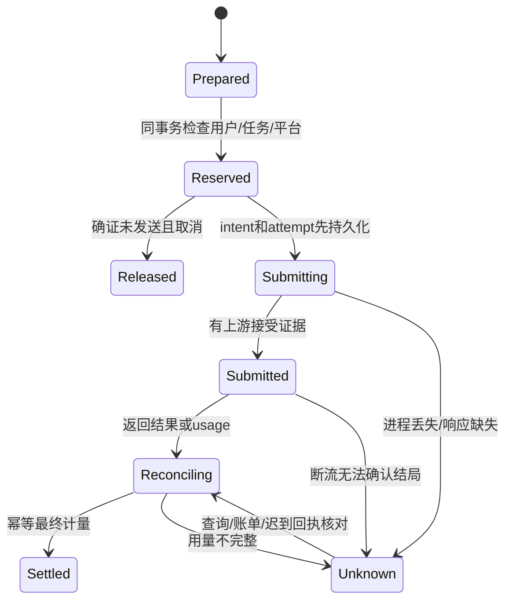
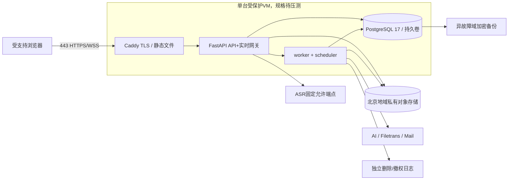

# PR-01 · Token 账本、预算、部署与故障恢复

设计状态：确定结构，容量/单价/运行指标待实验；本文件不是采购、部署或付费调用授权。依据 COST-01–03、QUOTA-01、QA/TEST/RELEASE 及增补A9。

## 1. 双账本与价格版本

产品额度（秒/次数）与实际资源费用（Token/对象字节/请求/金额）分离。一次用户总结操作占一次总结额度，但 N 个批次、必要汇总、实际失败尝试都分别有 task_attempt、usage 和成本。自动解释每批受互动次数或独立获批额度约束。阅读/关键词搜索/卡片揭晓没有模型调用和AI次数扣减。

| 每激活账号 | 10人阶段 | 30人阶段 | 约束 |
|---|---:|---:|---|
| 实时ASR | 12h/月 | 18h/月 | 每日3h，按服务端送交与供应商计量规则记录 |
| 重转写 | 2.4h/月 | 3.6h/月 | 默认每课一次；基数是默认月额，不是已用量 |
| 互动/按需解释 | 20次/月 | 36次/月 | 自动解释不能绕过 |
| 总结 | 8次/月 | 12次/月 | 批次费用分别记 |
| 活跃采集 | 1节/账号 | 1节/账号 | 多设备阅读不限为三台 |

北京时间自然日/月（Asia/Shanghai）边界由服务端clock计算，存UTC起止区间，不依赖客户端时钟，不结转。管理员追加额度需reason、操作者、再认证/MFA和审计，仍受平台预算约束。改变默认政策须产品确认。

价格表按 `provider, model, region, effective_from, meter_unit, input_kind, currency, pricing_version` 版本化。保存输入文本/音频/图像与输出Token的原始计量、最终计量标识、provider request ID和原始usage的受限摘要。金额用 `bigint micro-CNY`（1元=1,000,000微元），JSON用十进制整数字符串避免JS浮点/大整数截断；算式用Decimal后按价格规则取整。价格变化不回写历史账。

PR-00记录的输入6元/百万Token、输出4.5元/百万Token仅可作**用户价格口径的情景输入**，不当作当前账户已核验费率。PRD附录要求控制台实际定价。未验证audio Token/秒和最小计费单位前，不能得出可信“每小时单价”。

## 2. BudgetGate 事务和收费不变量

一个调用的执行顺序：

1. prepare冻结来源范围、价格/模型/提示版本、Token上限、图片数、计划批次和目的地，得到保守 `max_cost`；缺费率/最大输入/输出上限时拒绝收费，不用平均成本替代最坏预留。
2. 同一PG事务按固定顺序锁平台预算周期→用户配额周期→任务→reservation；校验开关、身份/资源/授权、剩余额度；插入唯一reservation、产品额度hold、任务与op收据。重复请求不重复占额。
3. worker/网关发送前再次检查墓碑、当前禁用开关、租约fence和授权，写 `submitting` intent 提交。只有这一条入口能访问真实Provider Adapter。
4. 响应保存原始结果与usage后再做结构校验；结构失败不代表供应商未收费。先保存已返回内容，后续可本地重新校验，不再次请求模型。
5. 结算时按provider request + meter + final revision幂等；累计usage更新使用增量差值，不把每个累计包再相加。结算后释放超额hold；未知/缺usage保留风险预留，待核对，不计0、不自动退款。
6. 取消只可释放确定未发的hold；已发取消只请求停止，保持结算/unknown。租约或reservation TTL到期本身不能证明未收费。

实时流不预留整月无限额度：按有界时间窗口先预留时长和最坏费用，send前消耗预算permit；余额不足停止新帧、正常finish/drain接受结果。窗口长度和Token上界由06a实测。没有可靠费用上界时只开放明确总费用授权的POC，不能开放学生无限流。pause不发送空音频凑时长，是否保活有最小计费须记录。已发块未知不能自动重送；旧流与新流的区间必须分开。

跨日/月：未发送的旧期hold在确证无发送后释放；新帧在新周期重预留。已经发送或unknown费用仍归原风险周期，不因月初归零。实际供应商账单归属月与本应用发送月不同则记录双时间，不悄悄改旧账。长时任务的未来未提交批次在新周期重验，整次总结产品次数保留原用户操作归属，费用逐attempt记录，规则TBD-02需用跨月样例签署。

## 3. 平台预算保护

| 预算池 | 10人/月 | 30人/月 |
|---|---:|---:|
| 基础设施 | ¥100 | ¥300 |
| 实时ASR | ¥160 | ¥700 |
| 重转写 | ¥35 | ¥150 |
| AI | ¥105 | ¥450 |
| 安全预留 | ¥100 | ¥400 |
| 总额 | ¥500 | ¥2,000 |

推荐 admission 不等到账单100%才拒绝：

`risk = settled + unresolved_exposure + active_holds + committed_infrastructure`。

新普通收费任务须同时满足用户额度、任务max_cost、模型预算池与 `risk + new_hold <= total_budget - safety_reserve`。对已结算费用不再重复计其hold；unknown exposure包含保留预留与新发现的超预留风险。基础设施固定费/预期流量先占位，避免全部预算被模型抢占。20%安全预留不分发为普通额度，只有明确受审计的管理员处置才能动用，不自动增加学生配额。

全预算风险60%提醒、80%强提醒、100%绝对停止新收费；由于保留20%安全余量，普通任务通常在80%前就触发准入限制，这是PRD允许“可更早暂停”的保守实现。阈值有防抖与一次性周期通知，但持续高危状态不能由“已读”消除。provider实际计费延迟、已有在途请求及固定资源仍可能使总账超限，系统不能宣称厂商账单硬封顶。

开关独立：registration、new_capture、asr_streaming、asr_filetrans、ai_interaction、ai_summary。平台收费总闸为最上层；关闭仅阻新收费，仍接受usage、已返回结果、删除、阅读、导出必要资料和任务查询。若PG/预算服务不可用，对新收费fail closed。UI不可仅置灰而服务端继续提交。

## 4. 音频与资源算术（不是压测结果）

16kHz × mono × PCM16 = 32,000B/s，约115.2MB/h；90–120分钟为172.8–230.4MB。100ms帧是3,200B。1s持久块是32,000B，每小时3,600块。按满月额度，10人120h≈13.824GB/432,000块，30人540h≈62.208GB/1,944,000块，尚未加复制/临时文件/数据库索引/请求费。7天留存不能简单除以四保证峰值，因为可能集中上课。

首版设计选择本地加密持久→约1s聚合块→私有对象+PG durable→上游100ms帧。保护已收费素材与故障恢复，代价是至少一个块聚合等待、较多PUT与表行。块时长是待测参数：06a测首字幕端到端P95、对象请求费、DB写放大与内存后，可在不改变稳定chunk ID/hash/偏移语义下调整。不能为达3秒目标先发送未持久化音频又声称云保存。

合并对象是可选后续优化：课堂结束将块打包，验证完整hash与index，事务切换manifest后才删旧对象；双副本窗口有界、删除清单包含新旧位置。Alpha先不实现压缩/复杂分层存储。若对象请求量已足够便宜，则保持简单块存储。

成本验证按三种场景：平均使用、全部账号满配额、同一时段峰值+失败重试/unknown。分列固定资源、存储GB月、PUT/GET、出站、邮件、备份、ASR、Filetrans、AI文本/图像/输出。1s块和50MB学习缓存不是同一容量：一节长录音可超过学习池数倍，恢复池必须独立预检。不能借提高个人额度掩盖平台预算不足；若实际成本超规划，提交参数/产品变更，不静默降低质量或更换供应商。

## 5. 部署拓扑推荐

目标环境：Linux、Python3.12、PostgreSQL17；具体补丁/镜像digest/驱动兼容在PR-02锁文件与集成测试冻结。本地原Python3.10回归环境不升级。Web静态构建由Vite产出，后端无Node常驻渲染服务。Caddy同源TLS与反向代理减少配置量；Nginx同样可行，首版选一个。Docker Compose用于可复现小规模部署模板，systemd监督容器重启；不是Kubernetes集群。

初始容量实验候选2vCPU/4GiB、1个API进程、1个worker、受限数据库连接池；**不是购买建议或已验证规格**。固定预算内先评估同机PG，物理卷不在容器临时层；对象存储独立私有，备份不同故障域。若资源报价/恢复责任不满足，比较受管PG总体成本后再选择；不承诺100元一定覆盖上述组合。单VM故障会中断服务，这是Alpha成本选择，必须恢复演练、告警和用户告知。

只开放443；PG/worker没有公网端口。管理员运维走受控通道；TLS证书、secret、数据库密码、供应商key不进前端/仓库/镜像层。环境区分dev/test/POC/Alpha，互用密钥与存储禁止。默认所有真实provider开关off，普通CI只有模拟provider。

健康检查：liveness仅进程可响应；readiness包括PG、迁移兼容、预算/删除日志状态。对象故障可以只禁新媒体而保留文字阅读；供应商故障只停对应云能力，不能整个站点假死。没有供应商探测自动产生收费请求。

## 6. 扩容触发条件与运维

测量queue age、WSS活跃流、首字幕/稳定字幕P50/P95、上传durable延迟、PG连接/锁等待、outbox lag、CPU/内存、每小时对象数、磁盘水位、unknown金额与删除最老任务年龄。日志只含request/task/attempt ID、状态、错误类别、计量和耗时；无正文、音频、邮箱完整值、key、token、短链。

扩容顺序：调并发/背压和索引→增加worker进程（PG领取仍权威）→将PG移受管/独立节点→多API进程/实例（WS owner与fence、跨实例outbox已具备）→只有实测PG队列成为瓶颈才引入外部队列适配器。API实例增加后上游流不会跨进程透明续接；断流按unknown/new epoch恢复。不要把RPM视为并发连接数。

告警最少包括：预算风险80/100%、未知暴露超阈值、auth异常、备份失败、删除接近24h目标、PG/磁盘错误、持续队列积压。10–30人先结构化日志+少量指标+值守通知，无需昂贵全链路平台；日志保留/访问控制同TBD-05/10。个人正文不入analytics，反馈附片段需用户显式选定。

## 7. 发布、迁移和回退

构建清单绑定commit、Web版本`0.1.0-alpha.N`、contract版本、Alembic revision、前端build、prompt/schema/provider配置、支持浏览器清单。Web tag `web-v0.1.0-alpha.N` 与原本地`v1.3.0`不相互覆盖。本PR不创建tag/包/发布。

迁移采用expand→双版本兼容读写→回填→验证→另一次contract；不在同PR删除旧字段。migration使用单独角色、锁和预检；API启动不自动执行破坏迁移。旧客户端通过能力/最低schema检查拒绝不兼容写，给安全导出恢复入口；SW更新不强制重载正在录音页面。

回退顺序：关新收费/注册或有问题的能力→保留收尾/查询/删除→排空已知安全任务，unknown留待核对→回兼容应用build→验证schema读写范围→开启合成探针→授权后恢复。DB不可逆不drop/drop cascade，停止受影响写入并前滚修复。恢复备份步骤见 [安全设计](05-SECURITY-OFFLINE.md)；备份不是通用撤销按钮。

## 8. 实施验收与风险登记

| 风险 | 拒绝的捷径 | 必要证据 / 所属PR |
|---|---|---|
| ASR成本/协议/Token速率未明 | 按宣传小时价承诺预算 | 06a/11a真实账户限额与usage、同源30段、长时3轮 |
| 音频小对象延迟和写放大 | 用内存ACK冒充持久保存 | 04a/06a故障注入+延迟/费用分项 |
| PG单点和账本同故障域 | 数据库内一份墓碑当备份防复活 | 04b/12a独立日志、恢复隔离、RPO/RTO演练 |
| 浏览器后台/配额不可控 | 宣称锁屏持续录制/永不丢 | 05a/05b/12b真机中断、配额满、尾帧和恢复 |
| Provider响应丢失 | 自动重试/切商 | 02b/06b/07故障后unknown核对及二次确认 |
| 低价LLM质量不足 | 来源ID合法便当正确 | 12b事实、数字、公式、缺步人工核对与阈值 |
| 双主题/动效伤可读性 | 只审首页截图 | 09/12全状态、320px/200%、读屏/低特效 |

这些测试列为后续验收义务，不是本轮实测结果。PR-01不关闭真实服务、真实浏览器、数据地域条款和部署参数的发布门禁。
