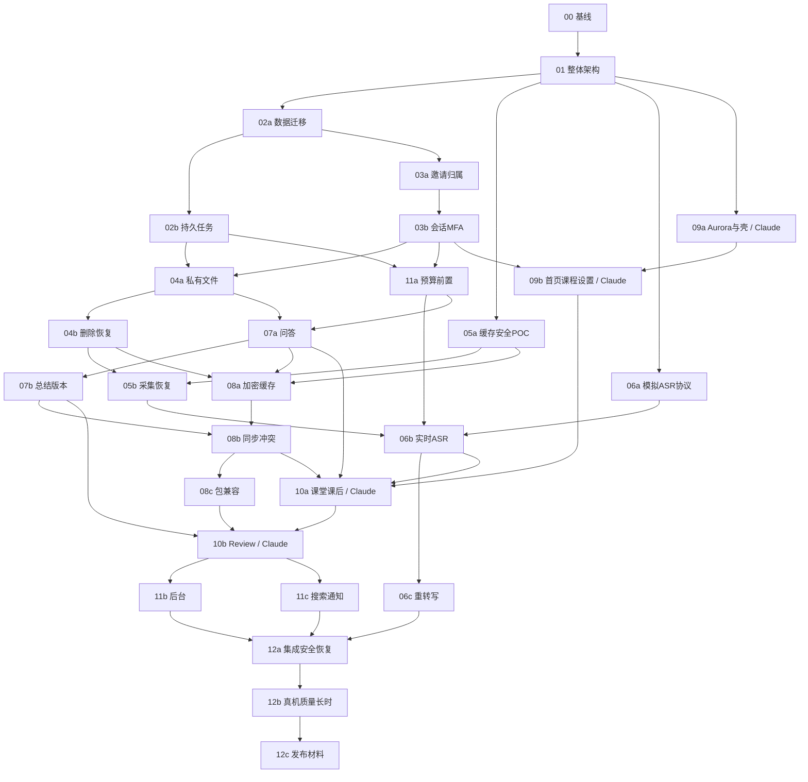

# PR-01 · 28个PR依赖、并行交接与验收

这是**完整系统设计的实施映射**，不是重新规划如何完成PR-01。本轮停在PR-01交付，PR-02/09及其他后续PR仍需用户分别授权。PR编号为工作包，不意味着已经创建远端PR。PR-00既有验收保持原样，远端CI仍待验证。

## 1. 依赖与可并行边界

完整、可校验DAG见 [pr-dependencies.json](contracts/pr-dependencies.json)。`depends_on`为可合并/验收硬依赖；`integration_depends_on`为完整链路验收依赖；`paid_depends_on`与专项授权共同限制真实收费。UI可用Mock提前工作，但不能把Mock通过作为后端完成或联合验收通过。

上图只画主要边，全部硬边以JSON为准。按机器DAG可拓扑排序，不能按编号把11a拖到收费接入之后。

## 2. 每个PR的输入、产物和放行标准

| PR | 负责人/主要产物 | 必须留存的验收证据 | 回退重点 |
|---|---|---|---|
| 00 | Codex；基线/CI/矩阵，已本地验收 | 原525主测试+171子测试、九套Node历史本地结果；远端CI未执行 | 原业务不改 |
| 01 | Astra；本架构、契约、ADR、Agent交接 | 118项映射、schema/正反例、DAG、链接/保护检查 | 仅新增设计与AGENTS追加，无数据迁移 |
| 02a | Codex；PG实体、repository、CAS、迁移 | 真PG空库/升级、跨owner FK、血缘/版本、rollback | 兼容代码回退，不drop新数据 |
| 02b | Codex；tasks/attempts/outbox/receipt | 多worker竞争、fence、发送前后kill、结果重放、游标提交顺序 | 停领取保账本，unknown不重排收费 |
| 03a | Codex；邀请/验证/名额/资源授权 | 同码竞争仅一激活、满额不吞码、所有对象A/B授权 | 暂停注册保审计 |
| 03b | Codex；Cookie/CSRF/MFA/恢复 | 全撤会话、单次恢复、WS Origin、secret不缓存 | 不降级MFA/开后门 |
| 04a | Codex；私有对象/上传/下载/密钥 | 对象成功DB失败、hash异体、越权/Range、秘密脱敏 | 停上传/签发，不删唯一副本 |
| 04b | Codex；期限/删除/备份恢复 | 可控时钟、全部版本/临时件、独立日志故障、恢复防复活 | 不恢复过期访问，清除失败前滚 |
| 05a | Codex主做安全，Claude浏览器配合 | 合成加密、关闭重开、换号/重置/撤销/满盘/轮换POC | 未过不启持久恢复，不用明文代替 |
| 05b | Codex采集runtime，Claude消费ports | 合成波形/尾帧、租约/离线旧epoch、hash、刷新/满队列 | 保恢复/导出入口 |
| 06a | Codex；Adapter/本地模拟器 | 固定协议/SDK版本；mock和获批真实file/stream分报告 | 默认真实provider off |
| 06b | Codex；partial/final/未知恢复 | 重复乱序final、送达不明、每段费用、原偏移/缺口 | 停新云帧，正常drain |
| 06c | Codex；Filetrans与候选 | 独立POC、一次/课、2.4/3.6h、过期拒绝、人工不覆盖 | 停新任务保各版本 |
| 07a | Codex；来源/问答/发送确认 | 30s/120s/意群/课件、旧快照确认、plan一次消费、unknown | 保历史不自动切商 |
| 07b | Codex；总结批次/四卡/个人稿 | 原review规则、批次usage、非法结构保raw、首稿候选 | 停生成不改采用指针 |
| 08a | Codex安全存储/Claude界面 | 三池、14天/20课/50MB、换号/撤销、未同步不淘汰 | 禁新缓存不丢唯一稿 |
| 08b | Codex同步/Claude冲突交互 | 两设备CAS、延迟ACK不误报新输入、typed merge、墓碑 | 停自动同步保本机稿 |
| 08c | Codex；JSON/MD/ZIP任务 | golden旧包映射/hash、炸弹/穿越/坏媒体、无凭据导入 | 停新导入，不删原包 |
| 09a | **Claude Code**；Aurora/路由壳/Mock | [前端交接验收](09-CLAUDE-FRONTEND-HANDOFF.md)，独立Mock/模拟录音、全状态/键盘/主题 | 仅Web壳回退，缓存兼容 |
| 09b | **Claude Code**；Dashboard/Courses/Settings | 真实空态、四标签、同名/CAS、真实继续入口/后端联调 | 页面flag，保数据 |
| 10a | **Claude Code**；Classroom/Processing | 五流、跨路由采集、双/单栏不丢稿、部分总结/关页风险 | 保停止/恢复控制 |
| 10b | **Claude Code**；Review | 三入口同对象、来源旧版、候选采用、离线缺图/音到期 | 兼容只读，不覆未知字段 |
| 11a | Codex；预算闸门（**前置**） | 真PG并发/跨月、累计usage、unknown保留、60/80/100 | 总闸停新收费，保核对 |
| 11b | Codex后台API、Claude界面 | Admin+MFA、无正文/冒充、reason审计、独立开关 | 停管理写，开关仍可受控使用 |
| 11c | Codex搜索/通知、Claude交互 | 授权/删除索引、无AI搜索、已读不清故障、反馈同意 | 禁索引新增但正文可达 |
| 12a | Codex集成、Astra跨模块审查 | ≥40预定义E2E目标≥95%、越权/丢失/费用零豁免、原回归 | Gate不放行，按能力关停 |
| 12b | Codex+Claude+人工QA | 30段同源、3次90–120分钟、真实浏览器/设备/账单、质量阈值 | 支持范围如实收窄，未过不扩测 |
| 12c | Codex+Astra；上线/回退材料 | build/schema/model清单、恢复演练、Gate签署 | 保持未发布，另获部署授权 |

每PR必须附需求ID、边界、变更文件、兼容影响、真实命令/环境/退出码/失败、模拟与真实区分、安全成本影响、未闭合项、回退/复现。旧测试和PR-00结果不重写；本轮未跑旧pytest时不能把历史结果冒充新结果。

## 3. 实施波次与关键路径

用户后续逐项授权后，首波可并行02a（Codex）、05a安全合成POC（Codex/Claude协作）、06a模拟协议（Codex）、09a（Claude）；共享contracts目录由Astra单一审查入口协调。并发容量不足时按关键路径02a→03a→03b→04a→04b→05b→06b→10a推进，11a在02b/03b后尽早合入。

第二波是持久任务/认证与前端壳，第三波文件/删除/费用与课程UI，第四波采集/ASR/问答/安全缓存，第五波总结/同步/包及课堂Review，第六波运营与联合验收。依赖边表示数据/安全前置，不要求所有UI等后端：Mock能提前实现组件/页面状态，但真联调的PR验收仍要满足硬边。

## 4. Agent责任和交接资产

| 角色 | 能决定 | 必须提交/不能单方决定 |
|---|---|---|
| Astra | 总体架构、接口、状态机、模块和跨端约束 | 冻结契约版本、ADR、跨模块审查；产品规则修改仍请用户确认 |
| Claude Code / Claude Desktop | PR09a/09b/10a/10b与相关前端组件/样式、可访问性交互实现 | 遵循ports/DTO/五流；提交Mock场景/视觉/交互证据；不得自行改API/授权/费用 |
| Codex | 后端、数据库、ASR/AI、身份、基础设施、集成测试 | 提供契约实现、故障/事务/安全证据；不让前端依赖内部ORM/函数 |
| Terra | 可选视觉原型/风格探索 | 输出主题/组件建议和静态样例，由Claude接入；不拥有生产API/状态设计 |

共同规则在根AGENTS.md；Claude入口仅CLAUDE.md + [09交接](09-CLAUDE-FRONTEND-HANDOFF.md)。团队决定放在Git中的ADR、契约变更或PR交接，不依赖聊天可见性。细化任务不自动改变已确认产品。

## 5. Git、Worktree、契约变更流程

1. 开始先记录repo root、branch、HEAD、dirty状态，读AGENTS和本PR契约版本。当前`feature/web-alpha-0.1.0`是集成线，不能随意reset用户改动。
2. 后续每个已授权PR使用独立任务分支，如`feature/web-pr09a-aurora`、`feature/web-pr02a-data`；名称示例不是本轮已创建。适合的干净worktree可复用；否则建立独立worktree，放J项目非C目录/工具管理位置。不要在同一分支的共享目录让两个Agent同时写同一文件。
3. 分支从用户已接受的集成commit起步，交接记录准确base SHA和contract版本。未合入依赖可使用本地依赖分支明确堆叠，但不得把多个PR混成一大改动；每次合流前重新检查差异与权限。
4. 冻结契约改动先写变更摘要：受影响operation/event/schema/字段、原因、破坏性、数据和Mock影响。Astra审查，Claude和Codex确认，再更新契约/版本/fixtures/Changelog。消费者不能单方增加“临时字段”绕过流程。
5. local commit仅在用户明确授权或任务约定允许时创建，精确暂存该PR文件；标题标PR/子包，正文说明验证。禁止自动push/merge/tag/release。PR-01本地commit已获单独授权，见[收尾记录](PR01-CLOSEOUT.md)，不扩展到后续PR。
6. 交接最少包含base/head、变更清单、契约版本、运行模式、命令/结果、已知限制、待审决策、回退和下一角色任务。代码引用采用仓库内路径，外部聊天只能补充不能作为唯一规范。
7. 分支合并/挑拣仅在获准后执行；冲突由所属模块负责人处理，契约冲突回Astra。worktree归档前确认唯一未提交文件/忽略目录产物已保存，不能用git clean清空共享资产。

## 6. 联合验收与停止点

Claude独立Mock通过→Codex契约/真实PG/对象测试通过→同版本API联调→Astra检查跨模块不变量→联合浏览器/故障注入→用户审核该PR。Mock录音不会请求真实麦克风，Mock AI不会访问provider；切换real模式须显式开发配置，不可静默fallback。

Gate0仅合成内部联调；Gate1须安全、真机、成本/删除恢复与所有发布阻塞项通过；Gate2按10人每人两课堂一复习、8人完成/6人有机会自愿复用观察再扩至30；Gate3决定是否更大Beta。40次/95%不豁免泄露、认证绕过、保存丢失或失控收费。

**PR-01架构已原则获批，当前只执行授权的本地提交收尾；不自动启动任何实现PR。** 后续工作由用户明确选择授权范围；02a与09a的独立Worktree建议见[收尾记录](PR01-CLOSEOUT.md)。
