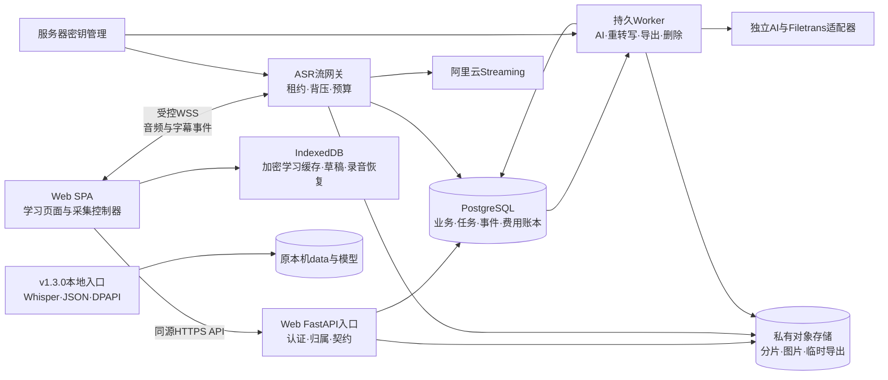
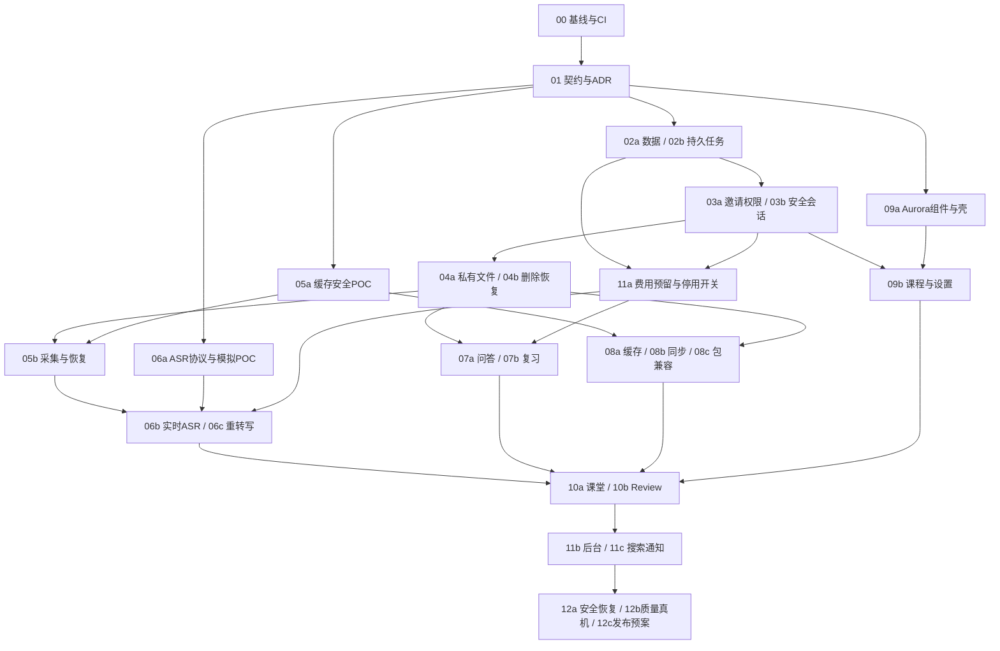

# 课间 Classroom OS · Web Alpha 0.1.0 技术审计与实施计划

审计日期：2026-10-28（北京时间）
状态：完整分析与建议方案，等待产品负责人确认；尚未开始 Web 业务开发。

本报告覆盖 A—G 七项交付。需求事实、代码事实、历史验证、本轮验证和建议方案分别标识。PR 编号是计划，不表示已创建 GitHub PR。

**结论：保留 v1.3.0 本地版独立运行，在同仓库内增设隔离的 Web 应用与后端入口，渐进复用领域逻辑。先完成需求基线、契约、认证、持久状态和预算保护，再接入真实云服务。不能把现有本机服务简单改监听地址后作为 Web Alpha。**

## 阅读依据及文档优先级

- 实际提供的 PDF：`J:\class-assistant\Classroom_OS_Web_Alpha_0.1.0_PRD_v1.1_Package\Classroom_OS_Web_Alpha_0.1.0_PRD_v1.2_含预览_阿里云ASR接入方案.pdf`。
- 共 **37 个物理页**；已完整读取。第 21 页是视觉概念预览，第 35—37 页是阿里云 ASR 增补 A1—A10。附录文字层编码异常，已渲染原页逐页核读；未用乱码推断内容。
- SHA-256：`DD7D970D54FB443969CE6BB210B0B18053BFECF972CF419EFA57EDB51B2FF5B8`。
- 文件名为 v1.2，但封面、正文页脚和文档控制仍写 PRD v1.1；不把同目录旧 v1.1 Markdown 当成 v1.2 全文替代。以下“p.”均指 PDF 物理页。
- 当前仓库不存在用户最初提及的 `docs/Classroom_OS_Web_Alpha_0.1.0_PRD_v1.2.pdf`。建议 PR-00 将用户提供原件按规范路径归档，并增加版本/差异索引，保留原件哈希，不擅自重写原始 PDF。
- **增补 A 明确更新实时 ASR 首选**：`qwen-audio-3.1-asr-flash-streaming`、`cn-beijing`；正文 ASR-02 的多供应商实验仍保留为验证要求，但不再将“首选供应商完全未定”作为当前结论。模型权限、质量、限流与真实成本仍待验证。
- 概念预览中的日程、统计数值、人物和聊天内容是示意。不能据此新增智能课表、学习评分、虚构统计或通用聊天主页；功能验收以 UI-DASH 等文字要求为准。

## A. 当前项目技术审计

### A1. Git、版本与工作区

| 检查对象 | 本轮事实 | 解释 |
|---|---|---|
| 用户当前目录 `J:\class-assistant` | 不是 Git 仓库；顶层为 PRD Package 文件夹 | 该目录不存在“当前开发分支/未提交业务修改”的 Git 状态；不能称其工作树干净 |
| GitHub 默认分支 | `main`，查询时仅返回这一远端分支 | 不代表历史开发分支从未存在 |
| 远端提交 | `43fa23c141e3350e90d72ed7768e3b8de7d68337` | 本轮固定审计基线 |
| 标签/代码版本 | `v1.3.0` 指向上述提交；`version.py` 为 `1.3.0` | Windows 本地产品线 |
| GitHub Release | v1.3.0 已发布，非 prerelease；2026-10-28 11:50:12 北京时间 | 不能沿用发布前记录中的“尚无 tag/Release”作为现状 |
| 审计副本 | `D:\Codex\Chats\2026-10-28\classroom-web-alpha-audit\work\repo-audit`，分支 `main`，跟踪 `origin/main`，检查时无跟踪文件改动 | 只说明新建审计副本状态；未检查或修改其他历史开发目录/正式安装 |
| 工程规则/CI | 固定提交没有仓库内 AGENTS.md、`.github` CI 工作流 | 本轮遵循用户提供的 AGENTS 指令；CI 自动门禁需要建立 |

证据：[固定提交](https://github.com/Mumao233/classroom-assistant/commit/43fa23c141e3350e90d72ed7768e3b8de7d68337)、[v1.3.0 Release](https://github.com/Mumao233/classroom-assistant/releases/tag/v1.3.0)、[版本文件](https://github.com/Mumao233/classroom-assistant/blob/43fa23c141e3350e90d72ed7768e3b8de7d68337/version.py)。未 fetch/切换用户旧工作树，没有推送、合并、发布或创建 PR。

### A2. 实际技术形态

| 层 | 当前实现 | Web 影响 |
|---|---|---|
| 服务端 | Python/FastAPI/Uvicorn；`Classroom` 继承多个工作流；一个实例保存全部课堂 | 可以继续用 FastAPI；不能复用全局当前课堂与共享用户配置作为多用户运行时 |
| 数据 | 逐课堂 `session.json`、本机媒体目录、原子 JSON 替换、进程内锁 | 缺数据库事务、多进程并发、用户级归属、删除账本及迁移工具 |
| 任务 | 进程内音频队列、AI 优先队列；部分任务/请求状态写入课堂 JSON | 工作流经验可用；内存队列和锁不能作为云端唯一事实来源 |
| ASR | 本机 faster-whisper；CPU/GPU 与电源模式；分段 WAV 处理 | 本地版保留；Web 新增服务端云 ASR Adapter 和连续流生命周期 |
| AI | 本机 Codex 子进程或 OpenAI 兼容 Chat Completions；流式结果、未知结果、来源校验 | 复用适配器接口/结果校验；Web 不依赖学生安装 Codex，不继承用户任意 API 地址和平台密钥设置页 |
| 前端 | 原生 HTML/CSS/JS，无打包；AudioWorklet、IndexedDB、KaTeX | 复用音频算法、校验规则和交互经验；新增 Web 页面、账号态、设备缓存与路由边界 |
| 安全 | localhost Host/Origin 检查、CSP、no-store、输入限制、图像/ZIP 校验、Windows DPAPI | 有本机安全基础；没有 Web 认证/资源授权/CSRF 会话体系；DPAPI 不适用云端密钥体系 |
| 依赖 | `requirements.txt` + dev requirements；范围约束较宽，无锁定的 Web 依赖集 | 先建立可复现测试环境，Web 依赖独立管理，不升级并污染本地版环境 |

源码证据：[app.py](https://github.com/Mumao233/classroom-assistant/blob/43fa23c141e3350e90d72ed7768e3b8de7d68337/app.py#L96)、[前端音频处理](https://github.com/Mumao233/classroom-assistant/blob/43fa23c141e3350e90d72ed7768e3b8de7d68337/static/pcm-worklet.js)、[README](https://github.com/Mumao233/classroom-assistant/blob/43fa23c141e3350e90d72ed7768e3b8de7d68337/README.md)。

### A3. 可复用资产与关键冲突

| 发现 | 代码证据 | 判断与处理建议 |
|---|---|---|
| 材料快照、原文/图片版本、请求范围固定、来源变化提示已存在 | `study_workflow.py`、`review_sources.py`、`slide_history.py` | 作为 Web 的领域语义基线；在用户授权和数据库事务外壳下复用 |
| 四类卡片、AI 原稿/个人稿、标记理解状态、批次生成/去重已存在 | `review_schema.py`、`review_workflow.py` | 结构校验与规范化算法可直接复用；队列、持久化和采用状态需适配 |
| ZIP 包、哈希、路径/大小检查、独立恢复、只读阅读页已存在 | `portable_package.py`、`portable_routes.py` | 保留攻击用例与旧包兼容；Web 必须加用户归属、上传限制与独立导入任务 |
| 全局 `current`、课程目录、AI 配置和数据列表 | `app.py:96–159,186–203`；`course_catalog.py` | **Web 阻塞**：不能多用户共用这些状态；所有读写必须显式 User + Session |
| `local_only` 只保护本机访问 | `app.py:1026–1040` | 保留本地版；Web 独立入口实现认证和授权，不能删掉它来“完成 Web 化” |
| 音频重复仅按课堂内 `seq` 返回旧结果，不核对内容 hash | `app.py:401–426` | REC-01 差距：Web 同键不同内容必须拒绝，防多设备/重复分片错误归并 |
| 本机 ASR 重启后重排 pending/running 音频 | `app.py:161–172` | 本地免费计算的恢复语义不能移植成收费云请求自动重放 |
| 当前学习/图片缓存直接持久化文本与 Blob，没有账号加密/信任授权 | `static/study-cache.js:1–60` | DATA-03/05/06 差距；共享设备与换号必须重新设计，不能简单增加 TTL |
| 首次笔记生成后，未选中其他笔记时自动设置采用稿 | `review_workflow.py:616–617` | 与 SYNC-02“AI 新稿只作为候选”冲突；Web 分支必须显式采用；保留本地版当前行为，若需统一另提产品变更 |
| 本地 Codex 模式新课堂可默认自动解释 | `app.py:197–199` | Web 默认按需；不沿用本地默认，自动解释须明确开启并计费 |
| 本地版原音无自动 7 天删除；课件软移除保留历史 | README 数据边界；媒体/历史模块 | Web 需要明确原音生命周期与资源级删除；保留历史证据不等于删除请求可无效 |
| 已有用户自建课程、大纲、词表和课堂绑定，缺学期实体与完整课程管理 | `classroom_features.py:64–133`、`course_catalog.py` | 保留已实现课程能力；不能把现有课程管理算作 UI-COURSE 全覆盖 |
| AI 次数/token 是本课堂统计，缺人民币预算预留和平台并发保护 | `ai_settings.py`、`ai_api.py` | 在任何收费 POC 前前置计量工作包；未知用量不能当 0 |

这些是相对 Web PRD 的差距或冲突，并非全部都是本地版缺陷。没有据此修改本地行为。

### A4. 测试与验证证据分层

1. **历史仓库记录**：v1.3.0 记录 `525 passed + 171 subtests passed`，零失败/跳过，九套 Node，通过合成资料的回环 HTTP 和真实浏览器检查。真实 ASR/CUDA、长课堂、续航、2 GiB 大包等未实测。
2. **后续 Release 记录**：补充用户人工确认直接双击离线 `index.html` 通过；这是用户人工验收，不能冒称本轮自动化复测。`docs/VALIDATION.md` 留有发布前限制与“尚未发布”措辞，PR-00 应加时间索引说明，不抹掉原始记录。
3. **本轮执行**：九套 Node 均通过；Python 三个可导入 unittest 套件合计 **57 passed、1 dependency error**，错误来自 `faster_whisper.vad` 缺失；44 个 Python 文件 AST、6 个应用 JS 语法、3 个 PowerShell 脚本解析、`git diff --check` 通过。
4. **本轮未完成**：完整 pytest 回归；环境缺 pytest/FastAPI/httpx/Uvicorn 等依赖。本轮没有安装依赖以补全环境，没有降低或跳过用例来制造全通过。未开启真实麦克风、真实模型或 Web 服务。

历史来源：[验证记录](https://github.com/Mumao233/classroom-assistant/blob/43fa23c141e3350e90d72ed7768e3b8de7d68337/docs/VALIDATION.md)、[Release](https://github.com/Mumao233/classroom-assistant/releases/tag/v1.3.0)。本轮详情见[验证附件](D:/Codex/Chats/2026-10-28/classroom-web-alpha-audit/outputs/验证记录_本轮与历史区分.md)，命令输出保留在本任务`work/test-temp`。

**开发门槛保留**：525 项历史 Python 测试及 171 子测试是应复现的既有覆盖基线；九套 Node 和既有安全/回环测试继续运行。不得用总数量替代用例保留审查，也不得把本轮 57 项结果当成 525 项通过。

## B. PRD 需求覆盖矩阵

分类：**复用**＝现有纯算法/格式规则可沿用，不代表整个 Web 功能已交付；**改造**＝已有本地功能，需替换用户、存储、任务或交互边界；**新增**＝审计基线未实现；**风险/冲突**＝不能按旧实现直接迁移或仍需证据。一个需求可同时包含可复用部分及风险。

以下覆盖正文全部编号需求族、设置页和增补 A1—A10；范围段中的各编号仍需在实施 PR 中拆为用例。PR 编号详见 F。

| PRD 需求 ID / 物理页 | 现有证据 | 覆盖分类与差距 | 对应计划 |
|---|---|---|---|
| PRODUCT-01/02，p5 | 本地录音→解释→复习闭环 | 改造：新增邀请登录、跨设备和独立课后处理；保持课堂学习定位 | 03、05–10 |
| PRODUCT-03，p5 | 部分课堂与复习能力 | 改造/新增：六大模块完整范围仍待完成，不能只交录音网页 | 01–12 |
| PRODUCT-04，p6 | 无教务/课表/协作系统 | 范围约束：不新增智能课表、OCR、PDF/PPT、语义搜索、原生端或计费结算 | 00/01 |
| PRODUCT-05，p6 | 快照、版本、ZIP、安全回归 | 复用：优先复用已测规则；新增 Web 隔离 | 01/02/07/08 |
| ASR-01，p7 | Whisper 多语言、术语 prompt、段落版本 | 改造：云 partial/final、语言/热词真实能力与时间戳来源 | 06a/06b |
| ASR-02，p7；A1/A7/A8 | 本地 ASR 测试为主 | 新增：按附录首选阿里云，保留同源对照；30 段样本与长时评测 | 06a/12b |
| ASR-03，p8；A6 | 本地重转写独立稿 | 改造：filetrans POC、一次/课、默认月时长20%、用户采用与原音到期拒绝 | 06c |
| ASR-04，p9 | 回看/回到实时、发送图文确认 | 改造：浏览器不持云密钥；ASR/AI/存储分别告知 | 03/06b/10a |
| ASR-05，p9；A4 | AI 未知结果/显式重试已有 | 复用规则+风险：云 ASR 已发送未知段不得自动重发 | 02b/06b/11a |
| REC-01，p8；A2/A3/A5 | Worklet、WAV、IndexedDB、seq 去重 | 改造：内容 hash、采集 epoch、持久 ACK、分离上传与计费幂等 | 04a/05b |
| REC-02，p8；A4 | 本地音频补传/刷新恢复 | 改造：租约 fencing、按原时间补识别、休眠/丢失缺口、空间失败 | 05b/06b |
| REC-03，p9 | 用户主动删除原音 | 新增/风险：7天、异常起算、版本对象/临时件、短链、删除账本与恢复防复活 | 04b |
| AUTH-01，p10 | 无 Web 账号 | 新增：邮箱验证、密码/重置、邮箱变更、限流和敏感再认证 | 03a/03b |
| AUTH-02，p10 | 无 | 新增：双模式7天单次邀请、验证激活与名额原子竞争 | 03a |
| AUTH-03，p10–11 | 本机当前课堂、无账号会话 | 新增：多设备阅读，可撤销 Cookie；单账号采集租约 | 03b/05b |
| AUTH-04，p11 | 无 | 新增：学生可选MFA、管理员强制、恢复码和独立恢复流程 | 03b |
| AUTH-05，p11 | local_only；ID 路由 | 新增/阻塞：所有对象/WS/搜索/文件/历史授权；Admin无默认正文权限 | 03a–04a/11b |
| AUTH-06，p11–12 | 可删录音、课堂包导出 | 改造/新增：禁用、注销、课程级联选择、清理与24h目标 | 03b/04b/08c |
| AUTH-07/08，p12 | 无平台后台/账号测试 | 新增：四页后台、审计、独立限流与完整安全验收 | 11a/11b/12a |
| DATA-01，p13 | JSON、媒体目录、内存队列 | 新增存储层：PostgreSQL、私有对象存储、持久任务、学期实体 | 01/02/04 |
| DATA-02，p13 | 来源快照、版本、原始输出校验 | 复用规则+改造：数据库不可变快照、事务与租户边界 | 02a/07b |
| DATA-03，p13–14 | 明文、按课堂缓存 | 风险/冲突：主动信任、账号空间、限定学习缓存；未信任仅当页 | 05a/08a |
| DATA-04，p14 | 待传图片10张/100MiB | 新增：14天/20节/50MB仅已同步学习缓存；不误套图片/音频恢复队列 | 08a |
| DATA-05，p14 | 音频与图片恢复暂存 | 改造/阻塞：本次录音独立授权、加密、确认后清理、未确认导出/删除 | 05a/05b |
| DATA-06，p15 | 无浏览器密钥封装 | 新增/阻塞：内存解密钥匙、联网重登解锁、撤销/重置/离线边界 | 05a/08a |
| SYNC-01，p15 | request_id、收据、保存提示 | 复用规则+改造：账号/基础版本/op_id；对象与DB核对；五种统一状态 | 02b/08b |
| SYNC-02，p15 | 个人稿revision；首稿自动采用 | 改造/冲突：多设备冲突、删除墓碑、AI候选显式采用 | 07b/08b |
| DATA-07，p15 | JSON/Markdown/ZIP、独立恢复 | 复用包安全规则+改造；平台备份/删除防复活新增；Web限额未定 | 04b/08c |
| UI-DASH-01/02/03，p16 | 主页面直接课堂 | 新增：学习首页、导航/顶部/内容、规定模块顺序 | 09b |
| UI-DASH-04/05/06/07，p16 | 局部任务/课堂状态 | 改造：活动采集/本地风险优先；真实最近课、真实待办，五流分别显示 | 09b/11c |
| UI-DASH-08/09，p16 | 旧样式、合成demo入口 | 新增：Aurora、真实空态/新老用户/离线/删除入口；不向新用户填假课堂 | 09a/09b |
| UI-COURSE-01/02/03/04/05，p16 | 用户自建课程、预设、大纲/词表、课堂绑定 | 改造/新增：学期、稳定ID、同名、双语名、列表/排序/课程元数据 | 02a/09b |
| UI-COURSE-06/07/08/09，p16–17 | 课堂选择/课件 | 新增四标签；改归属不改来源；课程大纲与课堂图分离 | 09b/10b |
| UI-COURSE-10/11/12，p17 | 单课复习，无学期/归档体系 | 新增：课程聚合共享对象、归档/删除、计划与实际课分离 | 09b/08b |
| UI-CLASS-01/02/03，p17 | 三栏、专注、字号/回看 | 改造：可拖拽折叠及无障碍替代；Web壳与设备布局 | 10a |
| UI-CLASS-04/05/06，p17 | 试音、录音/暂停、标记/课件 | 改造：准备页、语言/授权/额度、单账号采集权和完整状态 | 05b/10a |
| UI-CLASS-07，p17 | 正式分段/编辑/回看 | 改造：云partial/final、补识别有序、人工稿不覆盖 | 06b/10a |
| UI-CLASS-08，p17 | 图片上传/粘贴/旋转/移除/历史 | 复用领域规则+云文件改造，保持发送另确认 | 04a/07a/10a |
| UI-CLASS-09，p17 | 30秒/2分钟/意群图文问答 | 改造：Web按需默认，自动解释必须显式授权且受费用保护 | 07a/11a |
| UI-CLASS-10/11/12，p17–18 | 局部状态、单页复习 | 新增独立课后处理与五流状态；手机/平板布局；切换不丢稿 | 10a/10b |
| UI-REVIEW-01/02/03/04，p18 | 单课Review | 改造：全局/课程/单课共用对象，筛选、阅读位置、目录/来源侧栏 | 09b/10b |
| UI-REVIEW-05/06/07，p18 | 四类卡片、揭晓/来源/手动理解 | 复用规则+Web媒体权限、原音到期入口 | 07b/10b |
| UI-REVIEW-08/09，p18 | AI原稿/个人稿/候选版本/revision | 改造：首稿采用冲突、云端并发比较与草稿恢复 | 07b/08b |
| UI-REVIEW-10，p18 | 无统一权限化搜索 | 新增：正式文本关键词、定位；不承诺OCR/语义检索 | 11c |
| UI-REVIEW-11/12，p18–19 | 本机草稿/ZIP/失败提示 | 改造：加密授权缓存、云同步、内容错误反馈与恢复 | 08/10b/11c |
| Settings/管理员界面，p19 | 本地AI地址/Key配置 | 冲突：学生仅偏好/配额；平台配置/密钥不暴露；账户/设备/隐私页新增 | 03b/09b/11b |
| UX-01/02，p19 | 本地桌面三栏 | 改造：五入口桌面/四入口移动、头像设置、采集控制器跨路由保持 | 09a/10a |
| UX-03/04/05，p19 | 局部搜索/状态/未知结果保护 | 改造/新增：权限搜索、通知中心、失败持久告警、同收费风险区分 | 11c |
| UX-06/07，p19 | 旧视觉/CSP/键盘部分行为 | 新增完整双主题、减动效、WCAG2.2 AA验收，不能据旧UI声称合规 | 09a/12a |
| DS-01/02/03，p20–22 | 非Aurora设计系统 | 新增：稳定阅读层、双主题tokens、玻璃降级与混合后对比 | 09a |
| DS-04/05/06/07，p22 | 既有CSS/控件 | 改造：排版/间距/圆角/组件全状态、焦点和模态规范 | 09a/10 |
| DS-08/09，p23 | 局部生成状态 | 新增：真实状态驱动AI标识/动效；不伪造进度，低特效可用 | 09a/10 |
| DS-10/11/12/13，p23 | 无完整视觉/辅助技术验收记录 | 新增/风险：200%/320px、键盘/读屏/触控、语义色、真机性能 | 12a/12b |
| COST-01，p24 | 无平台预算 | 新增：500/2000元含基础设施/模型/预留；非厂商封顶 | 11a/12b |
| QUOTA-01，p24 | 单课AI统计 | 新增：12/18小时、3小时/日、2.4/3.6重转写、20/36互动、8/12总结、1课 | 11a |
| COST-02/03，p25 | 未知用量标识、无金额预算 | 复用未知结果原则+新增预留/提交/核对/结算、60/80/100%阈值 | 02b/11a |
| QA-01，p26 | 本地自动化/故障注入 | 改造：保留旧测试+≥40次E2E、3次90–120分钟、全链路恢复/隔离 | 00/12 |
| QA-02，p26 | 无当前云ASR质量基准 | 新增：WER/CER/术语/延迟、总结事实人工复核，阈值待冻结 | 06a/12b |
| QA-03，p27 | Windows为主 | 新增：冻结版本的桌面/移动真机支持矩阵及不支持边界 | 12b |
| TEST-01，p27 | 既有合成验收 | 新增：2–3账号→10人→30人；用户流程/复用率观察须独立授权 | 12b及后续内测 |
| RELEASE-01，p27–28 | 本地升级备份方案 | 改造：四Gate、灰度/开关、数据库前滚/回退、删除恢复演练 | 12c |
| DEV-01/02/03/04，p29–30 | 本地SCOPE/PLAN/VALIDATION | 复用证据习惯+新增Web契约/CI；本轮仅审计，费用保护前置 | 00/01及各PR |
| A1/A2/A3，p35 | 无云ASR Adapter；Worklet重采样已存在 | 改造：真实双向流、后端代持Key、16k PCM16、格式不能伪报 | 05b/06a |
| A4/A5，p36 | seq/段落版本、非云事件 | 新增：流ID/事件序号/final幂等、正常收尾、原采集偏移、未知段核对 | 06b |
| A6/A7，p36 | 本地重转写和本机配置 | 新增：filetrans独立POC、服务器Workspace配置、模型固定但能力待验 | 06a/06c |
| A8/A9/A10，p37 | 无云计量和POC | 新增：安全/质量/长时/真实账单；不得宣称已支持；额度保护前置 | 11a/06a/12b |

### B1. 需要登记而不能悄悄消除的文档歧义

| 项目 | 已能确定的解释 | 待确认/留痕内容 |
|---|---|---|
| v1.2文件名 vs v1.1封面/正文 | 以本次指定PDF及其附录为审计对象 | PR-00 建立原件与规范文档对应，避免误用旧MD |
| 正文候选选商 vs 增补首选 | 增补已更新为Qwen-Audio 3.1 Streaming/北京 | 对照实验仍需执行；不因此自动切备用商 |
| 正文“未知收费任务不自动重发” vs A4“未确认段补转写” | 可以自动补上传，不意味着可以自动重复调用供应商 | 已发送未知段必须先核对、必要时人工确认重复收费；把区分写进事件契约 |
| A9“实时识别时长的20%” | 按正文ASR-03明确口径：默认月额度20% | 保留2.4/3.6小时，不改为已消费时长20% |
| A10把额度/密钥边界称作PR-04 | 正文PR-04主要是文件/删除；DEV-02要求费用子任务前置 | 本报告用PR-11a明确单列，并与03/04共同作为硬依赖 |
| 三栏44/25/31与最小宽度 | 比例是初值；1160px的25%=290px，扣间距后可能低于280px | 用约束布局计算；不满足440/280/320及间距就降栏，不能硬套比例 |
| 概念图“今日活动/节省时间/任务数” | 是视觉示意 | 不把它升级成统计/智能排程需求，不复制假数字 |
| 源码首稿自动采用 vs SYNC-02 | Web要求候选由用户采用 | Web单独实现，本地维持；若希望首稿例外需明确产品变更 |

## C. Web Alpha 推荐技术架构

以下为待确认的推荐方案；不表示已经安装、实现或部署。

### C1. 模块化单体与独立产品入口



| 决策 | 推荐 | 理由与约束 |
|---|---|---|
| 服务端 | 继续Python/FastAPI，新增独立Web入口与模块，保留原`app.py`和启动器 | 最大化复用校验/来源规则；Web启动不得构造本地Classroom、加载Whisper或读取本地config/Key |
| 前端 | 新Web工作区采用TypeScript + React + Vite及明确路由；在PR-01 ADR确认 | 账号、页面、异步任务和多设备状态复杂；只建设新Web入口，不全量迁移旧JS。也可评审TS原生模块方案，不能为了行数改框架 |
| 数据库 | PostgreSQL + 显式repository/UoW事务；建议SQLAlchemy/Alembic | 符合PRD；版本冲突、名额、采集租约、预算预留依赖数据库约束 |
| 对象存储 | 私有bucket；服务端生成不可猜对象key、内容hash与资源记录 | 文件名/客户端user_id不参与信任决策；公开静态服务器不挂载私人媒体 |
| 长任务 | PG任务表+attempt表+outbox；独立Worker，同一代码库 | 小规模先不引入微服务/Redis集群；任务事实在DB，可后续替换执行队列 |
| 实时推送 | 同源WSS：独立音频流与状态订阅契约；可共用连接但逻辑分流 | 授权/租约/背压与可重放的正式事件分开；不暴露阿里云Key |
| 静态离线 | Service Worker只缓存静态版本化外壳；私人内容走授权加密存储 | 不把带Cookie的API响应或媒体短链加入普通Cache API |
| 依赖 | Web单独依赖与锁文件；测试/构建过程默认禁真实模型出网 | 本地依赖保持；开发缓存及临时文件置非C盘目录 |
| 部署 | 只做配置与资源估算；目标同源HTTPS、私有DB/存储、最少进程 | 本轮不创建资源、不部署、不开放公网；具体地域/规格/域名/上线手续TBD |

建议目录为 `web/frontend/`、`web/backend/`、`web/contracts/`、`web/migrations/`、`tests/web/`；这是组织建议，PR-01确认后再建。根目录本地代码继续可用。共用模块按小块提取或无副作用导入，先用适配器隔离I/O；每次提取必须同时过两条产品线测试。

### C2. 核心实体与不变量

- 身份：`User、Invite、EmailVerification、AuthSession、MfaCredential、TrustedDevice、ConsentRecord`。学生/管理员只有两角色；资源owner来自会话，不能从请求体信任。
- 学习：`Semester → Course → ClassSession`；`ScheduledClass`只预留关联，不实现智能排程。课程改归属不改历史来源；同名不自动合并。
- 采集：`CaptureLease、CaptureEpoch、AudioChunk、AudioAsset、AsrStream、TranscriptSegment、TranscriptRevision`。时间用采样数/有效采集偏移与墙钟分别保存，保留已知/未知缺口。
- 内容：`Slide、SlideVersion、EvidenceSnapshot、Question、Mark、ReviewRun、ReviewBatch、Card、NoteVersion、Adoption`。快照不可被当前材料替换；机器/人工/候选/采用分离。
- 执行：`Task、TaskAttempt、OperationReceipt、OutboxEvent、ProviderResult、UsageReservation、UsageLedger`。一次用户操作可有多次供应商调用；请求/费用两本账关联但不混同。
- 生命周期：`Tombstone、DeletionJob、DeletionLedger、ImportJob、ExportJob、AuditEvent`。删除先撤访问；恢复备份先重放删除/禁用信息。

所有私有实体包含owner及稳定ID；关系校验禁止把A用户课堂关联到B用户课程。接口层授权、repository过滤和数据库约束必须一致；可加RLS作为纵深防御，但不能替代应用授权，使用连接池时需事务内设置身份并测试重置。Admin汇总运营查询与正文查询分离。

重要唯一约束建议：

1. `(owner_id, operation_type, operation_id)` 对应稳定请求指纹；同键同内容返回原结果，同键不同内容返回冲突。
2. `(class_session_id, capture_epoch, sequence)` 唯一，附内容hash；旧租约fencing token不得写入新采集epoch。旧租约失效不能丢弃其已采集未确认分片：同账号可经独立恢复接口核对原epoch后补上传，显示重叠/未知范围；是否补识别另行判断授权、状态和费用。
3. `(asr_stream_id, provider_segment_key, revision)` 或经映射后的稳定事件键去重；不能按文本相同去重，老师可能重复同一句话。
4. 用户只有一个有效采集租约；多标签/设备竞争在事务中决定，过期接管需要明确事件和本地采集停止策略。
5. 笔记/标记/课程写入使用base_revision/ETag；删除墓碑优先于旧设备重放。
6. 邀请激活、邮箱验证、名额占用在同一事务提交；预算检查与费用预留也在服务端原子完成。

### C3. 工作流与API契约

统一API版本建议 `/api/web/v1`。核心资源族：`auth/invites/sessions/devices`、`semesters/courses/classes`、`capture-leases/audio-chunks/asr-streams`、`transcripts/slides/evidence`、`questions/reviews/notes/marks`、`sync/tasks/usage`、`imports/exports/deletions`、`admin`。每个私有路径、分页、下载、WebSocket订阅、后台任务都必须校验owner；缺失与越权错误避免暴露他人资源存在性。

五条独立状态建议：

| 工作流 | 建议状态及关键约束 |
|---|---|
| 采集 | idle / recording / paused / interrupted / ended；站内路由切换不卸载采集控制器，刷新不自动开麦 |
| 上传 | local_pending / uploading / cloud_durable / failed；只有对象持久写入+元数据确认后可显示云端已保存 |
| ASR | not_submitted / streaming / draining / completed / failed / result_unknown；partial不作为稳定引用 |
| AI | prepared / awaiting_consent / reserved / dispatched / validating / completed / failed / result_unknown；未校验/未落盘不标完成 |
| 同步 | 已同步 / 仅本设备保存 / 正在同步 / 同步失败 / 版本冲突；UI由真实服务状态驱动 |

任务worker使用租约和事务领取；重启只恢复安全的未提交步骤。外部请求前写attempt/预留，返回后保存原始结果与usage，再发布已校验产物。崩溃在“发送与落盘”之间产生`result_unknown`，不可用简单重试装作exactly-once。可查询供应商时先核对，不可查询时保留未知并提示人工决定。

文件入库采用staging → 校验/hash → 私有存储写入 → DB确认 → durable ACK。中间失败用任务账本/扫描协调器清理或补确认；不能声称对象存储和数据库天然具有跨系统原子事务。已提交外部请求的对象需保留关联，不以清理孤儿逻辑删掉唯一恢复材料。

结束课堂只停止采集，不自动重转写或总结。课后页展示缺失分片/未稳定转写/未知任务；材料未齐时由用户选择等待，或明确授权仅对部分范围生成，产物保留该范围和缺失说明。

### C4. 浏览器缓存与录音恢复

推荐POC方案：按账号+设备+用途生成独立数据密钥，AES-GCM加密、唯一nonce，并以账号/对象/版本/用途作AAD；密钥由服务端KEK封装保存，浏览器仅在已认证授权后取回并导入为内存中的不可导出CryptoKey。IndexedDB只存密文、必要元数据和密钥版本，不能同时持久化可直接解密的钥匙。此方案仍须TBD-03安全评审，且**不是端到端加密**。

- 学习缓存、未同步草稿、本次录音恢复队列三个独立空间/配额/清理策略；录音授权不自动产生历史学习缓存授权。
- 可信学习缓存执行14天/最近访问20节/50MB软限额；单位最终冻结。过期计时从成功核验云端版本开始，纯本地阅读不续期。
- 开始录音前完成安全暂存能力、配额与本次恢复授权检查；无法持久写入时不能把录音状态标为安全。未信任设备仍须独立评审本次恢复密钥流程。
- 保留“已打开授权页有限离线”；重开浏览器默认联网认证解锁，不实现独立离线登录。
- 正常退出先提供未同步内容处理路径，再完成退出；会话撤销或切换到其他账号时，必须立即清旧正文展示、内存密钥和旧订阅，不能等待草稿处理完成才隔离。密文恢复区可按审查后的策略保留，但不给新账号解锁。重新登录同账号及密码重置后的恢复规则需明确，不能悄悄丢唯一草稿。
- 远端撤销对已离线且解锁的页面不能即时擦除；本地授权失效检查与最长解锁窗口在安全POC冻结。
- 加密不能防已解锁页面XSS；CSP、依赖审查、Markdown/导入净化和无第三方分析脚本同样必要。

## D. 数据迁移及兼容方案

### D1. 两条产品线共存

1. 本地线继续 `version.py=1.3.0`、原启动脚本、Whisper、DPAPI、`127.0.0.1:8766` 和原目录约定；后续维护版本另走本地发布流程。
2. Web产品版本建议 `0.1.0-alpha.N`，展示名“Web Alpha 0.1.0”，Git标签建议 `web-v0.1.0-alpha.N`，数据库迁移号与Aurora设计版本独立。**这是PR-00待确认命名，不立即改任何版本文件/标签。**
3. Web独立进程、配置前缀、依赖环境、存储及浏览器origin；不允许Web服务扫描旧`data/`、读取Windows Key Store或继承本地API地址。部署不得复用原安装目录。
4. 不自动迁移真实课堂；优先通过用户主动选择的既有ZIP/JSON，预检并导入为本人独立副本。本轮不读取、导出或上传用户数据。

### D2. 映射、兼容与导入事务

| v1.3.0数据 | Web目标 | 保留/排除规则 |
|---|---|---|
| 本地课程预设/course_id | 用户选择的Semester/Course及来源预设信息 | 同名不合并；无学期/时间不得猜测；由用户指定导入归属 |
| session id、创建顺序/时间 | 新ClassSession id + legacy_origin/provenance | 外部id只作来源，不成为访问权限；不伪造历史时区/精准采集时间 |
| segments、机器稿、edits、revisions | TranscriptSegment + 不可变版本 | 保留文本/时间/人工修订；旧片段映射仍标为片段精度 |
| slides与历史文件/hash | SlideVersion + 私有MediaAsset | ID重映射并维持所有引用；坏图标损坏，不替换成当前图片 |
| 问答、卡片、笔记、依据快照 | 对应内容/快照/采用关系 | 保留原来源类型、版本、个人稿与历史采用关系；导入不是新AI生成 |
| pending/running任务、旧发送同意、配置 | 非可执行历史说明，或排除 | 不导入活跃队列/密钥/授权，不自动重发、不扣新云额度 |
| 可选音频 | 新音频对象及清晰导入生命周期 | 默认不含音；缺失音频保留文字定位；导入7天起算规则TBD-04先冻结 |
| 旧浏览器草稿/待传内容 | 不自动跨origin迁移 | 先在旧版显式处理；ZIP本身不含未上传或未保存内容 |

导入流程：上传隔离区 → 限额/路径/压缩炸弹/manifest/hash校验 → 仅数据解析（不执行包内JS/HTML）→ 预览完整/部分恢复差异 → 用户确认 → 映射ID并创建新对象 → DB提交/收据 → 清理临时件。上传本身不调用模型；导入中的历史身份/URL不得用于服务端任意读取、下载或发起请求。

保留旧ZIP格式读取及合成样本回归；新增Web格式用显式schema_version和能力声明。不得暗中改变旧格式后仍称可被v1.3.0完整读取。若Web内容不能无损降级，提供明确的兼容导出或告知旧版不支持，不默认双向同步。兼容性以黄金合成包的文本、版本、hash与引用逐项比对验收。

导入采用双层来源保存：原始快照、原source IDs及原hash作为provenance保持原样；Web实体通过映射表关联新主键。若生成重写ID的规范化快照，应计算新hash并保留旧hash关联，不能改内容却继续声称原snapshot_hash有效。

### D3. 数据库演进与回退

- 使用expand → 验证/回填 → 切读写 → 观察 → 后续contract。一个PR不同时删除旧结构并强制所有代码切换。
- 每次migration在空库、上一版本库及包含合成旧数据的库执行；保存版本与校验报告，验证前后外键/来源/数量/采用状态。
- 代码回退只到仍能理解当前schema的兼容版本；新增数据不靠强行down migration丢弃。不可逆变化用停止写入+前滚修复；需要备份恢复时先保护新写入。
- 备份恢复先加载最新独立删除账本与账号禁用信息，再核对权限、媒体有效期，最后开放读取。删除元数据的保留期与故障域由TBD-05确认。
- 本地版回退始终使用自己的程序/数据备份；Web故障不能触发覆盖本地目录，也不能让两个版本写同一数据。

## E. 安全与成本风险、ASR接入及未定参数

### E1. 阿里云接入核验（公开文档，2026-10-28）

**已确认模型存在；未验证当前账户已开通，也没有实际调用。** 不再把“Qwen-Audio 3.1 Streaming”当作唯一可用的API名称，应使用附录和官方文档给出的精确ID。

| 项目 | 公开文档核验结果 | 不可据此宣称的内容 |
|---|---|---|
| 实时模型 | `qwen-audio-3.1-asr-flash-streaming` | 不等于目标Workspace有权限或已接通 |
| 重转写候选 | `qwen-audio-3.1-asr-flash-filetrans` | 不保证比实时稿质量更好，需独立POC |
| 北京实时价格 | 输入6元/百万Token；输出4.5元/百万Token；用户本轮再次确认，与官方公开原价一致 | 不能套用Fun-ASR、旧Qwen或火山的秒价/小时价 |
| 北京Filetrans公开原价 | 输入0.8元/百万Token；输出2.7元/百万Token | 不包含其他模型、存储/流量/计算与账户优惠 |
| 请求速率 | Streaming 1200 RPM；Filetrans 600 RPM | RPM不是同时连接数，不据此承诺30人同时录音 |

来源：[Streaming模型信息](https://help.aliyun.com/zh/model-studio/qwen-audio-3-1-asr-flash-streaming)、[Filetrans模型信息](https://help.aliyun.com/zh/model-studio/qwen-audio-3-1-asr-flash-filetrans)、[统一价格](https://help.aliyun.com/zh/model-studio/model-pricing)、[限流](https://help.aliyun.com/zh/model-studio/rate-limit)。免费额度和优惠不纳入长期预算保证，目标账号的实际限额及套餐须后续获授权核验。

**连接方式**：浏览器只连课间后端；后端使用服务器密钥连 `wss://{WorkspaceId}.cn-beijing.maas.aliyuncs.com/api-ws/v1/inference`。握手认证后发送 `run-task`，收到 `task-started` 再送二进制音频，同时读结果；结束输入用 `finish-task`，继续消费尾部结果直到 `task-finished`，不能发完stop就丢弃末尾字幕。实际Workspace地址通过部署配置注入，公开源码只保留占位符。[官方WebSocket指南](https://help.aliyun.com/zh/model-studio/qwen-audio-asr-streaming-websocket-api)

**SDK**：附录给出的 `Recognition.call(input.wav)` 是文件演示，不能冒充浏览器持续实时字幕。当前官方SDK页面还提供新的Client会话接口；PR-06a必须锁定安装版本、API族与事件契约，不能混用旧Recognition示例、新Client与另一代Qwen接口。可优先采用锁定SDK封装，若SDK不能满足取消/背压/事件审计，再在同一Adapter内评审原生WebSocket，不让协议细节进入业务UI。[Python SDK](https://help.aliyun.com/zh/model-studio/qwen-audio-asr-streaming-python-sdk)

**输入与容量**：PRD首选16kHz、mono、PCM16。现有AudioWorklet有连续混声道/插值重采样能力，可作为测试基线；Web路径仍需验真实设备采样率、抗混叠质量、量化及尾段。不能仅把48k字节声明为16k；连续PCM不要重复塞WAV文件头。SDK建议约100ms/1–16KB分包，这是建议值，不是已核实硬上限。[SDK说明](https://help.aliyun.com/zh/model-studio/qwen-audio-asr-streaming-python-sdk)

由格式直接计算：`16000 × 2 bytes × 1声道 = 32,000 bytes/s`，100ms为3.2KB；1小时约115.2MB、2小时约230.4MB。**50MB学习缓存无法承载长课堂恢复录音。** 10路同时原始PCM约2.56Mbit/s，30路约7.68Mbit/s，仅指一方向裸音频，未计TLS、补传、对象写入/下载。网络带宽、临时磁盘、对象请求数均需预算。

应用恢复块、上传块、供应商100ms帧不必一一对应。不得每100ms无限新增对象/DB记录而忽略成本，也不能为了大块上传使首字幕必然超时；PR-05/06实测选择持久化块大小及发送策略。先确认本地安全持久化，后端“收到字节/已送ASR/对象与DB已保存”仍分别报告。

**能力边界**：公开选型表把Streaming音频大小/时长列为不限，但不构成单WebSocket永续保证；Filetrans列单文件URL、≤2GB、≤12小时等条件。这是供应商上限，不是Web上传承诺。文件服务若需可访问URL，只用限定对象/期限的授权读取，不开放bucket；签名URL的排队寿命、第三方留存和删除边界须评审。[语音识别选型](https://help.aliyun.com/zh/model-studio/asr-model)

**字幕、语言与用量**：服务事件区分心跳、句子开始、临时和最终结果，包含句/字时间字段；3.1的usage为当前任务累计Token。应用按流epoch和句ID映射稳定segment，累计usage按高水位/差量入账，不能把每个事件的累计值再相加。逐字字段存在也不等于本产品已验证对齐精度。[服务端事件](https://help.aliyun.com/zh/model-studio/qwen-audio-asr-streaming-server-events)

客户端文档提供语言提示、热词/上下文及方言控制：language_hints最多4；合并热词上限2000、超级热词50；上下文消息类型/数量与每轮字符有限制。超过热词上限的随机取子集行为应在应用侧预检阻止，不能悄悄截断。`keep_dialect`默认false涉及方言规范化，须与“保留原话”及普通话/英文偏好一起确认；不把该选项变成自动翻译承诺。[客户端事件](https://help.aliyun.com/zh/model-studio/qwen-audio-asr-streaming-client-events)

**仍未核实**：该精确模型的audio tokens/秒与采样率换算、独立并发连接额度、单连接寿命/空闲超时、最大补送速率、重连后远端任务查询/续传、供应商请求ID是否提供计费幂等。模型页8192/1024 Token字段也不能直接换算整节课堂时限；必须与流式协议/账户规则实测核对。不能据搜索摘要中孤立的“25 Token/秒”计算小时价格。

### E2. 断网恢复与收费边界

| 故障/状态 | 自动可做的恢复 | 不可自动做的事 |
|---|---|---|
| 浏览器断网，采集和安全存储可用 | 本地继续录音；明确云字幕暂停；联网先核对manifest再补缺失上传 | 显示已云保存、假称后台/锁屏持续采集 |
| 对象已存，响应丢失 | 用操作ID/hash查询原回执 | 另建同内容正式对象或重复创建付费任务 |
| 确知未发供应商的片段 | 在授权/额度内按采集时间送去补识别，记录新attempt | 把补结果追加到当前课堂时间或用文本去重删重复原话 |
| 已发供应商，断流/超时后结果未知 | 保存已确认final/usage与unknown范围；查询本地及供应商可查状态 | 因“未确认”就静默重发收费音频；自动清零费用 |
| 无法查询未知任务 | 保留unknown，展示范围与可能重复费用；用户明确选择新尝试 | 承诺已取消/免费/只计费一次 |
| ASR连接断开 | 新stream epoch、明确时间映射，保留旧连接证据 | 假装续传原连接；无提示换供应商/地域 |
| 服务端重启 | 由持久task/attempt/outbox恢复未提交步骤和状态 | 将所有pending/running音频统一重新送云 |
| 预算/配额不足 | 停止后续收费帧/新任务，结算在途；安全且用户知情时允许本地暂存 | 继续无限送帧、自动切付费备用商、删除学习资料 |
| 用户结束/刷新/撤麦/休眠 | 停采集、记录已知/未知缺口；已云接收任务继续处理，UI可查 | 刷新自动开麦；把浏览器关闭说成服务器任务已取消 |

连接重试和收费任务重试必须是两个策略。自动重建传输不应绕过ASR-05的知情确认。正常收尾要有超时与未知分支，不能一直等task-finished阻塞用户退出，也不能把等待超时直接标为完成。

### E3. 预算是否足够

PRD预算保留不变：

| 项目 | 10人/月 | 30人/月 |
|---|---:|---:|
| 基础设施 | ¥100 | ¥300 |
| 实时ASR | ¥160 | ¥700 |
| 重转写 | ¥35 | ¥150 |
| AI | ¥105 | ¥450 |
| 安全预留 | ¥100 | ¥400 |
| 总预算 | ¥500 | ¥2,000 |
| 全员实时满额 | 120小时 | 540小时 |
| 全员重转写满额 | 24小时 | 108小时 |
| 互动/整课总结满额 | 200次 / 80次 | 1080次 / 360次 |

满额下，实时ASR分配对应允许的平均实际成本约 **¥1.333/小时、¥1.296/小时**；重转写约 **¥1.458/小时、¥1.389/小时**。这些是“预算÷配额”的可承受均价，**不是供应商报价**。计费模式改为Token后，需要真实样本的输入/输出Token与账单，才能判断是否满足。

北京公开价格下的估算公式：

```text
C_stream = 6 × input_tokens / 1,000,000 + 4.5 × output_tokens / 1,000,000
C_file   = 0.8 × input_tokens / 1,000,000 + 2.7 × output_tokens / 1,000,000
C_total  = C_stream + C_file + C_LLM + 计算/数据库/存储/请求/流量/邮件/监控
```

还必须记录静音、重叠补识别、失败尝试、提示上下文、批次/汇总、供应商取整/延迟，以及未知在途风险。分批总结仍算一次用户操作，但费用账本逐attempt记录。自动解释不得绕过20/36次互动限制；阅读、揭晓、普通搜索不消耗AI次数。

服务端执行**预留→提交→待核对→结算/释放**，同一用户和平台预算都防并发超支；费用状态未知保守预留。北京时间自然月重置，不结转；跨月长连接按可解释的时间/账单规则分摊，具体口径在TBD-02冻结。60%提醒、80%强提醒、100%阻断新收费任务，并把已承诺在途计入判断。安全预留不自动转成用户配额。熔断不能撤销供应商已处理费用，所以不承诺账单绝不会超过预算数值。

当前不能证明500/2000元覆盖全部配额。若POC不满足，应提交成本/模型/配额的产品变更建议，不由开发代理减质量、缩时长、删除测试或偷用备用商。

### E4. 安全与运行风险登记

| 风险 | 控制与验收证据 | 最晚门槛 |
|---|---|---|
| 跨用户泄露/全局current串课 | 全资源owner、WS逐消息/订阅检查、任务执行时再授权、A/B负向测试 | 03/04，Gate1前无已知绕过 |
| 密钥暴露/任意目的地SSRF | 服务端机密注入、供应商allowlist/出站限制、禁重定向与内网元数据目标；Key不回填、导出、写日志/前端bundle | 04/11a/06a |
| 不可恢复音频或草稿丢失 | 本地durable确认、云对象/DB对账、空间失败显式停/导出、唯一副本不被缓存淘汰 | 05/08 |
| 费用失控/重复提交 | 预算原子预留、流发送边界、unknown冻结、attempt账本、全局开关、恢复不自动重发 | 11a在收费前 |
| 会话接管/邀请竞态 | 成熟认证组件、密码哈希参数、一次性令牌摘要、CSRF、MFA/恢复码、管理员bootstrap与恢复审计 | 03b |
| XSS/导入恶意包 | 安全Markdown/KaTeX、CSP、ZIP路径/展开限额、隔离解析，不执行包内页面 | 07/08c |
| 浏览器加密被过度承诺 | 加密钥匙不持久明文；重开联网解锁；离线撤销边界明示；解锁页XSS另防 | 05a/08a |
| 7天删除不完整/备份复活 | 立即停授权、对象历史/临时件清理、删除账本、失败告警、恢复前重放墓碑 | 04b/12a |
| 原音过期时仍有供应商任务 | 停止新授权，定义在途任务/已下载副本与第三方保留边界 | TBD-04/10，Gate1 |
| 单体与队列资源耗尽 | 有界缓冲、背压、用户/平台并发、文件/ZIP/导出限额、Worker隔离、压测 | 02b/05/12b |
| AI事实错误 | 合法来源与语义正确分开；人工检查事实/公式/关键数字/缺步，错误反馈和扩大内测阻断 | 07/12b |
| 产品承诺超过浏览器能力 | 真机前台录音验证；不承诺锁屏/后台持续；不支持内置浏览器给明确提示 | 12b |
| 管理员默认不能看内容被误解为E2EE | 应用权限与基础设施运维权限分别说明；最小权限与无正文诊断 | 03/11b |
| 发布过程破坏本地线 | 独立版本/入口/依赖/目录；旧测试不减；无自动部署或push | 每个PR |

### E5. PRD未定参数逐项关闭计划

“技术负责人/安全评审人/产品负责人”是拟定职责，未指派具体人员。实现者可调查和提案，但重大产品规则必须由产品负责人确认。

| ID | 当前判断与仍缺参数 | 必须提交的关闭证据 | 最晚节点/责任 |
|---|---|---|---|
| TBD-01 | 首选模型/北京已明确；账号可用、SDK、连接寿命、并发、热词/时间戳质量、Filetrans仍待验 | 版本锁定、合成协议测试、授权POC、30段基准、账单/错误恢复记录 | 06真实接入前；ASR负责人 |
| TBD-02 | LLM型号、Token/图片预算、每任务上限、失败/unknown扣还、自动解释与跨月分摊未定 | 价格表版本、分布样本成本、并发预留/熔断测试、账单核对 | 06/07收费前；后端+产品 |
| TBD-03 | 学习/录音密钥封装、重登、重置、撤销、未信任设备恢复、解锁窗口未闭合 | 威胁模型、加密POC、密钥生命周期图、共享设备/存储失效实测 | 05持久恢复及08前；安全评审 |
| TBD-04 | 正常课堂起算只是建议；异常未结束、迟到、导入、最长残留、短链、在途任务与删除SLA未定 | 决策表、可控时钟测试、版本对象/临时件清单、删除完成及授权撤销演练 | 04b验收前；产品+数据 |
| TBD-05 | 备份周期/保留、是否含原音、RPO/RTO、删除账本故障域、审计最小保留未定 | 备份/恢复计划与实际演练、删除防复活报告、责任人 | Gate1前；运维+产品 |
| TBD-06 | Web单文件/ZIP/用户容量/音频恢复队列/导出寿命、字节单位未定 | 浏览器可用空间及持久化检查、满队列/超限/并发大包测试，明确拒绝行为 | 04/05/08验收前；前后端 |
| TBD-07 | 质量阈值未冻结；P95≤3秒只是优化目标 | WER/CER/混合分词规则、术语准确率、人工复核总结、严重错误处置和签署阈值 | Gate1前；质量+产品 |
| TBD-08 | 12字符是产品初值；哈希成本、普通/管理员会话、再认证、MFA恢复未审 | 成熟组件选择与安全评审、攻击/恢复测试、管理员无后门恢复记录 | 03b验收前；安全+产品 |
| TBD-09 | 推荐React/TS与FastAPI单体；规格、部署配置、流并发、浏览器版本未冻结 | ADR、负载/延迟/资源测试、版本化浏览器矩阵 | 界面架构/压测前，最迟Gate1 |
| TBD-10 | 数据地域首选北京；供应商留存/使用条款、录音许可/隐私告知、适用上线手续未核实 | 负责人确认的数据流和告知、供应商规则、必要许可/手续记录 | 真实学生开放前 |
| TBD-11 | 颜色tokens只是初值；语义色/透明混合/最低性能未验 | 深浅全状态对比、键盘/读屏/缩放、低特效/真机报告 | 设计QA/Gate1前 |

补充需在上述TBD内明确：采集租约多久失效/如何接管、断线用户离线录音与另设备接管的冲突处置、单流轮换与补识别优先级、删除课程移走/级联交互、搜索历史版本/个人草稿的索引范围。不能以“技术默认值”绕过已确认需求。

## F. 分阶段PR开发计划

### F1. 拆分原则与依赖

保留PRD的00—12工作包编号，用a/b/c拆成28个可独立审查和测试的PR。**PR-11a是费用保护的前置PR，不能等管理界面做完才实现。** 所有“真实”模型/麦克风/用户测试另按明确授权执行；本轮仅形成计划。



图为主要依赖，以下表格是完整执行约束。UI可基于冻结契约使用假数据并行开发，但不算后端完成。06a的文档/模拟协议可提前；其**收费验证部分**必须等03、04、05、11a与专项授权。

### F2. 每个PR的范围、测试和回退

| PR | 单一主要目标与边界 | 依赖 | 独立验收 | 回退方案 |
|---|---|---|---|---|
| **00** | PRD归档索引、冲突/需求矩阵、旧版基线、版本命名方案、CI；不改业务 | 用户确认本计划并授权00 | G中全部验收；完整旧测试复现、无业务diff | revert新增文档/CI；旧源码/安装/数据不变 |
| **01** | 实体/API/WS/错误/状态/幂等契约、ADR和迁移设计；不接真实服务 | 00 | schema lint、合成正反例、无隐式owner/current、unknown与删除状态齐全 | revert契约草案；无数据迁移 |
| **02a** | PG实体、repository、版本CAS、墓碑和初始migration | 01 | 空库/旧schema迁移、跨owner FK拒绝、同名课程、CAS冲突、事务回滚 | 保留新增表；停Web写入并回到兼容代码，不drop新数据 |
| **02b** | Task/Attempt/Receipt/Outbox、worker租约与重启恢复 | 02a | 发送前后崩溃、重复领取、租约失效、已有结果恢复、unknown不重放 | 停领取新任务，保留账本/unknown供核对；回退worker兼容版本 |
| **03a** | 邮箱验证、双模式邀请、用户归属与资源授权基础 | 02a、01 | 同邀请码并发仅1激活；过期/撤销/满额失败不吞码；A/B资源矩阵拒绝 | 暂停注册/邀请，撤销受影响会话；保留账号与邀请审计 |
| **03b** | Cookie会话、CSRF、密码恢复/改邮箱、MFA、设备撤销、Admin bootstrap | 03a、TBD-08决策 | 全会话撤销、恢复码单次、敏感再认证、管理员MFA、WS Origin与撤销 | 关闭登录/敏感操作或回兼容认证版；不能降级绕过MFA |
| **04a** | 私有对象、staging/manifest/hash、短时下载、服务器密钥/上游边界 | 02b、03a/03b | 文件越权、同键异体、对象写成DB失败、短链过期、日志脱敏；无公开桶 | 停新上传/签发，保留已确认文件和协调账本；不删除唯一副本 |
| **04b** | 7天/主动/注销删除、导出临时件生命周期、备份恢复防复活 | 04a、TBD-04/05相应决策 | 可控时间到期、历史版本/临时音频清除、删除失败、备份恢复先墓碑 | 回退不恢复已撤权限；暂停有缺陷删除worker并告警，继续禁止过期读取，修复后前滚 |
| **11a（前置）** | 用户/任务/平台额度、预算原子预留、usage对账、ASR/AI开关 | 02b、03b、TBD-02计量口径 | 并发抢额度、跨月、重复usage、未知不归零、60/80/100阈值、停止新收费而读写可用 | 总开关停新收费，保留reservation与在途结算；不回退为无保护调用 |
| **05a** | 缓存与录音恢复密钥POC/威胁模型，仅合成数据 | 01；线上身份整合需03b | 关闭重开无钥匙、同账号联网解锁、换号不可读、重置/撤销/存储失败；TBD-03批准 | 默认禁持久私人缓存，清理合成POC；不启用明文替代 |
| **05b** | 麦克风/试音、暂停/尾帧、采集租约、分片持久化和上传核对 | 03b、04a/04b策略、05a | 合成音源及授权真机；双设备竞态、断网/刷新/配额满、hash冲突、fencing、按原偏移补传 | 禁新采集；保留待上传恢复入口和导出，不能卸载队列丢唯一音频 |
| **06a** | Aliyun Adapter、版本/协议冻结、模拟服务与可控POC工具 | 模拟依赖01；收费依赖03b/04a/05b/11a及专项授权 | run/start/frame/finish/drain，错误/心跳/累计usage、真实格式；获授权后最小文件与真流式 | 默认禁云ASR；撤回适配器不动本地Whisper；保留POC证据 |
| **06b** | 实时partial/final、持久事件、时间映射、断流与未知恢复 | 05b、06a、02b、11a；删除规则有效 | 重复/迟到final幂等；断流不静默重发已发送未知段；显式新尝试记录可能重复费用，不保证供应商仅计费一次；pending上传与unknown区分；P95测量 | 停新云帧/新流，正常收尾可收结果；未知保持待核对，用户知情本地暂存 |
| **06c** | 独立filetrans重转写、额度审批、版本比较和采用 | 06b、04b、11a；独立Filetrans POC | 一次/课、2.4/3.6h、过期音拒绝、人工稿不覆盖、任务失败/未知保留 | 关闭新重转写，保留实时稿/人工稿/已生成候选与费用记录 |
| **07a** | 复用来源快照和问答；服务端AI Adapter及发送确认 | 02b、03b、04a、11a；合成转写可先联调 | 30秒/2分钟/意群、不漏图、固定目的地、旧材料确认、unknown、不自动解释 | 禁新AI请求，保留历史答案和原始结果；不自动换商重答 |
| **07b** | 四类卡片、分批总结、个人稿、候选与采用、来源变化 | 07a、DATA-02契约；最终真实链路需06b | 原有review规则回归、每批费用、非法结构保原输出、首稿不自动采用、版本冲突 | 停生成；只读既有产物/个人稿，保留候选与采用指针，不回放任务 |
| **08a** | 可信设备加密学习缓存、14天/20课/50MB、撤销/退出 | 05a、03b、04b、07契约 | 未信任不缓存；三池独立、LRU/TTL、配额失败、钥匙清理、音频不进学习缓存 | 禁新缓存/解锁，按安全策略处理已加密旧区，未同步草稿须可恢复/导出 |
| **08b** | 离线草稿outbox、五种同步状态、冲突比较、删除优先 | 02b、08a、07b | A/B设备同时编辑、相同op返回原结果、删后旧稿不复活、输入不丢 | 停自动同步，保留本机唯一稿；只读/导出并显示降级，恢复后逐操作核对 |
| **08c** | 旧ZIP/JSON导入、Web异步导出、独立副本及格式兼容 | 04b、07b、08b、TBD-06 | 黄金合成旧包逐字段/引用/hash比对；炸弹/穿越/坏媒体；不导入Key/授权/队列 | 停新导入导出；保留已提交副本与原包；按import batch有授权地删除副本，不删源课 |
| **09a** | Web独立壳、Aurora tokens/基础组件、主题/路由/可访问性 | 01设计契约 | 双主题全状态、320px/200%、键盘焦点、无模糊/减动效；无需模型 | 回退Web壳版本，保留API/缓存兼容；不改旧static |
| **09b** | Dashboard、学期课程四标签、Settings、真实状态入口 | 02a、03b、09a；缓存联调需08 | 真正空态、同名课、归档/删除选择、真实最近/待办、学生不见密钥配置 | 各页面feature flag或兼容版；保留课程数据和旧同步契约 |
| **10a** | Classroom与独立课后页，三/双/单栏、专注、五流状态 | 05b、06b、07a、08b、09b | 路由不掉采集、布局不丢草稿、结束未上传告警、部分总结明确范围、键盘/移动操作 | 禁新课堂入口或回退UI；保留正在采集控制/安全停止和恢复入口 |
| **10b** | 全局/课程/单课Review、来源侧栏、阅读/卡片/采用/反馈入口 | 07b、08、09b、10a状态契约 | 同一对象无复制、来源历史不替换、原音过期不显示可播、离线图片缺失明示 | 回兼容只读Review，保留个人稿/采用关系，不用旧UI覆盖新字段 |
| **11b** | 用户/邀请/用量/运行状态后台、配额调整审计 | 03b、11a、04b、07–10 | Admin强制MFA、无正文/冒充入口、追加额度理由、停用可追溯 | 暂停管理写入，保留独立费用开关与受审计运维恢复 |
| **11c** | 权限关键词搜索、Ctrl/⌘K、任务通知/反馈和全局故障 | 03b、07b、08b、09/10、11a | 正式文本索引/删除清理；离线仅当前账号已解锁缓存且提示范围不全；搜索不调AI、不扣AI次数；历史/草稿索引规则明确；通知不泄露、已读不清故障 | 禁索引/通知新增，正文仍可直达；重建索引前应用授权与墓碑 |
| **12a** | 集成安全、持久性、删除/恢复、预算与全量回归证据 | 全部相关后端/UI PR | ≥40次预定义E2E目标≥95%，全部越权用例拒绝、故障注入、旧测试零删弱 | Gate不放行；按故障关闭功能/回兼容版，保存失败证据 |
| **12b** | 真浏览器/真机、ASR质量、3次90–120分钟、成本/性能验收 | 12a基础通过、收费/设备授权、TBD质量与环境 | 冻结浏览器版本/网络/语料；30段人工参考，P50/P95；全状态双主题与读屏 | 不扩大支持/内测，明确受限设备；不为过门槛降低质量定义 |
| **12c** | Gate签署材料、上线/恢复手册、灰度与版本标识预案 | 12a/12b、全部发布阻塞项关闭 | 可复现发布清单、代码/schema/模型版本、开关/恢复演练、负责人确认 | 保持未发布；若后续授权发布则依演练切回兼容版，DB不可逆用前滚 |

每个PR须提交：需求ID、改动/保留范围、文件与数据兼容、真实命令/结果、模拟与真实边界、安全/成本影响、未解决项、复现与回退步骤。涉及共享模块时跑原完整Python及九套Node；Web新增DB/对象/授权/worker测试不能替代旧测试。每个可执行回退都要注明保留数据和待核对收费任务，不能只写“git revert即可”。

### F3. 发布门槛与后续用户验证

- **Gate0**：隔离合成环境、契约/原回归可复现，可内部联调；不等同获准公网部署。
- **Gate1**：2–3内部账号完成安全、真机/长时、费用、删除/恢复；TBD发布阻塞项关闭；零未解决P0/P1，才具备邀请10人条件。
- **Gate2**：10人每人至少两次独立课堂及一次复习；观察至少8人无提示完成、至少6人在有下一次机会时自愿复用，并有成本证据，再逐批扩到30人。不是强制使用或统计保证。
- **Gate3**：30人尽量覆盖不同专业、中文/英文/混合、设备与约4教学周；决定更大Beta，不自动开放注册。
- 至少40次E2E及95%目标不豁免泄露、认证绕过、保存丢失和失控收费；长时至少3次90–120分钟。不能重复重跑成功用例冲淡失败。
- 浏览器目标：Windows Chrome/Edge、macOS Chrome为一级（发布时最新两稳定大版本）；Safari完整录音须实测；Firefox基础阅读/笔记；移动Safari/Android主要阅读/复习，前台录音范围实测；内置浏览器首版不正式支持。
- 权限、收费API、真实资料、部署和发布是不同授权。通过开发验收不会自动获得真实课堂上传、push/merge/release或公网开放权限。

## G. 首个开发任务的详细验收标准

**建议首个授权工作包是PR-00：冻结Web Alpha需求基线并建立本地版回归保护。** 当前报告不等于已执行PR-00。先做00，再单独审查PR-01契约；不把真实ASR接入作为第一步。

### G1. 范围与可审阅交付

拟新增/追加：`docs/web-alpha/`中的PRD索引、基线审计、需求到PR/测试矩阵、冲突登记、版本ADR、回归运行说明，以及不含部署/收费权限的CI文件。已有同名文档先比较再追加，不整文件覆盖。PRD原件可按用户建议路径归档，哈希保持。

首PR**不改变**课堂运行行为、现有API、音频格式/分片、AI策略、原缓存/数据结构、`version.py`、启动器、用户配置或安装目录；不建远端分支、tag或Release。CI和文档可在用户授权后于独立开发工作树形成供审查diff。

### G2. 可判定验收用例

| 编号 | 验收动作 | 通过条件/证据 |
|---|---|---|
| AC-00-01 | 再核对实际仓库/HEAD/分支/工作树 | 写明真正开发目录；记录dirty状态并保留用户改动；与43fa23c有漂移则给差异，不擅自reset |
| AC-00-02 | 归档37页PRD及附录索引 | 原PDF hash与本报告一致；v1.2文件名/v1.1内页差异、物理页与页脚偏移记录；附录A1–A10无遗漏 |
| AC-00-03 | 文档优先级与冲突表 | 明确Streaming首选、20%口径、未知收费段恢复边界、首稿采用差异、A10依赖命名和概念图非功能要求 |
| AC-00-04 | 需求追踪完整性 | PRODUCT/ASR/REC/AUTH/DATA/SYNC/UI/UX/DS/COST/QUOTA/QA/TEST/RELEASE/DEV及A1–A10均有实现分类、未来PR与验收入口；范围外项目不混入必达 |
| AC-00-05 | 两产品版本ADR | 保留本地1.3.0；给Web显示/包/tag/API/schema/设计版本的明确映射，记录批准状态，不实际发版 |
| AC-00-06 | 建立测试清单与隔离环境 | 原测试文件/关键断言不删弱；列固定commit、Python/Node/依赖、temp路径及出网策略；依赖与缓存置可控非C盘目录 |
| AC-00-07 | 复现原完整Python回归 | 完整依赖环境运行原`pytest tests -q`，复现525项与171子测试基线或逐项解释计数变化，0产品失败/0新增跳过；本轮缺faster_whisper的用例须正常运行通过 |
| AC-00-08 | 复现九套Node与静态检查 | 九套全部通过；Python/JS/PowerShell解析、diff检查通过；保留命令、退出码和日志，不仅凭进程exit0忽略未完成测试 |
| AC-00-09 | Windows旧版CI | Windows运行完整旧测试并覆盖合成DPAPI/PowerShell，不因Linux不支持而撤掉；无真实API Key、真实课堂目录或用户profile依赖 |
| AC-00-10 | Web后续测试门禁设计 | 列清真实PG事务/对象存储/Worker/授权/浏览器矩阵如何新增；此PR没有Web业务时不得展示假的Web E2E通过 |
| AC-00-11 | 安全/费用/部署开关审查 | CI不配置收费密钥、不自动触发Codex/云模型/麦克风、不部署；无读取真实data/config/key的步骤，不把材料写进日志 |
| AC-00-12 | 无业务改动证明 | 对比批准基线，diff仅授权文档/CI/测试运行配置等范围；旧入口、启动器、业务源码、已有测试断言和data格式保持；工作区摘要附后 |
| AC-00-13 | TBD与后续依赖 | 11项TBD都有关闭证据、职责和最晚节点；11a计量在06/07收费前，05a加密POC在恢复缓存前 |
| AC-00-14 | 回退演练及交接 | 撤销00仅影响新文档/CI；原测试仍可运行；提交可复现清单、未完成事项与下一PR-01范围，等待下一步授权 |

若完整回归仍被依赖阻塞，应交付“环境阻塞、PR-00尚未验收”，不得改断言/加skip，也不能沿用历史525通过充当本轮结果。普通依赖安装在后续明确开发工作包的隔离环境进行，不改现有本地安装。

### G3. PR-01预告（不包含在首PR中）

PR-01的验收应至少有：实体关系/归属图；音频/ASR/AI/同步状态转换表；HTTP/WS schema和错误示例；幂等键作用域与同键异体处理；首次候选采用契约；采集租约/时钟/缺口模型；费用预留/未知结果与删除墓碑模型；旧包ID映射与兼容矩阵；框架/任务/密钥/迁移ADR。契约可用合成样例校验，不预先创建真实账号或接通供应商。

## 本轮交付及执行边界

本轮完成：PRD37页完整阅读及附录图像核对、远端版本/分支/Release只读核验、固定源码审计、已有测试/验证记录审查、安全可运行检查、官方ASR文档核验，以及A—G实施计划。另附[阿里云ASR官方资料核验](D:/Codex/Chats/2026-10-28/classroom-web-alpha-audit/outputs/阿里云ASR_官方资料核验.md)。主报告已由代码、测试和ASR三个独立审查方向复核并修正；结构检查确认A—G、全部需求族、11项TBD、14项首PR验收均在，Markdown表格与代码围栏完整。

本轮没有：业务或测试源码变更、真实课堂读取/上传、真实API Key读取、收费模型调用、开麦、资源购买、数据迁移、部署、公网开放、push、merge或发布。唯一新增内容为D盘审计副本、合成测试中间文件和本分析交付；用户J盘PRD保持不变。

**下一步等待用户确认本方案并明确授权PR-00后再开发。** 对重大TBD的建议只形成可审阅决策，不预先视为已批准。
