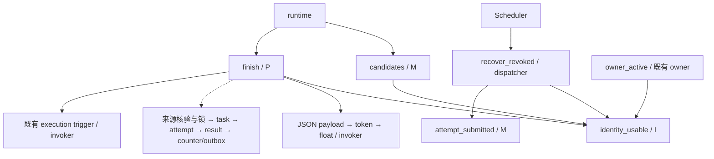

# PR-03a 第三轮 · R2 权限方案独立设计审查

日期：2026-11-02（Asia/Taipei）。审查角色：Astra，独立架构与安全 Reviewer。

## 1. 决定及批准范围

**APPROVE DESIGN：仅批准本报告明确限定的 R2 权限模型。**

三个隔离函数所有者、逐列 ACL、仅作用于这些新角色的 RLS policy，可以实现既有受限本地收尾职责。无需赋予超级用户/BYPASSRLS、表 ownership、Scheduler 正文权限或通用 SQL 入口。

批准由方案与本报告共同限定；以下三点是实施约束，不能按更宽解释执行：

1. 来源表必须按 SELECT、UPDATE 分开建 policy。锁行 UPDATE policy 的 `WITH CHECK(false)` 不得被同角色的宽松 `FOR ALL`/UPDATE policy 抵消。
2. `app.owner_id` 是行域，不是身份凭证。runtime 保留现有固定跨账号后台处理能力；此批准不声称它只能处理当前终端用户的任务，也不授权从 HTTP 请求中直接接受 owner/task/fence 来调用该入口。
3. 非超级用户迁移测试限定为**已有明确旧对象管理权后的 0005→0006**。不承诺仅有 CREATEROLE 的普通部署账号能跑通空库历史链或转移超级用户持有的函数。

R1 的异常封口/尺寸修复和 R3 的来源核验/隔离写集合仍须按既有授权实施并提交完整代码复审。本报告不批准尚未出现的 SQL 实现，不改变任务状态契约，不批准 PR-03a 整合、发布或开始 PR-03b。

**PR-03a 整体维持 REQUEST CHANGES；R1/P1、R2/P1、R3/P2 均保持 OPEN，直到实际修复、新提交和独立代码复审通过。** 原首轮身份失效恢复 P2 的历史 CLOSED 结论不扩大为整项批准。

## 2. 审查对象、版本和现场 Git 状态

- 工作树：`J:\class-assistant\worktrees\web-pr03a-identity`。
- 分支：`feature/web-pr03a-identity`。
- HEAD：`cb5f73c288fe013763e1e3ee9ebc3eb94a44a6b0`。
- [方案原件](J:/class-assistant/worktrees/web-pr03a-identity/docs/web-alpha/pr03a/remediation/third-round/PERMISSIONS-PROPOSAL.md)：日期 2026-11-02，未提交文件，无独立 Git 版本。
- 方案 SHA256：`ccf431bcbc8b6362adb2d23efe90343870d8d85ab93a19ebcb354b57dca975b9`。
- [本次只读快照](J:/class-assistant/reviews/pr03a-r2-design-20261102/outputs/PERMISSIONS-PROPOSAL-reviewed.md)：与原件逐字节相同。
- 当前跟踪文件与暂存区均无差异、无冲突；唯一未跟踪文件为上述方案。不能把整个工作树表述为完全干净。
- 0001–0005 十个迁移文件与 HEAD 的 Git blob 相同；当前没有 0006 实现。

已读取父目录及主仓库/目标工作树 AGENTS、方案、[第三轮交接](J:/class-assistant/worktrees/web-pr03a-identity/outputs/pr03a/third-round/20261102T114612.393722Z/DELIVERY.md)、[第二轮独立报告](J:/class-assistant/reviews/pr03a-second-20261031/outputs/REVIEW.md)，并核对 0001–0005 角色、ACL、RLS、触发器、四个函数、LocalReconciler、TaskSources 及 Alembic 事务环境。源表及触发器调用的交叉检查未发现需要扩大到整表权限才能支持当前计划的情况。

## 3. 受限角色与权限矩阵

简称：I=`classroom_web_identity_checker`，M=`classroom_web_recovery_metadata`，P=`classroom_web_local_result_processor`。表中未列出的项目表权限一律不授。SELECT 表示**列权限**，不是整表授权。

| 表 | I SELECT | M SELECT | P SELECT | P 写权限 |
|---|---|---|---|---|
| users | id,state,deleted_at,normalized_email,email_verified_at,password_hash | 无 | 无 | 无 |
| tasks | 无 | id,owner_id,kind,lease_token,state,not_before,lease_expires_at,updated_at,error_code | id,owner_id,kind,state,lease_token,lease_expires_at,revision,class_session_id,not_before,error_code,may_have_charged | UPDATE state,error_code,may_have_charged,lease_token,leased_by,lease_expires_at,revision,updated_at,completed_at |
| task_attempts | 无 | id,owner_id,task_id,attempt_number,raw_output_ref,submitted_at,provider_request_id,provider_outcome,state | id,owner_id,task_id,attempt_number,raw_output_ref,provider_outcome,state,finished_at | UPDATE state,raw_output_ref,provider_outcome,error_code,finished_at |
| provider_results | 无 | id,owner_id,attempt_id,validation_status,conflict_sha256 | id,owner_id,attempt_id,raw_output,validation_status,conflict_sha256 | UPDATE validation_status,validated_payload |
| semesters | 无 | 无 | id,owner_id,deleted_at,revision | UPDATE(id)，仅用于锁行，实际写入由 policy 拒绝 |
| courses | 无 | 无 | id,owner_id,semester_id,deleted_at,revision | 同上 |
| class_sessions | 无 | 无 | id,owner_id,course_id,course_material_version_id,deleted_at,revision | 同上 |
| course_material_versions | 无 | 无 | id,owner_id,course_id | 无 |
| deletion_tombstones | 无 | 无 | owner_id,resource_type,resource_id | 无 |
| owner_event_counters | 无 | 无 | owner_id,next_sequence | INSERT id,owner_id,next_sequence；UPDATE next_sequence |
| outbox_events | 无 | 无 | 无 | INSERT id,owner_id,event_sequence,event_type,aggregate_type,aggregate_id,aggregate_revision,payload,schema_version |
| operation_receipts、deletion_requests、全部 identity 业务表及其他表 | 无 | 无 | 无 | 无 |

解释与上限：

- I 必须有身份谓词所引用列的 SELECT；包括密码摘要列不代表能向外返回摘要。唯一自有入口只返回 boolean；不授用户写入或角色管理。
- M 的 provider_request_id/raw_output_ref 是提交证据元数据；M 无 raw、validated_payload、task input 或用户身份字段权限。跨 owner 元数据扫描是必要的队列功能。
- P 能在一个 O 行域内读取 raw 并写校验元数据；不能修改 raw/digest/conflict/接收时间、task input、owner_id、业务来源、Receipt，不能 INSERT Task/Attempt 或 DELETE 记录。具体函数只能执行审核通过的状态转换，列 ACL 本身不证明转换正确。
- `outbox_events.payload` 的 INSERT 是既有最小状态事件所需；它不是写入正文的许可。实现必须固定构造白名单字段并测试无 raw/input/validated_payload。
- 当前代码若需读取额外列或调用额外函数，必须说明具体 SQL 原因，不可用整表 SELECT/UPDATE、角色继承或宽松政策掩盖缺权。

### schema、sequence、角色属性

- 三角色全部 `NOLOGIN NOINHERIT NOSUPERUSER NOBYPASSRLS NOCREATEDB NOCREATEROLE NOREPLICATION`。
- 最终仅保留 `USAGE ON SCHEMA public`，不保留 CREATE；不拥有业务表、序列、schema 或 database。不需要任何 sequence 授权：现有相关 ID 为 UUID，计数器是显式行更新。
- 内建 UUID/时间/JSON 函数按 PostgreSQL 正常内建权限执行；不因此授予项目 schema 内所有函数的 EXECUTE，不改变全局 PUBLIC 权限。
- 三角色彼此无成员关系，也不继承 runtime/identity/dispatcher 等角色。应用登录、runtime、Scheduler、identity、dispatcher 不得通过任何传递路径取得这三角色的 MEMBER/USAGE/SET 能力。
- 检查必须包含 `pg_auth_members` 的 grantor、ADMIN、INHERIT、SET 选项；NOINHERIT 不阻止 SET ROLE，也不能替代成员图审计。有效权限还须计入 PUBLIC、默认 ACL 和继承路径，不能只比较直接 GRANT。

## 4. RLS 的准确批准边界

本方案**确实新增 RLS policy**，不是“保持 RLS 完全不变”。获批变化只针对新 I/M/P 的职责，其中 I 读取的 users 当前未启用 RLS；不得改写现有 runtime、identity、dispatcher 的 policy，不关闭 ENABLE/FORCE RLS。

令 `O = nullif(current_setting('app.owner_id',true),'')::uuid`：

| 对象/角色 | 允许的 policy 形式 |
|---|---|
| M：tasks、task_attempts、provider_results | 仅 `FOR SELECT TO M USING(true)`；依靠列 ACL 限于元数据 |
| P：任务、Attempt、结果 | `FOR SELECT USING(owner_id=O)`；另建 `FOR UPDATE USING(owner_id=O) WITH CHECK(owner_id=O)` |
| P：semesters、courses、class_sessions | `FOR SELECT USING(owner_id=O)`；另建 **`FOR UPDATE USING(owner_id=O) WITH CHECK(false)`** |
| P：材料、墓碑 | 仅 `FOR SELECT USING(owner_id=O)` |
| P：counter | SELECT/UPDATE 的 USING 限 owner=O；INSERT 和 UPDATE 的 CHECK 限 owner=O |
| P：outbox | 仅 `FOR INSERT WITH CHECK(owner_id=O)` |

这明确了方案第 51 行一般规则与第 66 行锁行例外。**不能先建一个 P 的宽松 FOR ALL policy 再期望 CHECK(false) 收紧它**：permissive policies 按 OR 合并。独立 PG17 实验已证实额外 FOR ALL 会让原本被拒绝的 `UPDATE id=id` 成功。

锁行实验同时证明：只有 `SELECT` 指定列和 `UPDATE(id)`，按上表拆分 policy 后，`FOR SHARE` 可锁到同 owner 行，而实际 UPDATE/INSERT/DELETE 被拒绝。无需为锁行增加来源 DELETE、整表 UPDATE、lock_owner/tombstoned helper 调用权或 material UPDATE。

### GUC 与普通运行身份

当前 runtime 已有普通 owner 业务的表级权限，并由 owner_active RLS 限制。方案不是“runtime 从此完全没有正文表 SELECT”，而是**没有新增直接正文权限，失效身份仍不能直接读 raw**。

runtime 持有 candidates 和 finish 的 EXECUTE，能够拿到候选 owner，再设置 O 执行固定后台收尾。这项既有系统能力保留；O 不是不可伪造凭证，Claim 类型也不是认证证据。真正授权边界是不可被 runtime 改写的固定函数、角色隔离及函数内部 task/fence/state/lease/identity/来源/raw 核验。

因此“伪造 GUC 测试”必须证明：不能借 GUC 得到角色、直接读取失效 raw、调用私有正文 helper、越过固定核验；不能把“某个 runtime 可以触发另一账号合法候选的固定后台动作”错误写成应被阻止的用户级接口行为。若未来要求连此系统动作都不能由普通 runtime 触发，需要另审执行身份/入口拆分，本次没有批准这种额外设计，也不要求提前实现它。

## 5. 四个函数与调用链审查

| 函数 | 新 owner / 调用 ACL | 核验与结论 |
|---|---|---|
| identity_usable(uuid) | I；dispatcher、M、P，以及确有调用需要的既有 owner_active 包装器 owner 可执行 | 指定 UUID、返回 boolean；只读上述 users 列。runtime/Scheduler/identity/PUBLIC 不获直接 EXECUTE。可实施 |
| attempt_submitted(uuid,uuid) | M；保留 dispatcher 的必要 EXECUTE，M 为函数 owner | 绑定 owner+attempt；检查提交时间、request ID、状态、raw 链接/存在性等风险证据；不返回 request ID/raw。可实施 |
| local_reconcile_candidates(integer) | M；runtime 可执行，Scheduler/identity/dispatcher/PUBLIC 不可执行 | 仅返回 task ID/owner/kind/fence；batch 1–100，稳定 updated_at,id 排序；无 raw 权限。可实施；R3 已隔离候选排除规则仍须实现审查 |
| reconcile_saved_result(uuid,bigint) | P；runtime 可执行，Scheduler/identity/dispatcher/PUBLIC 不可执行 | O 与 task owner、fence、状态、无 live lease、失效身份、精确 Attempt/raw、无 conflict、持久来源及祖先必须在函数内核验。只能返回必要状态，不发布正文。权限容器可实施，函数正确性待新代码验证 |

实际调用关系如下；虚线部分代表尚需改写和验证的目标函数体，不表示已实现：

必须显式保留的调用细节：

- P 需要三个 invoker helper 的 EXECUTE：`classroom_web_local_json_payload(text)`、`classroom_web_local_json_token(text)`、`classroom_web_local_float_token(text)`。只授最外层不够，三者不能改成 definer 或向 runtime/PUBLIC 开放。
- 0003 execution guard 的额外 SQL 只涉及 provider_results 的 id/owner_id/attempt_id，矩阵已覆盖。触发器读取 NEW/OLD 不要求为 P 新增全部业务列 SELECT；来源 FOR SHARE 不触发 UPDATE guard。
- helper 转 owner 后，按实际 OID/owner 显式补足旧 owner_active 包装器所需的 identity helper EXECUTE；不能依赖旧超级用户隐式权力证明非超级用户部署成功。lock_owner 仍直接读取 users，不因本方案新增 helper 授权。
- 四函数固定 search_path，项目对象明确 schema；public 不可被应用角色 CREATE。未见方案引入动态 SQL 或通用对象名/SQL 参数。新增、替换或转 owner 后都要按实际签名/OID 审核 `proacl/acldefault`，禁止遗留未知 grantee/default EXECUTE。
- SQL 的异常边界必须覆盖读取 raw 后的完整嵌套调用及写入，而非仅最后 UPDATE。R1 正文脱敏尚未实现；固定返回 boolean 不能证明异常安全。
- 原历史 owner_active/lock_owner 等包装器没有因本设计自动降权。此批准只针对四个列明目标，不得宣传为所有历史 definer 已完成低权限改造。

## 6. 来源锁序、状态写入及费用边界

方案的 `semester SHARE → course SHARE → classroom SHARE → task UPDATE → attempt → result → owner counter` 与既有 TaskSources/0002 材料撤权锁序相容。材料自身不可变，使用原课程行协调撤权，不必给材料表 UPDATE。锁前发现完整祖先集合、稳定排序、锁后复验图；不能持 task 锁后再补取祖先锁。

实际 R3 实现须分别定义“图变化未处理，false 且无写入”与“来源已撤权，false 但一次隔离元数据事件”的行为。Task/Attempt/error/fence/revision/Outbox 的准确写集合、重复调用、候选排除、Provider outcome 保留规则必须随代码明确；本次 R2 设计批准不代替该状态审查。

所有新权限仅服务于已有 raw 的本地核验和受限隔离：禁止 Provider 调用、新 Attempt、unknown 自动重发、正文发布、资源复活、费用风险清除、Receipt 改写。尚无真实 reservation/usage 账本，不能宣称费用已结算/释放。

## 7. 迁移可行性与回滚

新增 `0006_local_reconciler_security`，父 revision 为 0005，单 Alembic head；0001–0005 十个文件保持不变。没有新增业务表、契约、enum 或产品政策。

### 必须使用的执行矩阵

| 起点/身份 | 批准的执行方式 |
|---|---|
| 空库、0003、0004 | 可信 bootstrap 按历史迁移链到 0005，再执行 0006；不能声称普通非超级用户直接跑通整个历史链 |
| 已部署 0005，相关对象仍归超级用户 | 由可信 bootstrap 执行；若改用非超级用户，必须先有独立、明确的对象管理权 provisioning 方案，不能只换登录名 |
| 已有 0005、受控非超级用户 DDL 身份 | 仅在其已具有相关表的 policy/GRANT 管理权、既有目标函数 ownership/可管理身份，以及必要角色 ADMIN/SET 权时验证 0005→0006 |
| 权限不足或已有同名角色不合规 | 在变更生效前拒绝；事务回滚，不放宽 RLS，不回退为超级用户函数 owner |

理由：0003 历史 SQL 先撤 dispatcher 的 public CREATE，再 ALTER FUNCTION OWNER；其原 bootstrap 路径不能简单改称普通非超级用户路径。当前 0005 catalog 的相关对象由迁移超级用户持有，CREATEROLE 不赋予这些旧对象 ownership。新增 policy 同样需要相应表所有者管理权。

独立 PG17 模型验证了：非超级用户 CREATEROLE 不能转移 bootstrap-owned 函数；转移自己持有的函数仍需要对目标角色的 SET 能力和目标角色在 schema 的 CREATE。临时提供必要能力后可转移，撤销 membership/CREATE 后函数 owner 保持正确。**这不授权让部署账号加入超级用户角色，也不授权宽泛 REASSIGN OWNED、DROP OWNED 或 CASCADE 清理。** 实际 provisioning 必须单独留证；不要为测试成功悄悄改动生产旧表 ownership。

0006 中角色创建/检查、定义替换、owner 转移、ACL、policy、撤销临时权限和版本更新必须同事务。角色创建者在 PG17 可能取得自动 ADMIN membership，也须进入临时关系清单；不能只撤销手工 SET grant。已有角色应核对 flags、全部入/出成员路径、ownership 和有效权限，拒绝未知权力，不能静默重置外部角色。

`env.py` 使用 `transaction_per_migration=True`：回滚承诺针对 **0006 单 revision**，不是把 0003→0006 整条历史链都退回 0003。独立 provisioning 的变更要单独记录、撤销或审计，不能被包装成 0006 已覆盖的原子性。故障测试应从进入 0006 前快照比较对象定义、ACL、roles、memberships、policies、数据及版本。

运行后若需停用，暂停本地收尾/领取并保留 raw、Attempt、Receipt、Outbox、unknown 和迁移账本，使用兼容代码或前滚修复。不做破坏性降级、不清库或重发未知请求。

## 8. 风险分级与最小约束

本次没有发现要求否决上述限定 R2 模型的新 P0/P1。以下风险不能用“已批准设计”跳过；严重度是错误实施时的影响，不表示已有 0006 代码已经发生该缺陷。

| 风险 | 级别 | 最小约束 |
|---|---|---|
| 保留旧超级用户 owner、运行角色能 SET 内部角色、默认 ACL 暴露正文 helper | P1 | 实际 owner flags/成员图/完整 ACL 白名单；发现不符拒绝迁移；禁止泛化授权 |
| raw 经错误 DETAIL/CONTEXT 或事件 payload 外泄 | P1，既有 R1 仍 OPEN | SQL 内完整异常边界、固定最小事件、客户端与 PG 日志原始标记扫描；不能仅靠返回类型 |
| 将可设置 GUC 当账号认证，暴露系统入口给请求参数 | P1 | 固定内部端口；明确 runtime 的系统能力，普通业务继续用认证后的 Owner UoW |
| 来源 SELECT/UPDATE policy 被 FOR ALL 的 OR 合并放宽 | P2 | 按本报告分命令建 policy；实际来源写入负例，禁止额外宽松 policy |
| 非超级用户 provisioning 不完整、临时 ADMIN/SET/CREATE 残留 | P2；若形成权限提升按 P1 | 明确执行矩阵、旧对象管理权、撤销清单与失败回滚；不能凭角色名称或 CREATEROLE 推断 |
| 锁后来源图未重检、已隔离候选继续占队、隔离写集合不明确 | P2，关联既有 R3 | 两种真实锁顺序、稳定排序、明确写集合、幂等与队列推进测试；新 SHA 复审 |

更小的替代方案比较：仅 ALTER OWNER 无适用 raw RLS，不能工作；合并 M/P 会扩大元数据职责的正文能力；继承 runtime 仍被 owner_active 拒绝；继承 dispatcher 或授更宽 Scheduler 权限破坏既有边界。三个角色虽多于一个，但职责、调用和审计面清楚，属于此边界下合理的最小设计。无需新通用授权开关、通用 SQL 执行器或额外业务表。

## 9. 本次真实验证与局限

### 本次实际执行

1. 只读 Git/文件检查：HEAD、分支、跟踪/暂存差异、未跟踪文件、冲突、diff --check、方案 hash、十个旧迁移 Git blob。结果通过。
2. 在新建独立 PG17.11 合成集群执行 **19 项 SQL 权限机制检查**，另有初始化/启停等 5 项操作检查；全部符合预期，脚本退出 0。预期拒绝和 OR 合并反例均单独记录，不能把反例成功称为安全策略通过。
3. 实验使用既有目标验证器，在连接前拒绝 PG*、非字面回环、query/端口/命名异常；随后核验实际 login/database/data_directory/host/port。仅使用本次 `127.0.0.1:55445` 集群。
4. 真实低权限连接验证了 SET ROLE/更改函数 owner 被拒绝；锁行/RLS、列权限和 owner-transfer 机制在简化合成表及 `design_probe` 函数中验证。没有应用项目 0006，也没有修改四个正式函数。
5. 集群已停止，停止退出 0，55445 端口关闭。所有文件在 J 盘独立审查目录；正式树及方案未改。

### 仅静态推断或历史材料复核

- 三角色列 ACL 与真实 0001–0005/触发器依赖的匹配、完整项目新函数逻辑、R3 并发安全和迁移可行性属于静态设计判断，仍需实际实现测试。
- 开发者 20261102T114612.393722Z 的 catalog/日志证明修前状态；本次复核其与 SQL 一致，不当作新角色/新 policy 已执行。
- 没有重跑 423、七项缺陷探针、Windows 525+171、九套 Node、mypy 或完整新迁移回归；也没有把上轮通过结果计作本次设计验证。
- 简化模型的固定 boolean 函数仅证明权限组合机制，不证明真正 finish 的业务授权、R1 脱敏或 R3 状态转换。

证据：

- [当前 Git/文件/历史 catalog 静态核对](J:/class-assistant/reviews/pr03a-r2-design-20261102/outputs/static-review.json)
- [PG17 权限实验完整结果及命令](J:/class-assistant/reviews/pr03a-r2-design-20261102/outputs/mechanics-results.json)
- [实验源码](J:/class-assistant/reviews/pr03a-r2-design-20261102/work/permission_model.py)
- [独立集群身份](J:/class-assistant/reviews/pr03a-r2-design-20261102/outputs/cluster-identity.json)
- [实验函数 catalog](J:/class-assistant/reviews/pr03a-r2-design-20261102/outputs/toy-function-catalog.json)
- [PostgreSQL 原始日志](J:/class-assistant/reviews/pr03a-r2-design-20261102/outputs/postgres.log) / [停止日志](J:/class-assistant/reviews/pr03a-r2-design-20261102/outputs/stop.log)

## 10. 实施后必须补齐的门禁与交接

- 保留原 423 项及原断言，原七探针全部修复通过，并分别保留修前/修后日志与精确源码 hash。
- 逐函数 OID/签名/owner flags、全部 ACL、PUBLIC/default ACL、角色 ADMIN/INHERIT/SET 的直接与传递路径；新角色无表/schema/database ownership；无永久 CREATE。覆盖新建、已有合规、已有不合规角色及权限不足。
- 角色×列×动作矩阵：M 的 raw/payload/input 被拒；P 跨 O、空 O、错误 O 被拒；来源 FOR SHARE 成功、实际来源 UPDATE/INSERT/DELETE 拒绝；runtime 伪造 GUC 无直接正文能力；Scheduler 权限快照完全不变。
- 实际项目四函数调用及全部 helper/trigger 依赖；owner_active 在 helper 转 owner 后对有效/失效账号仍正确；普通事务、Admin/跨 owner 隔离保持。
- R1 的实际 JSONB 边界、原始客户端异常链和 PG 日志无正文、原子回滚、后续任务推进；R3 全来源/墓碑矩阵、两种锁先后、图变化、双 Worker/Reconciler、隔离幂等、批次推进；Provider 次数不增加。
- 真正 0006 的空库/bootstrap、已部署 0005、受控非超级用户 0005→0006、重复升级、单 head、19 表数据/账本保持和单 revision 故障回滚。不得用 toy 实验替代。
- 类型/静态/依赖/契约保护及对应旧产品门禁，明确实际命令、退出码、失败和未验证项。
- 实施时将本报告的批准边界与方案一起纳入 PR 文档的 Git 记录；由已授权开发者完成，不只留在聊天或忽略 outputs 中。本审查没有代为编辑、暂存或提交正式仓库。

**允许的下一步仅为：开发者在既有 PR-03a 授权范围内按上述边界实施 R1/R2/R3，新增增量迁移并做真实 PostgreSQL 验证；完成后提交新精确 SHA 供 Astra 独立复审。没有任何 PR 整合批准。**

本次未修改正式源码、迁移、测试、契约或方案，未连接正式数据库、调用真实 Provider、操作集成分支、Push/Merge/Tag/Release/部署或启动 PR-03b。设计审查结束。
