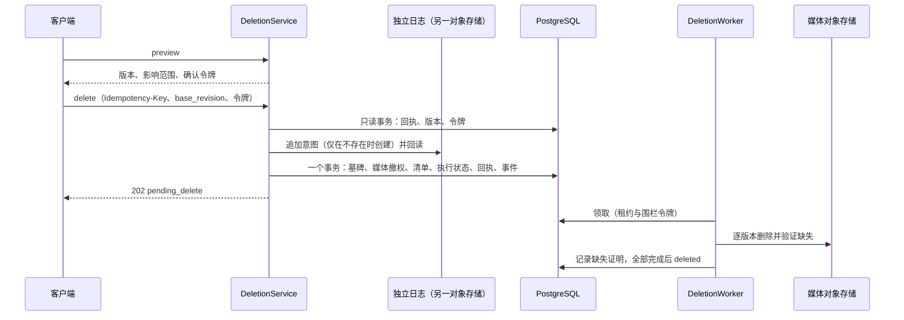

# PR-04b 数据删除与备份恢复 · 架构与实现

负责人为林珈诚，实施为 Claude Code（用户于 2026-11-16 指定）。分支 `feature/web-pr04b-deletion`，工作树 `J:\class-assistant\worktrees\web-pr04b-deletion`，基线为 `origin/main` 的 `b86bed0c37851f2ef65b01729c097d0970cdf551`（已含 PR-04a、05a、09b、11a）。契约 OpenAPI 0.2.0 未改动。需求追溯 REC-03、AUTH-06、DATA-07，设计依据为 [删除与备份设计](../architecture/05-SECURITY-OFFLINE.md) 第 6、7 节。

## 1. 开工时核对到的边界

| 已有能力 | 位置 | 本包如何使用 |
|---|---|---|
| `deletion_requests`、`deletion_tombstones` 及墓碑守卫 | 迁移 0001、0002 | 冻结列不变；墓碑原语 `PgTombstoneRepository.revoke` 增加可选的 `request_id` |
| 祖先墓碑即撤销全部后代读取 | `PgCatalogRepository._load`、任务回收函数 | 级联只写根墓碑，后代媒体逐条撤权并入清单 |
| 媒体状态含 `delete_pending/delete_failed/deleted`，撤权不可逆 | 迁移 0009 | 复用这些状态与触发器，未改 0009 |
| 上传在持有资产行锁时写对象 | `MediaService.put` | 撤权事务与在途上传靠同一行锁串行 |
| 账户墓碑 | 0001、0002 明确留给 04b | 本包补上账户适配器 |
| `deleteAccount` 再认证 | `AuthService.reauthenticate` 返回 `SERVICE_DISABLED` | 保持关闭，见第 7 节 |
| 音频提交 | 0009 的 `media_audio_commit_not_enabled` | 保持关闭 |

开工时不存在的部分：`deletion_assets` 表、对象删除与列举、独立删除日志、物理清除执行者、到期清扫、备份恢复流程。

TBD-04（保留期限与删除时限）和 TBD-05（备份策略）仍未签署。本包只实现机制，凡属这两项的数值均无默认值，缺失时拒绝。

## 2. 删除请求的顺序



只有日志条目已回读确认、数据库事务已提交，才返回 202。三种中断的处理如下。

| 中断点 | 结果 | 恢复 |
|---|---|---|
| 日志不可用 | 数据库先撤权，状态 `access_revoked`，无日志位置，返回 503；worker 不会领取 | 客户端用同一键重试，或 `reconcile()` 补完受理 |
| 日志已写入，数据库未提交 | 未返回 202，数据仍可读 | 进程启动时 `reconcile()` 按日志重放 |
| 数据库已提交，响应丢失 | 请求已受理 | 同一键重试得到同一请求 |

三条路径与备份恢复后的重放共用同一个幂等步骤 `PgDeletionRepository.apply`。

### 幂等的三层

- 回执：`owner + operationId + Idempotency-Key`，同键异体返回 409。
- 意图：`intent_id` 由 `owner + scope_type + scope_id` 确定性导出，`request_id` 由 `intent_id` 导出。同一对象无论用多少个键、并发多少次，都只有一条日志条目和一条请求。
- 数据库：`deletion_executions` 对 `(owner_id, intent_id)` 与 `ledger_generation` 唯一，应用时先取意图级咨询锁。

### 确认令牌

预览返回的令牌是对「owner、会话、范围、对象版本、课堂数、媒体字节数、过期时间」的 HMAC，默认 5 分钟。提交时按当前状态重算，版本不符返回 409，范围变化、跨对象、过期或篡改返回 422。令牌不落库。

## 3. 独立删除日志

`S3DeletionLedger` 把每条意图写成一个不可变对象 `ledger/v1/<20 位代数>.json`，内容为代数、上一条的 SHA-256 和意图。写入只用 `If-None-Match: *`，占用下一个代数即是对链头的比较并交换：两个写入者只有一个成功，另一个重读后接在其后。

- 意图只含标识（意图、请求、owner、范围类型与标识、来源），不含标题、文件名、哈希等内容。
- 读取从第 1 代逐条校验链接与规范编码；列举结果用于发现缺口（条数须等于最高代数）。任何缺失、改写、截断、前缀内异物都报 `LedgerCorrupt`。
- 构造时实测存储是否拒绝对已存在键的二次创建并保留首次内容，不满足即拒绝启用。
- 与媒体使用不同的端点、桶和凭据；`DeletionService` 拒绝与媒体同桶的配置。

与 ADR 文字的差异：ADR 描述「不可变意图对象 + 链式清单 + 条件写更新 head」。本实现把意图直接放进链条目，head 由「下一个代数能否创建」表达，不存在可被覆盖的 head 对象。保证相同，对象更少。这一点请 Astra 复核。

墓碑的 `ledger_sequence` 记为该 owner 的本地墓碑序号，外部日志位置记在 `deletion_executions.ledger_generation`，二者经 `request_id` 关联。原因是日志不可用时也要先写墓碑撤权，而墓碑不可修改。

## 4. 物理清除

`DeletionWorker` 用独立的受限数据库身份运行，只能调用迁移 0010 的固定函数，读不到任何私有表。

- 领取：`FOR UPDATE SKIP LOCKED`，写入租约并递增围栏令牌。只领取已有日志位置的请求。
- 清除：`S3ObjectStore.erase` 列出该键的全部版本与删除标记，逐个按版本删除，最后再次列举并 `HEAD`，都为空才算成功。普通删除在开启版本化的桶上只会新增删除标记，因此不使用。
- 记录：每个对象单独记缺失证明；失败记 `STORAGE_UNAVAILABLE`，请求转 `delete_failed` 并按退避重排，访问始终保持撤销。
- 围栏：租约过期后被他人领取，原 worker 的任何写入都被拒绝（SQLSTATE `CWD01`）。
- 完成：全部缺失后请求为 `complete`，媒体行为 `deleted`，写入 `object.deleted` 事件。已完成的请求对任何角色都不可回退。

### 写入沉降窗口

撤权前已进入的上传可能在撤权后才把对象写进存储。请求在 `access_revoked_at + write_settle` 之前不可领取，早于该时刻的缺失证明被数据库拒绝（`CWD02`）。默认 120 秒，依据是媒体入口 60 秒预算加存储超时。超出窗口仍出现的对象由孤儿清扫处理。

### 清单范围

清单按对象键记录，覆盖范围内所有状态的媒体行，包括只创建未上传、已上传未确认的 staging 行。对象键由上传标识确定性生成，因此「对象写成功而数据库失败」留下的对象也在清单内。

| 范围 | 撤销方式 | 媒体范围 |
|---|---|---|
| `class_session` | 课堂墓碑 | 该课堂全部媒体 |
| `course`、`semester` | 根墓碑（仅级联） | 其下全部课堂的媒体 |
| `audio` | 无墓碑，课堂保留 | 该课堂的 `audio_chunk` |
| `media_asset` | 无墓碑 | 单个资产，仅到期清扫使用 |
| `account` | 账户墓碑并封存账户 | 该 owner 全部媒体 |

## 5. 到期、孤儿与保留策略

- 到期清扫 `expire_due()`：以数据库时钟判断 `expires_at`、`hard_expire_at` 与过期未确认的上传。系统路径只接受已到期的单个资产，不能提前、不能指定其他范围，且不依赖 owner 处于活动状态，禁用账号不会延长保留。读取在到期瞬间已由 04a 拒绝。
- 孤儿清扫 `sweep_orphans()`：清单已证明删除却再次出现的对象直接清除。没有任何清单行指向的对象默认只计数，须显式 `purge_unreferenced=True` 才删除，因为对着错误或空的数据库执行会清空整个桶。不符合生成键格式的对象从不触碰。
- 保留策略权威：`retention_policies` 表出厂为空。资产只有引用表中同媒体类型的已批准版本、两个截止时间齐备且不超过上限，才能带保留策略；策略名本身不授予任何权限，分配后不可更换。`media_audio_commit_not_enabled` 约束原样保留。

## 6. 备份恢复

`RestoreCoordinator.run()` 在隔离环境、未对外服务时执行，顺序固定。

1. 实时读取并校验独立日志，失败即停止，副本连封存都不做。
2. 封存：全部账户 `security_epoch` 加一，撤销所有会话、挑战、再认证证明与邮件动作，清空 worker 租约。
3. 重放日志中数据库没有的意图。
4. 以当前时间重新判定到期。
5. 孤儿清扫，默认只报告无清单对象。
6. 执行已到期的物理清除。
7. 审计：墓碑血缘下仍可读的媒体、未受理请求须为零，才置为可服务。

应用层有对应的闸门：注入了 `deletion` 的应用在 `reconcile()` 成功之前，对 `/api/web/v1/` 下所有 HTTP 与 WebSocket 请求返回 503。直接拿备份副本启动的服务不会提供任何数据。日志缺失、被改写、比数据库落后时保持关闭。

重放遇到 owner 不活动时：副本里不存在该 owner，或账户已在注销中，视为已覆盖；owner 被禁用则记为未解决并保持关闭，由操作者处理。

备份工具本身（`pg_dump`、保留周期、是否含原音、RPO/RTO）属 TBD-05，本包不提供也不决定。验收用 PostgreSQL 自带的 `pg_dump`/`pg_restore` 做真实演练。

## 7. 账户注销

`DeletionService.erase_account(OwnerContext)` 是内部端口：写账户墓碑、撤销全部媒体，并在同一事务最后调用 `classroom_web_seal_account`，把账户置为 `erasing`、递增安全版本并撤销所有会话。账户墓碑若没有在同一事务封存账户，提交时被拒绝。物理清除完成后账户为 `erased`，邮箱、密码哈希、资料与偏好被清空，只留不含内容的壳。

没有 HTTP 路由通向它。`/me/delete` 与 `/me/deletion-preview` 未注册，`deleteAccount` 再认证仍由 PR-03b 返回 `SERVICE_DISABLED`。启用需要单独批准 R3 再认证路由。日志不可用时账户注销直接失败且不做本地封存，因为被封存的账户无法重试。

## 8. 数据库权限

| 角色 | 性质 | 能力 |
|---|---|---|
| `classroom_web_eraser` | 无登录、无成员，仅作固定函数的属主 | 列级读写生命周期元数据；清空已注销账户的身份字段 |
| `classroom_web_deletion_worker` | 调用者组 | 只能执行领取、清单、记录、完成、到期、对账查询等函数 |
| `classroom_web_restore_operator` | 调用者组，仅恢复时使用 | 封存与审计 |
| `classroom_web_runtime` | 既有 | 对新表只读；经两个函数撤权与封存本人账户 |

对已验收对象的改动都是增量的：`guard_deletion_request` 仅对 eraser 属主的函数放行 owner 上下文检查，并新增「进度不可回退」；`guard_tombstone`、`check_revocation` 增加账户分支，其余分支逐字保留。`deletion_requests`、`deletion_tombstones` 的列与冻结模型一致，`deletion_assets` 的列与冻结模型一致，实现所需的额外状态放在新表 `deletion_executions`。

## 9. 运行接入

```python
store = S3ObjectStore(endpoint=media_endpoint, bucket=media_bucket, region=region,
                      access_key=media_access, secret_key=media_secret)
ledger = S3DeletionLedger(endpoint=ledger_endpoint, bucket=ledger_bucket, region=ledger_region,
                          access_key=ledger_access, secret_key=ledger_secret)
queue = PgDeletionQueue(deletion_worker_database_url)
deletion = DeletionService(auth=auth, database=database, queue=queue, store=store, ledger=ledger,
                           confirmation_secret=injected_secret, policy=DeletionPolicy())
deletion.reconcile()          # 成功前应用保持关闭
app = create_app(auth=auth, contract=contract, origin=origin, media=media,
                 media_spool_directory=spool, deletion=deletion)
worker = DeletionWorker(queue=queue, store=store, policy=DeletionPolicy(), worker_id=worker_id)
```

`create_app` 的 `deletion` 参数默认为 `None`，此时不注册任何删除路由，既有部署行为不变。注入后注册课堂、原音、课程、学期的预览与删除，以及 `GET /deletions/{id}`，DTO 与 OpenAPI 0.2.0 一致。

### 技术参数（实验值，可在限定范围内配置）

| 参数 | 默认 | 说明 |
|---|---|---|
| `write_settle` | 120 秒 | 须不小于媒体入口预算加存储超时 |
| `retry_backoff` / `max_backoff` | 60 秒 / 1 小时 | 指数退避 |
| `lease_seconds` | 120 | worker 租约 |
| `confirmation_lifetime` | 5 分钟 | 确认令牌 |
| `orphan_grace` | 24 小时 | 无清单对象的最小年龄 |
| `physical_deadline` | 无 | TBD-04 批准后才可设置；`deadline_at` 现恒为空 |

## 10. 验证入口

所有测试在 VMware 来宾执行，宿主只做源码快照与静态检查。来宾内起独立的 PostgreSQL 17.11 与两套 SeaweedFS 4.53（媒体、日志各一），均只监听回环地址，数据全部为合成。

```powershell
& 'J:\class-assistant\worktrees\web-pr04b-deletion\tools\pr04b\submit.ps1' -Mode probe      # 对象存储能力实测
& 'J:\class-assistant\worktrees\web-pr04b-deletion\tools\pr04b\submit.ps1' -Mode targeted   # 本包 26 项
& 'J:\class-assistant\worktrees\web-pr04b-deletion\tools\pr04b\submit.ps1' -Mode full       # 完整后端回归
```

运行结果、哈希与未覆盖项见 [交接记录](HANDOFF-20261116.md)。
